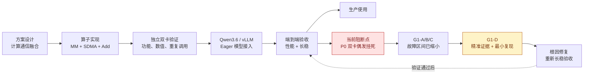
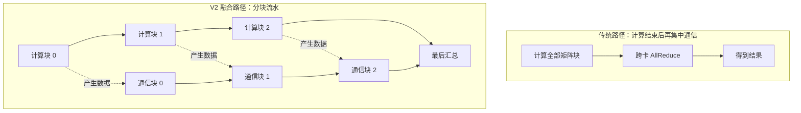
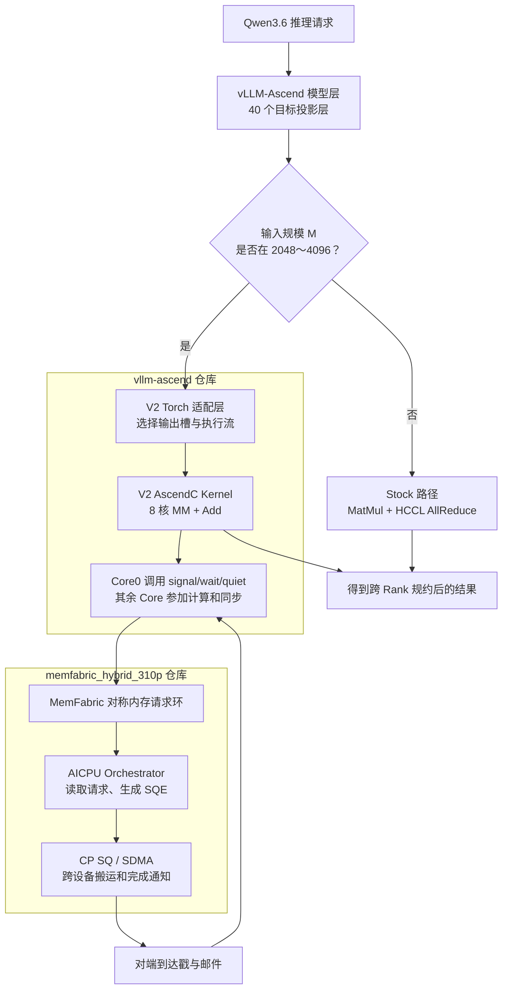
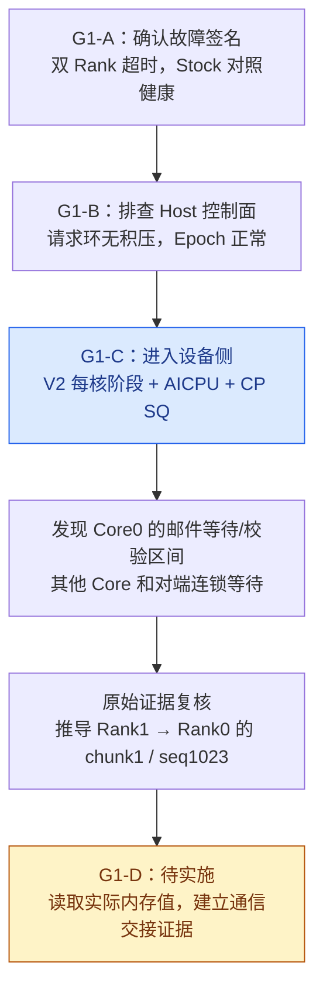
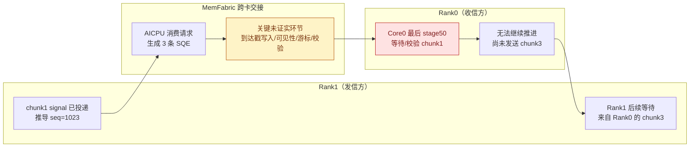
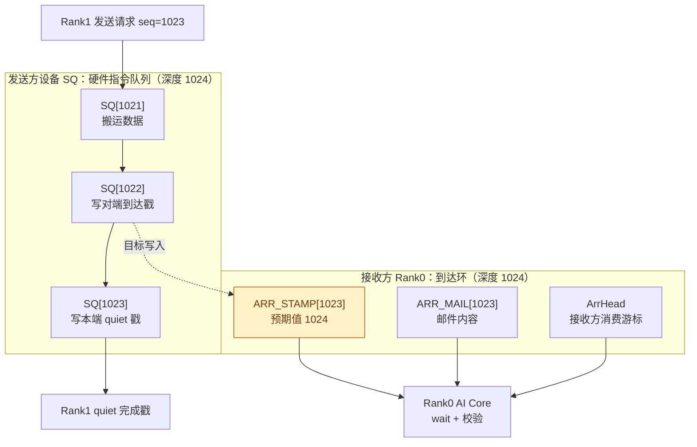
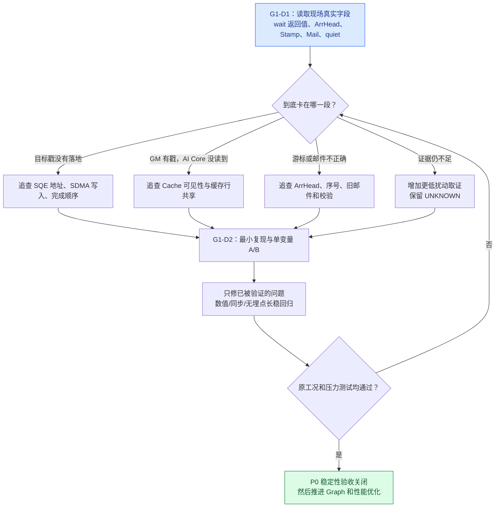

# 310P3 Qwen3.6 计算通信融合算子项目进展汇报

> **汇报日期**：2026 年 10 月 21 日  
> **适用对象**：项目负责人、研发管理者、算子及推理框架开发人员  
> **结论版本**：截至 G1-C 原始证据归档（2026-10-21），G1-D 尚处方案裁决阶段  
> **文档性质**：阶段性项目汇报，不是根因确认报告，也不是生产验收通过证明  
> **代码位置**：本文件归档于正式开发分支 `feat/310p-memfabric-public-api`；G1-A/B/C 的新增诊断代码与证据仍在独立 `diag/*` 分支，**本次归档不表示诊断代码已合入正式分支**。

---

## 一、先讲结论：项目走到哪一步了？

**一句话总结：融合算子已经做出来，并且在独立测试和真实模型的基础功能测试中跑通；但真实服务连续运行会偶发双卡挂死，且目前端到端没有稳定加速，所以还不能投入生产。我们已经把挂死范围缩小到一封跨卡通信消息的接收/校验链路，接下来要找到这封消息究竟在哪一步出错。**

| 汇报维度 | 现状 | 怎样理解 |
|---|---|---|
| 核心算子研发 | **已实现** | 计算、跨卡搬运、规约、同步流程已编码并可运行 |
| 独立算子正确性 | **已验证** | 多尺寸、多分块、串行/交叠、重复调用等已通过 |
| 模型 Eager 接入 | **已跑通** | Qwen3.6 的 40 个目标投影层可以实际调用 V2 |
| 单算子性能 | **部分场景有收益** | 大 M 的独立测试快于 Stock，但不代表模型整体更快 |
| 模型端到端性能 | **未通过** | 吞吐、首 Token 延迟等指标未取得稳定正收益 |
| Gate E 长稳 | **未通过（P0）** | 偶发双 Rank AICore Timeout，Worker 无法恢复 |
| G1-A/B/C 诊断 | **已完成并保全证据** | 已定位到设备侧邮件等待/校验区间，根因未定 |
| G1-D | **待设计落地和实机验证** | 精确检查消息、内存槽、缓存与 SQE 的交接 |
| 生产可用性 | **不具备** | 必须先完成 P0 修复和无埋点长稳，再做性能验收 |

> **汇报人备注（人话）**：不要说“项目失败”或“已经完全成功”。更准确的是：**技术功能已经验证，工程可用性还没有验收过关**。我们目前是在攻关一个低概率但影响严重的稳定性问题。

### 图 1：项目阶段与当前所处位置

**怎么讲这张图**：前四步已经跑通，项目不是卡在“算子能不能做”。真正的阻断发生在最后的**连续服务验收**，因此现在优先排障而不是追加新功能。

---

## 二、项目到底做了什么？为什么需要融合？

### 2.1 原来的做法与融合后的做法

模型在两张 NPU 卡上并行计算时，每张卡各自得到一部分结果，接着要跨卡汇总。旧路径通常由 **MatMul（矩阵乘法）** 和 **HCCL AllReduce（跨卡求和）** 两个独立阶段完成。

V2 的基本思路是：**把大计算切成多块，算完一块尽早发往对端，同时继续算下一块，让计算和通信尽可能同时进行。**

### 图 2：为什么融合可能更快

> **人话解释**：原来像“所有货物生产完，再统一叫车发走”；融合后像“生产完一批就发一批，同时继续生产下一批”。理论上能减少等待时间；但车辆调度、交接确认等环节变复杂，因此也更容易暴露时序问题。

### 2.2 两个代码仓库各负责什么？

| 仓库 | 职责 | 人话解释 |
|---|---|---|
| `vllm-ascend` | V2 MM、Add、核间同步、Torch 接口、模型层路由 | **负责算什么、何时发起通信、什么时候可以继续算** |
| `memfabric_hybrid_310p` | 对称内存、请求环、AICPU SDMA 编排、SQE 提交、到达/完成通知 | **负责把数据送过去，并告诉对端“货到了”** |

真实运行时，两边的实现密切配合：V2 的 AI Core 调用 MemFabric 设备通信原语；MemFabric 的 AICPU 和 SDMA 处理实际搬运。

### 图 3：从模型到双卡通信的完整关系

> **人话解释**：vLLM 像生产线总调度；V2 算子像计算工位；MemFabric 像物流系统；`signal` 是发货通知，`wait` 是等收货回执，`quiet` 是确认本端发出的搬运已经完成。**现在最像是物流交接单未被正确确认，而不是矩阵乘法答案算错。** 这是当前定位方向，并非已证实的根因。

### 2.3 当前支持范围

- 平台：昇腾 310P3，当前重点验收为 **TP=2（双 Rank/双卡）**。
- 模型：Qwen3.6-35B-A3B-W8A8。
- 接入层：10 个 Full Attention `o_proj` + 30 个 GDN `out_proj`，合计每 Rank 40 层。
- V2 路由：`2048 ≤ M ≤ 4096`；其他 M 使用 Stock。
- 支持分块：256、512、1024 行（Gate E 使用 1024）。
- 当前主要实机路径：Eager；Graph 实际融合路由尚未完成。

> **术语卡片**：`Rank` 可理解为并行推理中的一张卡/一个计算参与方；`TP=2` 是模型的张量并行计算分在两张卡上；`M` 在本工程中是当前矩阵乘法的输入行数，并非模型参数量；`chunk` 是把这批行再分成的小块；`Eager` 是逐步按实际执行路径运行，不依赖把整段模型固化为图。

---

## 三、研发与验收做到了什么程度？

### 3.1 正确性验证

已完成 AI Core 同步基础验证、单块与多块 MM+AllReduce、串行与交叠运行、动态尾块补齐、输出缓冲复用、HCCL 混合路由、真实模型 Eager 接入等。

**关键结果：**

| 场景 | 已有实机结果 | 说明 |
|---|---|---|
| G0 核间同步 | 1000/10000 次量级回归 PASS | 核与核之间可以完成既定会合 |
| G1/G2 独立融合算子 | 主要 M/chunk/串行交叠配置 PASS | 基础算法可运行、结果正确 |
| T1 小 M 原始 NZ | 多核数及尺寸矩阵 PASS | 小形状补充验证 |
| G3 混合路由 | 1000/1000 PASS | 同进程 Stock/HCCL 与 V2 可以交替调用 |
| 新进程冷启动 | 20 轮 PASS | 按资源排空和预热规则执行 |
| Qwen3.6 Eager | 目标 40 层接入、首调位精确 PASS | 模型已真实使用算子 |
| Gate E 连续稳定性 | **FAIL** | 真实连续服务仍可能整机双 Worker 卡死 |

> **汇报人备注（人话）**：单算子通过，证明“单独做这件事通常做对了”；并不能证明“放到繁忙的真实模型服务中，一直反复做也永远不会卡住”。

### 3.2 性能结果：为什么还不能说“加速成功”？

- 独立算子：部分大 M 配置相对 Stock **快约 16%～25%**（取决于具体形状及实验基线）。
- 真实 Eager Serving：三组配对性能测试中，**吞吐中位变化约 -3.51%**；TTFT 中位延迟三次均退化约 **2.1%～2.5%**；TPOT 高分位尾部最差退化约 **10.6%**。
- Graph：已有测试中融合分支未真实调用 V2，不能把 Graph 下看似正常的性能当作 V2 优化收益。

**这说明：单个工位做快了，不代表整条生产线就会快。** 例如通信资源竞争、MatMul 实现效率、层与层之间的调度成本，都可能吃掉原本的单算子收益。

> **术语卡片**：`Stock` 是原始对照实现；`TTFT` 是“发起请求到第一个字/token 出来要多久”；`TPOT` 是“生成过程中每个后续 token 平均要多久”；`尾部延迟` 是那些比较慢的请求表现，往往比平均值更影响服务体验。

---

## 四、目前主要遇到哪些问题？表面看起来是什么样？

| 优先级 | 问题 | 用户/运维能看到的表象 | 当前处理状态 |
|---|---|---|---|
| **P0** | Gate E 双 Rank 偶发挂死 | 服务运行数分钟后两卡超时、请求连续失败、Worker 无法恢复 | **诊断中；未修复** |
| P1 | 端到端性能负收益 | 独立算子快了，但真实模型吞吐、首 token 时延未改善 | 待稳定性问题解决后专项优化 |
| P1 | Graph 未执行 V2 | Graph 跑得正常，实际还是 Stock 路径 | 编译追踪路由问题已定位，尚未完成有效接入 |
| 历史已缓解 | 首次写入、冷启动、部署、输出槽复用等 | 新环境偶发数据错误、构建或启动失败 | 已实施工程修复/缓解，部分底层机制仍需关注 |

### 4.1 P0 故障的具体表象

Gate E 工况：**双卡、Eager、输入约 4096 tokens、输出 256 tokens、并发 10、连续约 10 分钟**。

观测到的共同特征：

1. 刚开始能够正常推理，首调算子数值正确。
2. 某次运行中途，一张卡的通信等待无法继续，另一张卡受到连锁影响。
3. 一段时间后设备报告 `507014 AICore Timeout`。
4. 两个 Worker 随后都不可恢复，后续请求失败。
5. 故障发生位置不固定：有时在 `aclnnSwiGlu` 报错，有时在事件同步 API 报错。

> **人话解释**：像两个人配合装配产品：A 等 B 送来一个零件，B 后面也开始等 A 的下一批零件。实际报错可能出现在“质检/交付”工序，但**质检报错并不代表质检导致缺件**。

### 图 4：为什么表面报错位置不等于真正故障位置？

**读图重点**：报错 API 是“发现问题的人”，不一定是“制造问题的人”。所以诊断没有围绕 SwiGlu 算法盲目修改，而是追溯到设备侧先停的通信链路。

### 4.2 为什么真实 vLLM 更容易暴露，而独立算子未必暴露？

| 独立测试 | 真实 Serving |
|---|---|
| 通常每次调用后同步、立即校验结果 | 连续提交许多算子，不对每次 V2 强制同步 |
| 输入形状和调用节奏相对可控 | 请求持续进出，Prefill/Decode 交替 |
| 干扰较少 | Attention、GDN、Stock/HCCL、缓存与异步调度同时存在 |
| 容易定位当前单次调用 | 错误可能延迟到下游同步点才表现出来 |

健康测试已经覆盖多次 1024 环回绕，因此 **“第 1024 次必然出错”不成立**。更需要调查的是：**某个边界条件加上连续异步负载、双 Rank 时序差异或缓存状态，是否才会触发故障**。

---

## 五、围绕挂死问题，我们做了哪些定位？结果是什么？

本项目没有直接猜测后改协议，而是按“先确认故障，再分层排除，最后定位具体消息”的顺序推进。

### 图 5：G1-A → G1-B → G1-C → G1-D 诊断演进

### 5.1 G1-A：确认故障确实存在

- F01：融合路径完成 **29 个请求**后复现双 Rank `507014`。
- F02R1：同类工况 **75/75** 请求成功。
- Stock 对照 S01：**75/75** 请求成功。

**得到的结论**：故障是**间歇性的**，且与融合路径相关；不能因为某一次通过就说问题解决。

> **人话解释**：已经确认问题真的会发生，而且重启后可能又正常，所以它不是一个每次都能复现的普通算错问题。

### 5.2 G1-B：核查 MemFabric 的“后台调度员”

在 MemFabric Host 侧记录：

- 请求环的生产/消费游标；
- 是否有请求越积越多；
- 设备后台任务（Epoch）的心跳、退出与重新拉起情况。

B02 再次在 **29 个请求**附近复现故障，但 Host 请求环没有持续积压，已结束 Epoch 均正常退出，监督器仍在运行。

**得到的结论**：没有证据表明 Host 控制面先停止；下一步必须深入设备侧。

> **人话解释**：后台调度员还在上班、订单登记也正常，但货物交接仍然出问题。因此不能只检查后台服务器日志。

### 5.3 G1-C：观察设备内的每一步执行

分别在两仓库新增可关闭的诊断代码：

- V2：8 个 AI Core 记录本核走到了计算、通信、规约的哪一步。
- MemFabric：记录 AICPU 处理请求与设备 SQ Head/Tail，判断“订单是否处理、硬件队列是否排空”。
- 每秒从设备读取简短的最后阶段快照，不直接改变正式通信算法。

**实机结果：**

| 场景 | 结果 |
|---|---|
| 诊断构建和 CPU 测试 | 已通过 |
| C1 混合路由正确性 | **51/51 PASS** |
| C2R1 长稳 | **75/75 PASS** |
| C2R2 长稳 | **第 3 个请求附近复现双卡超时** |

C2R2 核心设备状态：

| 观察对象 | 最后阶段 | 易懂解释 |
|---|---|---|
| Rank0 Core0 | `208:1:50` | 第 208 次融合调用，等待对端 chunk1 的到达邮件/校验 |
| Rank1 Core0 | `208:3:50` | 同一次调用，等待对端 chunk3 的到达邮件/校验 |
| 两侧其余 Core | `stage60` | 等 Core0 放行，自己不能先继续规约 |
| Host 请求环 | 两侧排空 | 已发出的请求没有在 Host 环里持续排队 |
| CP SQ | 事后 Head == Tail | 设备硬件提交队列在采样时已经排空 |
| Epoch | 正常续跑 | 后台通信服务没有整体停机 |

**注意两个证据边界：**

1. `stage50` 记录在 `wait()` 调用之前，而下一阶段写在邮件返回并校验通过之后。故而它只说明**卡在等待/校验区间**，不能严格断言 `wait()` 永远没返回。
2. `SQ Head==Tail` 只说明**采样时队列为空**，不等于每条跨卡写入都正确到达，也不能彻底排除此前出现过瞬态 SQ 问题。

> **人话解释**：我们知道哪一个接收工位没继续，但仍不知道是“没收到货”“货到了看不见”“拿错交接单”，还是“交接单检查出错后停机”。

### 5.4 G1-C 原始日志归档与重新分析

10 月 21 日已整理 G1-B B02、G1-C C2R1/C2R2：

- **164 个原始文件**建立 SHA256 保全清单，完整原始日志留在 310P3 服务器。
- GitHub 存放脱敏日志、统一时间线、会话统计、边界分析和可复现提取脚本。
- 证据区分 **直接观测**、**根据源码和序号推导**、**尚未知晓**，防止把假设当事实。

重新分析指出一个重要因果关系：**Rank0 先无法完成来自 Rank1 的 chunk1 交接，可能导致 Rank0 未能发出后续 chunk3，从而解释 Rank1 的等待。** 这比“两个 Rank 同时丢两封消息”更符合当前 V2 流水执行顺序。

### 图 6：一处异常如何拖住两张卡？

**怎么讲这张图**：目前看起来不需要假设“双卡同时坏”。只要中间一张交接单出了问题，整条双卡流水就可能互相等待而停住。**箭头表示根据执行顺序建立的候选因果链，不代表每一个中间环节都已直接测到。**

---

## 六、为什么特别关注 1024 边界？它已经是根因了吗？

**还不是根因，但这是当前最值得验证的线索。**

MemFabric 的接收端有一个 1024 槽的到达环；设备 CP SQ 的深度也为 1024。每封通信请求通常对应 **3 条 SQE**，按“搬运数据 → 写到达戳 → 写本端完成戳”排列。

从 C2R2 的最终阶段和请求计数推导，最可疑的一封消息是：

| 字段 | 当前推导 |
|---|---|
| 发送方 → 接收方 | Rank1 → Rank0 |
| 内容 | 第 208 次调用的 chunk1 到达通知 |
| 请求序号 | **1023** |
| 接收环槽 | **ARR[1023]：到达环最后一槽** |
| 期望戳值 | **1024** |
| 对应 SQE 三连 | **SQ[1021]、SQ[1022]、SQ[1023]** |

### 图 7：1024 边界上的两个“环”，不要混为一谈

**容易讲错的地方**：`ARR[1023]` 是接收侧“邮箱格子”；`SQ[1023]` 是发送侧“第三条操作指令的位置”。它们都接近末尾，但不是同一个物理结构。**写到达戳的是 SQ[1022]，不是 SQ[1023]。**

**跨会话线索：**

- B02 终态请求数：dev0/dev1 = **6146/6145**。
- C2R2 终态请求数：dev0/dev1 = **1025/1026**。
- 两次都停在接近 1024 倍数的区域，且两 Rank 最终请求数差一封。
- C2R1 健康执行 **15027** 封请求/设备，跨越约 14 次回绕也没有故障。

**因此只能说“边界相关值得优先验证”，不能说“跨到第 1024 槽必然出错”。** B02 没有 V2 阶段戳，其具体丢失槽位仍未知；只有两个失败样本，也不适合用精确概率证明相关性。

> **人话解释**：像一个有 1024 个格子的循环传送带。故障发生时恰好接近末尾最后几个格子，但我们也知道传送带曾安全地绕了很多圈。现在要查的是：**是不是某种忙碌程度或交接顺序，碰上最后一格才会触发缺陷**。

---

## 七、下一阶段 G1-D 要做什么？先后顺序如何？

G1-D 的任务是**缩小根因并尝试制造可重复的最小故障**。不应一上来就改 SQE 或缓存行布局，否则可能把证据破坏掉。

### 图 8：G1-D 从证据到修复的决策路径

### G1-D1：最小设备侧精准取证（P0）

要取得以前没有的直接数据：

1. **在 V2 侧区分 `wait()` 入口、返回、邮件校验和 Trap 前状态**，避免把所有失败都记为 stage50。
2. **读取 Rank0 真正的 `ArrHead`、`ARR_STAMP[1022/1023/0]` 及对应 `ARR_MAIL` 内容**，判断是否拿错槽、戳值不对或读取不可见。
3. **核对 Rank1 的 quiet 完成戳、SQE 目的地址和当前 SQ 状态**，确认“指令已被消费”与“目标内存已写对”是两件事。
4. 使用与现有 G1-C 隔离的诊断版本、默认关闭埋点，并保留出错前后的时间线和实际二进制哈希。

**交付物**：一张能够追踪特定 `seq` 从发起到接收的设备证据链，以及明确的剩余 UNKNOWN 清单。

### G1-D2：脱离 vLLM 的最小复现（P0）

用独立 TP2 程序逐步模拟真实模型：

| 实验 | 只改变什么 | 想回答什么 |
|---|---|---|
| A：每次同步 | 保持已有独立算子节奏 | 稳定的对照基线 |
| B：40 层连续调用 | 去掉逐调用同步，仍保留同 Stream 依赖 | 是否只需连续异步调用就能复现 |
| C：混合计算/通信 | 在 B 中加入 Stock/HCCL 或其他负载 | 是否由资源竞争触发 |
| D：真实 vLLM 强制同步 | 仅诊断性地改变 V2 调用间同步节奏 | 故障是否对调度时序高度敏感 |

**交付物**：若能脱离模型复现，后续验证将不再每次依赖完整 Qwen 启动与 10 分钟 Serving；若不能复现，也能缩小“只有 vLLM 具备”的触发条件。

### G1-D3：1024 边界验证（P0）

- 专项覆盖 `seq=1022/1023/1024` 的发送和接收，记录真实序号及槽位。
- 同时观察健康的非边界消息，避免只采故障样本。
- 区分“SQE 三连跨 SQ 尾”“到达环末槽”“Cache Line 共享”三种条件。
- **只有直接证据支持后**，再做单变量地址布局或缓存策略 A/B；不能在正式版本中猜测性改协议。

### 修复后工作（P0 关闭之后）

1. 根据证据执行最小修复，并用可复现案例检验因果关系。
2. 重新执行 T0/T1/T2、位精确、不同 chunk、Stock/V2 混合路由和冷启动回归。
3. 在**无诊断埋点**的二进制上执行多轮 Gate E 长稳、双 Rank 异步连续压力及复现环境回归。
4. 修复 Graph 路由固化，确认编译产物确实调用 V2。
5. 再做端到端性能优化，以真实吞吐、TTFT、TPOT 和尾部延迟为最终指标。

> **汇报人备注（人话）**：下一步不是“继续加日志碰运气”，而是把一个具体包裹从寄出到签收每道工序都拍下来，再通过可重复对照实验确认哪一环出错。

---

## 八、做完待办，能不能肯定找到根因并彻底解决？

**有明确的诊断路径，而且比 G1-A 之前更有把握缩小范围；但无法承诺“一轮 G1-D 必定找到根因”。**

当前具备的重要条件：

- 已知具体停滞代际和两个 Rank 的最后执行阶段。
- 已知设备请求环、Epoch 和事后 SQ 状态。
- 已能从源码推导最可疑消息的 seq、目标槽和对应 SQE 三连。
- 已有完整原始日志保全与健康对照，可以设计定向取证。

仍存在的难点：

- 设备内存和 AI Core 缓存是否具有一致可见性，需要直接观测。
- 低概率时序问题可能被诊断代码本身的读写影响。
- 设备 SQ “事后为空”并不代表每一步瞬态行为正常。
- 如果最终涉及驱动、固件或硬件限制，可能需要更底层接口和厂商协助。

**怎样才算根因级解决？**

| 验收关口 | 必须获得的证据 |
|---|---|
| 找到哪里出问题 | 能定位某一个错误游标、内存写入、Cache 可见性或 SQE 行为，而不是只看到超时 |
| 讲清为什么 | 有源码/协议推导与真实设备证据互相支持 |
| 证明修复有效 | 单变量修复或对照实验证明问题随改动消失，并能解释原因 |
| 确认没有副作用 | 数值与历史单算子回归全部通过 |
| 真正解决 P0 | **无埋点**真实 Gate E、多轮冷启动和异步混合长稳通过 |
| 具备生产条件 | 在 P0 关闭后，再通过 Graph 接入和端到端性能验收 |

> **汇报人备注（人话）**：“修复后一次没再遇到”不算根治；必须能解释原来为什么坏、修了哪里、为什么修完就不会再坏，并且能经得起长时间反复测试。

---

## 九、适合汇报时直接照读的 90 秒摘要

> 我们研发的是面向昇腾 310P3 的计算通信融合算子。原来两张卡需要先完成计算、再进行跨卡汇总；现在我们把大任务拆成小块，争取边计算边传输，以减少等待。核心算子已经实现，独立双卡测试和 Qwen3.6 模型 Eager 功能都已跑通，单算子部分场景有加速。
>
> 目前有两个尚未通过的验收关口：一是模型端到端还没有稳定性能收益；二是连续服务时偶发双卡一起超时，造成 Worker 无法恢复。这是当前最高优先级的 P0 问题，因此还不能部署生产。
>
> 我们已经做了三轮递进诊断：第一轮确认故障及对照，第二轮排除明显的后台请求积压与任务停机，第三轮进入设备内部，发现计算核在等待跨卡通信消息时不能继续。重新分析日志后，进一步推导出一封序号 1023、位于到达环边界的关键邮件，但还不能确定它是没写进去、写了没被看到，还是读取或校验出了问题。
>
> 下一轮 G1-D 将直接检查这封消息的真实内存状态，并通过独立的连续异步调用建立最小复现。我们已有明确的根因定位路线，但只有获得直接证据、完成针对性修复和无诊断版本长稳回归，才能宣布稳定性问题真正解决。稳定性闭环后，再完成 Graph 接入及模型性能优化。

---

## 十、依据资料与链接（按“证明什么”索引）

> **版本提醒**：正式分支中的 G3 文档记录 10 月 19 日前后的开发验证事实；后续 G1-A/B/C 和证据包在 `diag/310p3-gate-e-forensics-20261020`、`diag/310p3-g1c-device-first-stop-20261020` 上，G1-D 复核请求在单独的 `diag/310p3-g1d-minimal-forensics-20261021` 上。**不能把诊断分支的已提交代码当成正式分支已合入的功能**。以下链接固定到具体提交，方便长期复核。

| 依据链接 | 主要讲述什么 / 支持本报告哪部分 |
|---|---|
| [V2 总体架构与设计](https://github.com/10wvw01/vllm-ascend/blob/518418f20cf8f09f2c418993400afaf639a101fc/csrc/_310P/memfabric_mm_ar_v2/docs/DESIGN.md) | 核心融合思路、计算/通信协同、内存与控制设计；对应第 2 章 |
| [V2 初期设备实测及修复](https://github.com/10wvw01/vllm-ascend/blob/518418f20cf8f09f2c418993400afaf639a101fc/csrc/_310P/memfabric_mm_ar_v2/docs/20261017实机测验及修复.md) | G0/G1/G2 基础正确性与首写、同步问题；对应第 3 章 |
| [T1 NZ 小 M 测试报告](https://github.com/10wvw01/vllm-ascend/blob/518418f20cf8f09f2c418993400afaf639a101fc/csrc/_310P/memfabric_mm_ar_v2/docs/T1_NZ_DIRECT_REPORT.md) | 小 M、不同比例 AI Core 的实现与实测；对应研发覆盖情况 |
| [T2 原生 MM + MemFabric AR 对照](https://github.com/10wvw01/vllm-ascend/blob/518418f20cf8f09f2c418993400afaf639a101fc/csrc/_310P/memfabric_mm_ar_v2/docs/T2_AR_ONLY_REPORT.md) | 分离 MM 与通信的对照实验、诊断与回归；对应功能验证边界 |
| [G3 Qwen3.6 端到端报告](https://github.com/10wvw01/vllm-ascend/blob/518418f20cf8f09f2c418993400afaf639a101fc/csrc/_310P/memfabric_mm_ar_v2/docs/V2_G3_QWEN_E2E_REPORT.md) | **最重要的开发验收依据**：40 层接入、1000 次路由、Graph 无效、端到端性能退化、Gate E P0；对应第 1、3、4 章 |
| [目录重构与设备回归](https://github.com/10wvw01/vllm-ascend/blob/518418f20cf8f09f2c418993400afaf639a101fc/csrc/_310P/memfabric_mm_ar_v2/docs/V2_REFACTOR_REGRESSION_20261019.md) | 正式/诊断代码分离、构建、T0/T1/T2 和 Serving 回归；对应工程交付状态 |
| [G1-A 故障取证设计](https://github.com/10wvw01/vllm-ascend/blob/54c367acda89fddb10e08b8ab35de2f6d9a56eae/csrc/_310P/memfabric_mm_ar_v2/docs/G1_GATE_E_FIRST_FAILURE_FORENSICS.md) | 为什么分层诊断、如何界定故障证据和排查顺序；对应第 5 章 |
| [G1-A 实机报告](https://github.com/10wvw01/vllm-ascend/blob/86e660edc1c1011a7ca23ac9bb29787fbe079271/csrc/_310P/memfabric_mm_ar_v2/docs/G1_GATE_E_FORENSICS_REPORT_20261020.md) | F01/F02R1/Stock 对照、超时签名及原始故障窗口；对应第 5.1 节 |
| [G1-B Host 飞行记录器报告](https://github.com/10wvw01/vllm-ascend/blob/86e660edc1c1011a7ca23ac9bb29787fbe079271/csrc/_310P/memfabric_mm_ar_v2/docs/G1_GATE_E_FORENSICS_G1B_ADDENDUM_20261020.md) | B02 的请求环、Epoch、Host 控制面状态与回退；对应第 5.2 节 |
| [G1-C 设备取证设计](https://github.com/10wvw01/vllm-ascend/blob/86e660edc1c1011a7ca23ac9bb29787fbe079271/csrc/_310P/memfabric_mm_ar_v2/docs/G1C_DEVICE_FIRST_STOP_DESIGN_20261020.md) | 两仓库埋点、阶段码、采样结构和设备测试 Gate；对应第 5.3 节 |
| [G1-C 实机报告](https://github.com/10wvw01/vllm-ascend/blob/95096ad25d004074e45e3ef65c33de5eb9842644/csrc/_310P/memfabric_mm_ar_v2/docs/G1C_DEVICE_FIRST_STOP_REPORT_20261020.md) | **关键定位证据**：C1、C2R1/C2R2、stage50/60、CP SQ、507014 和环境恢复；对应第 5.3 节 |
| [G1-C 原始证据复核包](https://github.com/10wvw01/vllm-ascend/blob/86e660edc1c1011a7ca23ac9bb29787fbe079271/csrc/_310P/memfabric_mm_ar_v2/docs/G1C_EVIDENCE_REVIEW_PACKAGE_20261021.md) | 单一关键邮件推导、1024 边界工作假设、直接观测/推导/未知分级；对应第 5.4、6 章 |
| [G1-C 证据索引](https://github.com/10wvw01/vllm-ascend/blob/86e660edc1c1011a7ca23ac9bb29787fbe079271/csrc/_310P/memfabric_mm_ar_v2/evidence/g1c_20261020/evidence_index.md) | B02/C2R1/C2R2 的原始日志归档位置、164 文件清单、脱敏规则和统一时间线；对应证据完整性 |
| [1024 边界推导 JSON](https://github.com/10wvw01/vllm-ascend/blob/86e660edc1c1011a7ca23ac9bb29787fbe079271/csrc/_310P/memfabric_mm_ar_v2/evidence/g1c_20261020/boundary_1024_analysis.json) | seq=1023、ARR[1023]、SQE 三连与两 Rank 依赖的推导链及 UNKNOWN；对应第 6 章 |
| [C2R2 故障窗脱敏日志](https://github.com/10wvw01/vllm-ascend/blob/86e660edc1c1011a7ca23ac9bb29787fbe079271/csrc/_310P/memfabric_mm_ar_v2/evidence/g1c_20261020/sanitized/C2R2_171840_172030.log) | 17:18:40–17:20:30 的设备/Host 实际日志摘录，可核对 stage208、1025/1026 和超时；对应第 5、6 章 |
| [G1-D 正式复核请求](https://github.com/10wvw01/vllm-ascend/blob/adefb2cfc23217bcfc9a356dbcc5ad00ab8f6fc8/csrc/_310P/memfabric_mm_ar_v2/docs/G1D_REVIEW_REQUEST_20261021.md) | OpenCode 对 G1-D 最小探针、边界实验和证据裁决的待办请求；对应第 7、8 章 |
| [MemFabric 到达环布局源码](https://github.com/10wvw01/memfabric_hybrid_310p/blob/5345cbdd5cf745342c21f7b68b0b0907869c164a/src/smem/include/device/smem_shm_sdma_layout.h) | ARR=1024、请求环/完成戳与实际字段偏移；对应第 2、6 章 |
| [MemFabric AICPU 设备 SQ 编排源码](https://github.com/10wvw01/memfabric_hybrid_310p/blob/5345cbdd5cf745342c21f7b68b0b0907869c164a/src/hybm/ops/hybm_kernel/hybm_sdma_orch_kernel.cc) | 设备请求消费、三条 SQE 的生成、提交和 SQ Head/Tail；对应第 2、5、6 章 |
| [MemFabric G1-C 实机归档](https://github.com/10wvw01/memfabric_hybrid_310p/blob/5345cbdd5cf745342c21f7b68b0b0907869c164a/docs/310p/G1C_SQ_DEVICE_TRACE.md) | MemFabric 侧的诊断构建、采样方案、现场结论与 G1-D 证据指引 |

**依据使用原则**：测试报告只证明其特定版本、硬件配置和运行条件下的结果；诊断报告中的 `derived` 不等于真实设备内存直采；本报告不把“故障区间已收敛”写成“根因已解决”。

---

**本阶段总评**：**核心计算通信融合能力已落地、单算子和 Eager 模型基础功能已验证；Gate E 双卡稳定性 P0 与模型端到端性能仍未通过。现有 G1-A/B/C 证据已经具备针对具体通信邮件做精准取证的条件。下一阶段以 G1-D 找到可证伪的机制并建立最小复现为主，修复后必须在无埋点版本完成长稳与性能双验收。**
