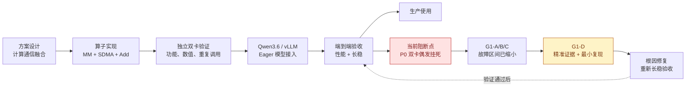
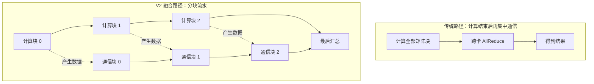
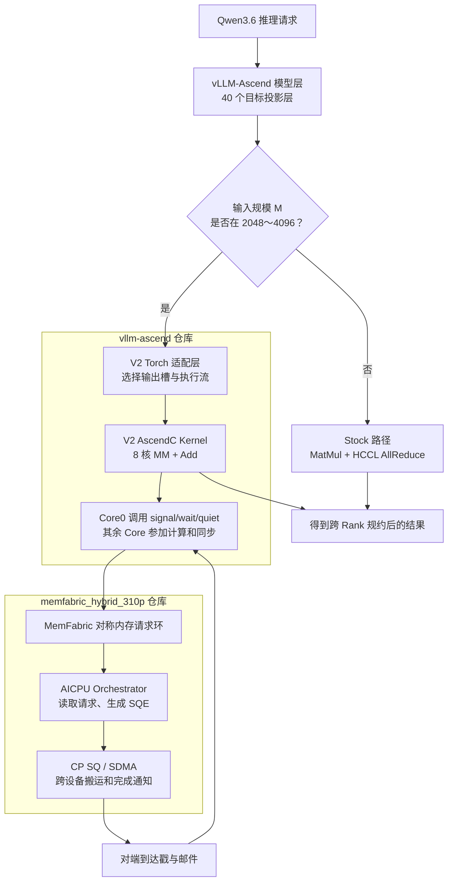
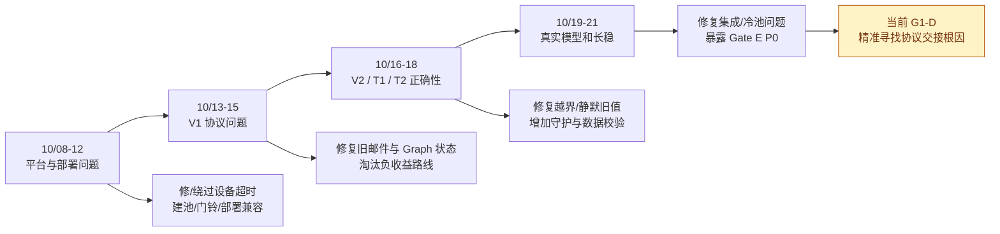
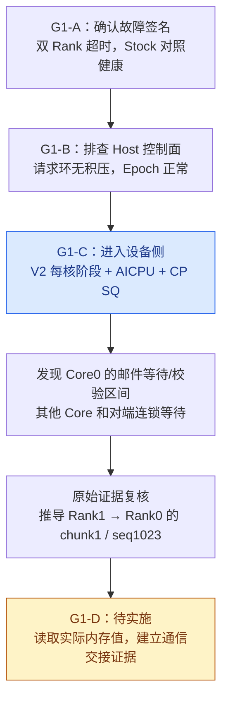
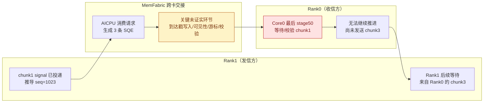
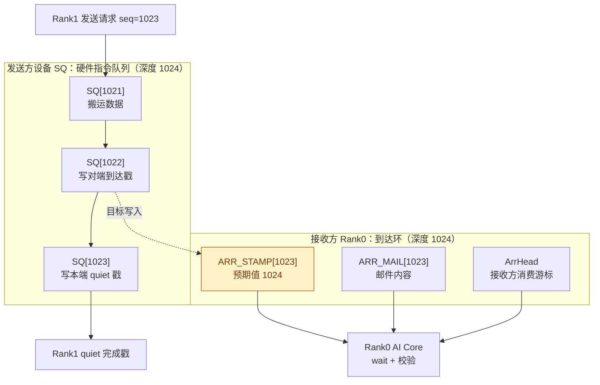
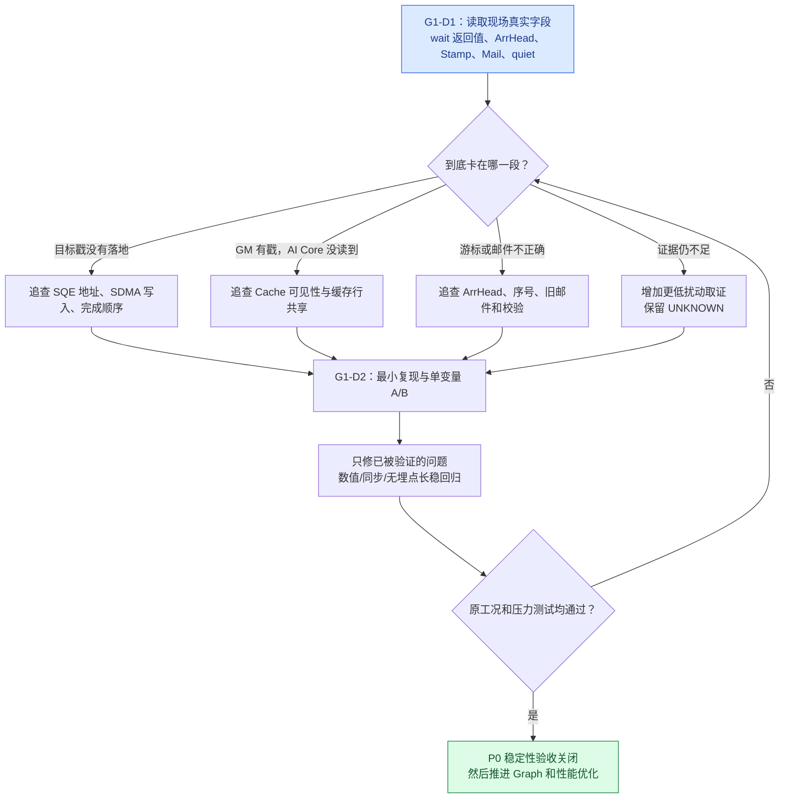

# 310P3 Qwen3.6 计算通信融合算子项目进展汇报

> **汇报日期**：2026 年 10 月 21 日  
> **适用对象**：项目负责人、研发管理者、算子及推理框架开发人员  
> **结论版本**：截至 G1-C 原始证据归档（2026-10-21），G1-D 尚处方案裁决阶段  
> **文档性质**：阶段性项目汇报，不是根因确认报告，也不是生产验收通过证明  
> **历史追溯范围**：2026-10-08 至 2026-10-21，覆盖 MemFabric 平台适配、V1 协议、V2/T1/T2 和 G3/G1 诊断；本报告 P0/P1/P2 按故障严重性分级，**不等于研发计划阶段名**。  
**代码位置**：本文件归档于正式开发分支 `feat/310p-memfabric-public-api`；G1-A/B/C 的新增诊断代码与证据仍在独立 `diag/*` 分支，**本次归档不表示诊断代码已合入正式分支**。

---

## 一、先讲结论：项目走到哪一步了？

**历史问题追溯**：从 2026-10-08 起逐项核查，共登记 42 项问题发生点（P0 16、P1 22、P2 4；为回顾性分级）。多数已修复或缓解，不能理解为当前还有 42 个未解决 BUG。详细台账见 **§四-A**。

**一句话总结：融合算子已经做出来，并且在独立测试和真实模型的基础功能测试中跑通；但真实服务连续运行会偶发双卡挂死，且目前端到端没有稳定加速，所以还不能投入生产。我们已经把挂死范围缩小到一封跨卡通信消息的接收/校验链路，接下来要找到这封消息究竟在哪一步出错。**

| 汇报维度 | 现状 | 怎样理解 |
|---|---|---|
| 核心算子研发 | **已实现** | 计算、跨卡搬运、规约、同步流程已编码并可运行 |
| 独立算子正确性 | **已验证** | 多尺寸、多分块、串行/交叠、重复调用等已通过 |
| 模型 Eager 接入 | **已跑通** | Qwen3.6 的 40 个目标投影层可以实际调用 V2 |
| 单算子性能 | **部分场景有收益** | 大 M 的独立测试快于 Stock，但不代表模型整体更快 |
| 模型端到端性能 | **未通过** | 吞吐、首 Token 延迟等指标未取得稳定正收益 |
| Gate E 长稳 | **未通过（P0）** | 偶发双 Rank AICore Timeout，Worker 无法恢复 |
| G1-A/B/C 诊断 | **已完成并保全证据** | 已定位到设备侧邮件等待/校验区间，根因未定 |
| G1-D | **待设计落地和实机验证** | 精确检查消息、内存槽、缓存与 SQE 的交接 |
| 生产可用性 | **不具备** | 必须先完成 P0 修复和无埋点长稳，再做性能验收 |

> **汇报人备注（人话）**：不要说“项目失败”或“已经完全成功”。更准确的是：**技术功能已经验证，工程可用性还没有验收过关**。我们目前是在攻关一个低概率但影响严重的稳定性问题。

### 图 1：项目阶段与当前所处位置

**怎么讲这张图**：前四步已经跑通，项目不是卡在“算子能不能做”。真正的阻断发生在最后的**连续服务验收**，因此现在优先排障而不是追加新功能。

---

## 二、项目到底做了什么？为什么需要融合？

### 2.1 原来的做法与融合后的做法

模型在两张 NPU 卡上并行计算时，每张卡各自得到一部分结果，接着要跨卡汇总。旧路径通常由 **MatMul（矩阵乘法）** 和 **HCCL AllReduce（跨卡求和）** 两个独立阶段完成。

V2 的基本思路是：**把大计算切成多块，算完一块尽早发往对端，同时继续算下一块，让计算和通信尽可能同时进行。**

### 图 2：为什么融合可能更快

> **人话解释**：原来像“所有货物生产完，再统一叫车发走”；融合后像“生产完一批就发一批，同时继续生产下一批”。理论上能减少等待时间；但车辆调度、交接确认等环节变复杂，因此也更容易暴露时序问题。

### 2.2 两个代码仓库各负责什么？

| 仓库 | 职责 | 人话解释 |
|---|---|---|
| `vllm-ascend` | V2 MM、Add、核间同步、Torch 接口、模型层路由 | **负责算什么、何时发起通信、什么时候可以继续算** |
| `memfabric_hybrid_310p` | 对称内存、请求环、AICPU SDMA 编排、SQE 提交、到达/完成通知 | **负责把数据送过去，并告诉对端“货到了”** |

真实运行时，两边的实现密切配合：V2 的 AI Core 调用 MemFabric 设备通信原语；MemFabric 的 AICPU 和 SDMA 处理实际搬运。

### 图 3：从模型到双卡通信的完整关系

> **人话解释**：vLLM 像生产线总调度；V2 算子像计算工位；MemFabric 像物流系统；`signal` 是发货通知，`wait` 是等收货回执，`quiet` 是确认本端发出的搬运已经完成。**现在最像是物流交接单未被正确确认，而不是矩阵乘法答案算错。** 这是当前定位方向，并非已证实的根因。

### 2.3 当前支持范围

- 平台：昇腾 310P3，当前重点验收为 **TP=2（双 Rank/双卡）**。
- 模型：Qwen3.6-35B-A3B-W8A8。
- 接入层：10 个 Full Attention `o_proj` + 30 个 GDN `out_proj`，合计每 Rank 40 层。
- V2 路由：`2048 ≤ M ≤ 4096`；其他 M 使用 Stock。
- 支持分块：256、512、1024 行（Gate E 使用 1024）。
- 当前主要实机路径：Eager；Graph 实际融合路由尚未完成。

> **术语卡片**：`Rank` 可理解为并行推理中的一张卡/一个计算参与方；`TP=2` 是模型的张量并行计算分在两张卡上；`M` 在本工程中是当前矩阵乘法的输入行数，并非模型参数量；`chunk` 是把这批行再分成的小块；`Eager` 是逐步按实际执行路径运行，不依赖把整段模型固化为图。

---

## 三、研发与验收做到了什么程度？

### 3.1 正确性验证

已完成 AI Core 同步基础验证、单块与多块 MM+AllReduce、串行与交叠运行、动态尾块补齐、输出缓冲复用、HCCL 混合路由、真实模型 Eager 接入等。

**关键结果：**

| 场景 | 已有实机结果 | 说明 |
|---|---|---|
| G0 核间同步 | 1000/10000 次量级回归 PASS | 核与核之间可以完成既定会合 |
| G1/G2 独立融合算子 | 主要 M/chunk/串行交叠配置 PASS | 基础算法可运行、结果正确 |
| T1 小 M 原始 NZ | 多核数及尺寸矩阵 PASS | 小形状补充验证 |
| G3 混合路由 | 1000/1000 PASS | 同进程 Stock/HCCL 与 V2 可以交替调用 |
| 新进程冷启动 | 20 轮 PASS | 按资源排空和预热规则执行 |
| Qwen3.6 Eager | 目标 40 层接入、首调位精确 PASS | 模型已真实使用算子 |
| Gate E 连续稳定性 | **FAIL** | 真实连续服务仍可能整机双 Worker 卡死 |

> **汇报人备注（人话）**：单算子通过，证明“单独做这件事通常做对了”；并不能证明“放到繁忙的真实模型服务中，一直反复做也永远不会卡住”。

### 3.2 性能结果：为什么还不能说“加速成功”？

- 独立算子：部分大 M 配置相对 Stock **快约 16%～25%**（取决于具体形状及实验基线）。
- 真实 Eager Serving：三组配对性能测试中，**吞吐中位变化约 -3.51%**；TTFT 中位延迟三次均退化约 **2.1%～2.5%**；TPOT 高分位尾部最差退化约 **10.6%**。
- Graph：已有测试中融合分支未真实调用 V2，不能把 Graph 下看似正常的性能当作 V2 优化收益。

**这说明：单个工位做快了，不代表整条生产线就会快。** 例如通信资源竞争、MatMul 实现效率、层与层之间的调度成本，都可能吃掉原本的单算子收益。

> **术语卡片**：`Stock` 是原始对照实现；`TTFT` 是“发起请求到第一个字/token 出来要多久”；`TPOT` 是“生成过程中每个后续 token 平均要多久”；`尾部延迟` 是那些比较慢的请求表现，往往比平均值更影响服务体验。

---

## 四、目前主要遇到哪些问题？表面看起来是什么样？

| 优先级 | 问题 | 用户/运维能看到的表象 | 当前处理状态 |
|---|---|---|---|
| **P0** | Gate E 双 Rank 偶发挂死 | 服务运行数分钟后两卡超时、请求连续失败、Worker 无法恢复 | **诊断中；未修复** |
| P1 | 端到端性能负收益 | 独立算子快了，但真实模型吞吐、首 token 时延未改善 | 待稳定性问题解决后专项优化 |
| P1 | Graph 未执行 V2 | Graph 跑得正常，实际还是 Stock 路径 | 编译追踪路由问题已定位，尚未完成有效接入 |
| 历史已缓解 | 首次写入、冷启动、部署、输出槽复用等 | 新环境偶发数据错误、构建或启动失败 | 已实施工程修复/缓解，部分底层机制仍需关注 |

### 4.1 P0 故障的具体表象

Gate E 工况：**双卡、Eager、输入约 4096 tokens、输出 256 tokens、并发 10、连续约 10 分钟**。

观测到的共同特征：

1. 刚开始能够正常推理，首调算子数值正确。
2. 某次运行中途，一张卡的通信等待无法继续，另一张卡受到连锁影响。
3. 一段时间后设备报告 `507014 AICore Timeout`。
4. 两个 Worker 随后都不可恢复，后续请求失败。
5. 故障发生位置不固定：有时在 `aclnnSwiGlu` 报错，有时在事件同步 API 报错。

> **人话解释**：像两个人配合装配产品：A 等 B 送来一个零件，B 后面也开始等 A 的下一批零件。实际报错可能出现在“质检/交付”工序，但**质检报错并不代表质检导致缺件**。

### 图 4：为什么表面报错位置不等于真正故障位置？

**读图重点**：报错 API 是“发现问题的人”，不一定是“制造问题的人”。所以诊断没有围绕 SwiGlu 算法盲目修改，而是追溯到设备侧先停的通信链路。

### 4.2 为什么真实 vLLM 更容易暴露，而独立算子未必暴露？

| 独立测试 | 真实 Serving |
|---|---|
| 通常每次调用后同步、立即校验结果 | 连续提交许多算子，不对每次 V2 强制同步 |
| 输入形状和调用节奏相对可控 | 请求持续进出，Prefill/Decode 交替 |
| 干扰较少 | Attention、GDN、Stock/HCCL、缓存与异步调度同时存在 |
| 容易定位当前单次调用 | 错误可能延迟到下游同步点才表现出来 |

健康测试已经覆盖多次 1024 环回绕，因此 **“第 1024 次必然出错”不成立**。更需要调查的是：**某个边界条件加上连续异步负载、双 Rank 时序差异或缓存状态，是否才会触发故障**。

---

## 四-A、专项补充：从 10 月 8 日起的完整问题追溯（P0 / P1 / P2）

> **为什么增加本章**：前一版侧重“当前尚未关闭的故障”，没有完整呈现此前处理过的正确性、协议、部署、环境、测试和工程问题，容易让汇报对象误认为项目只遭遇过几个问题。本章按 10 月 8 日至 21 日的研发轨迹补齐**历史问题台账**。早于 10/08 的基础问题只在所引历史报告中保留，不冒充本窗口的新发现。

### 先解释分级：别把“研发阶段 P0/P1/P2”当作“故障等级”

- **P0（严重故障）**：导致结果错误、设备崩溃、整条服务不可用，或阻断核心生产验收。
- **P1（重要问题）**：导致某种集成能力不可用、显著性能负收益、环境兼容/工具失效、可信测试缺口。
- **P2（一般问题）**：构建脚本、诊断工具、文档路径等局部可修复问题。
- **定级原则**：此处是**汇报用的回顾性分级**，不等于所有原报告正式宣布过同样的事故等级。历史文档中名为“P0/P1/P2 阶段”“Phase P0”等，只是开发计划里程碑；**不能计入问题数量**。相同根因跨阶段出现时，表里会标明关联，不能简单相加当作独立根因总数。
- **状态口径**：“已修复”表示当时修复并回归；“已缓解”表示采取工程对策但底层机制未必解释；“受限”表示硬件/驱动能力缺口，不是当下正在发生的故障；“未解决”才是当前待办。历史设备版本、原始日志和新诊断版不能混用结论。

### 图 5-A：项目为什么有那么多问题，却仍能向前推进？

> **人话备注**：前期像先修路、接电、调试工位；中间发现有时货物拿错或没写到仓库；后来生产线终于跑通，才暴露“持续高负荷交接时偶发停摆”的问题。**历史修复是真实进展，但不能拿历史 PASS 抵消现在的 Gate E FAIL。**

### 10 月 8—12 日：310P3 平台、设备编排与部署链

| 日期 | 级别 | 问题及当时表象 | 定位与处理 | 现在是否解决 | 依据 |
|---|---|---|---|---|---|
| 10/08 | **P0** | **AICPU 任务 28 秒被监控击杀**：设备编排任务连续运行一段时间被杀，出现 507901/流异常 | 当时改用 KFCKernel(type5) 规避设备侧 28 秒监控；**v9 常驻方案后来被 10/12 的 Host 全设备同步问题推翻** | 历史方案已替换；不能写成“常驻方案生产可用” | [H01]、[H02] |
| 10/08→10/12 | **P0** | **常驻 AICPU 与全设备同步互相等待**：Qwen 大 workspace 分配调用设备同步，常驻任务永不结束，随后 507017/507046/服务失败 | 确定为另一套超时机制；改为**15 秒有限 Epoch + Host 心跳 + 监督重拉(KVER11)**，08 示例同步 10/10 与 soak 回归 | 旧故障链已针对性缓解；真实 Serving 另有 Gate E P0，不能混为已根治 | [H01]、[H02] |
| 10/08 | **P1** | **逻辑设备号重映射导致对称内存授权失败**：设置可见设备为 2,3 后建池报 507899；直接选 die 正常 | 定位逻辑 ID/物理 die 混淆；编排器 HAL devId 改用 dieId | 编排器相关问题已修；池的重映射部署约束仍要遵守 | [H01] |
| 10/08 | **P1** | **编排器使用错误设备号**：dev2/dev3 下 HAL 查询返回 22、主错误 1422，0/1 下隐蔽 | 修正 epoch 参数传 dieId 并在多 die 回归 | 已修复 | [H01] |
| 10/08 | **P1** | **dav-2002 运行时指针转换错位**：Kernel 中把整数地址转成 GM 指针时出现偏移/读写不正确 | 设备探针确认工具链约束，改用经过验证的指针参数与直接地址访问方式 | 已规避；后续设备代码仍需遵守纪律 | [H01] |
| 10/08 | **P1** | **部分设备 KFC system() 临时不可用**：dev0 的命令返回 -1／507018，其他设备正常，数小时后自愈 | 跨卡对照、核对驱动与设备日志；没有单一确定根因 | 环境事件已恢复；保留运维观察 | [H01] |
| 10/09 | **P2** | **示例构建路径错误**：从示例目录执行 run.sh，CMake 把当前目录当源码目录 | 补充 cmake -S 显式源码路径 | 已修复 | [H03] |
| 10/10—12 | **P1** | **设备侧 SQ 门铃地址不可查询**：310P3 查询 SQ_REG_BASE 返回 65534 NOT_SUPPORT，直写门铃方案不可用；StarsQuery 同步可报 507018 | 源码 + 四组实机验证证实 CP1 未获有效门铃映射，只能沿用 halSqCqConfig/ioctl 提交 | **能力限制仍在**；属于未来直驱优化阻碍，不是 Gate E 根因证明 | [H04] |
| 10/10—12 | **P1** | **PyPTO/JSON 三算子部署路径不适用**：复制 JSON 转发方案后 launch 表面正常、同步 507018；某些预置设备库不存在 | 发现此构建的 NEW_CANN 路径关闭，区分 310P KFC 直发与其他平台 JSON 通道 | 路线已澄清，不应列为 V2 当前运行故障 | [H05] |
| 10/12 | **P1** | **设备侧时钟在 type5 下不可靠**：用 cntvct 计 15 秒，实际可持续约 34 秒，重新撞超时链 | 实机证实计数器失效，改 Host 100ms 心跳作为 Epoch 时钟 | 已修复并纳入 KVER11 | [H01]、[H02] |

### 10 月 13—15 日：V1 协议、Graph 重放与路线取舍

| 日期 | 级别 | 问题及当时表象 | 定位与处理 | 现在是否解决 | 依据 |
|---|---|---|---|---|---|
| 10/13—14 | **P1** | **V1 波级固定开销较大**：频繁清理 ready/控制状态，使小波单次延迟明显偏高 | 改为单调 generation 等控制优化；原 v7 约 0.52ms/波降至约 0.2ms/波的归档口径 | 已优化；不是最终 V2 Serving 性能保证 | [H06]、[H07] |
| 10/14—15 | **P0** | **不同 V1 通信路径复用邮件 tag，产生错信**：N-split m=241 混合压力 79680 次出现 7 次 mismatch，异常后可能挂死 | 增加 MF310P_WAVE_TAG，区分单波、N-split、批流水邮件 | 已定位并修复；定向 5000 次和长稳回归通过 | [H07] |
| 10/14—15 | **P1** | **Graph replay 使用残留 mail-ok 标志**：Graph 固定 generation 导致上次成功标志干扰新一次重放 | 在 Kernel A 端清理 mail-ok，重复变输入 replay 验证 | 已修复 V1 相关路径；不同于后来 V2 Graph 旁路 | [H07] |
| 10/15 | **P1** | **早期单 Kernel V1→V2 合一反而变慢**：内核融合进一步减少 launch，但 TPipe/计算流水导致实测负收益 | 完成 A/B，回退到两 Kernel V1 方案；10/16 另起全新 V2 设计 | 已完成路线裁决，不是当前 V2 同一代码版本 | [H07] |
| 窗口内遗留 | **P0** | **V1 长时间 eager 混合负载卡顿/超时**：早期有约 20 秒冻结甚至双 Rank wait/quiet 507014；单独回归时可见 wedge | 当时归因 MemFabric epoch 续命；10/12 v11 解决常驻与 Host 同步的已证机制 | 历史症状仍要与新 V2 Gate E 区分，**不能据此证明它们根因相同** | [H06]、[H07] |

### 10 月 16—18 日：V2、T1、T2 正确性专项

| 日期 | 级别 | 问题及当时表象 | 定位与处理 | 现在是否解决 | 依据 |
|---|---|---|---|---|---|
| 10/16—17 | **P1** | **G0 多核诊断结果互相覆盖**：多 AI Core 共写同一结果区，偶发数据丢失、探针误报 | 改为每核独占 64B 槽及缓存行写回 | 已修复 | [H08] |
| 10/17 | **P1** | **初始化顺序错误导致建池失败**：还没完成双方内存几何交换就调用 get_layout，返回 rc=-1 | 按正确生命周期先 exchange_geometry 再 get_layout | 已修复 | [H08] |
| 10/17 | **P0** | **MTE3 首次输出写入静默丢失**：Kernel/通信 status=0，但输出仍是旧值或预填值；后续调用又正常 | 多级设备探针确认首写敏感性，增加首调/新地址守护、预热与数值门 | **工程性缓解**；底层机制仍无官方解释；新二进制需复核 | [H08]、[H09]、[H10] |
| 10/17 | **P2** | **NZ 布局枚举使用错误**：测试把 FRACTAL_NZ 误写成 3，导致“矩阵伪转置”假象 | 更正 torch_npu 枚举为 29，重新位精确验证 | 测试问题已修复 | [H08] |
| 10/17 | **P0** | **T1 的 UB 工作区越界**：M=256 发射后 MTE on-chip read OOB／AICore 异常，M=255 正常 | 发现 basicM=256 使 NZ2ND 临时区与队列超出 UB；将 basicM 上限改为 128 | 已修复；单卡 1028/1028 与双卡矩阵通过 | [H09] |
| 10/17—18 | **P1** | **测试两 Rank 使用不同随机种子**：两边 M/权重不相同，产生 MAIL_MISMATCH、trap 或超时，却不是协议自身故障 | 随机列表/权重种子统一，与 rank 无关 | 测试程序已修复 | [H09] |
| 10/17—18 | **P0** | **带池全设备同步 0–15 秒不可预测**：首调/换缓冲可能同步等待到 Epoch 结束；双 Rank 不对称时一侧超时 | 改小守护范围并引入有限 Epoch/预热等；T2 首跑曾由偏斜触发 507014 | 部分缓解；长期目标是消除热路径全设备同步依赖 | [H09]、[H10] |
| 10/18 | **P0** | **T2 D2D 中转读到旧数据**：普通 aclrtMemcpyAsync D2D 读到上次结果，协议状态仍是成功 | 换内容专项暴露旧读；改用 AICore Stage 搬运 | T2 方案已修复；揭示跨引擎可见性风险 | [H10] |
| 10/18 | **P0** | **T2 Stage 内核出现 512B 旧数据洞**：MTE1 读出后直接交给 MTE3 写，缺少向量到存储的正确交接 | 引入 VECOUT 队列/向量拷贝，确认旧数据块消失 | 已修复，数值复测通过 | [H10] |
| 10/18 | **P0** | **生产者输出在缓存里，后续 MTE1 读到旧值**：融合前的 F.linear 刚写完，staging 内核读取到旧 DDR 内容 | T2 采用生产者→Stage 强制 Stream 同步并计入性能 | 正确性已修；性能成本很高，T2 不适宜生产替换 HCCL | [H10] |
| 10/18 | **P0** | **T2 fresh 地址与空闲窗的 MTE3 异常**：新的 partial 地址可能读到垃圾；空闲后第一批存储不落地 | 守护新地址，采用牺牲预热发射；开启守护正确、关闭可重现错误 | 工程性缓解；平台一致性风险仍需关注 | [H10] |
| 10/18 | **P1** | **T2 Warm 缓存只追踪一个地址**：y 槽轮换时每调用都被当首次写入，触发长达 15 秒同步 | 改为多个 y/partial 地址集合记忆 | 已修复 | [H10] |
| 10/18 | **P1** | **早期 G3 Forward M 超过预算可能误走融合**：用户 prompt=4096 不等于模型 Forward M；超过 4096 时 V2 工作区/多窗口未完成 | 明确路由只支持 2048..4096，其他 M 走 Stock/HCCL | 边界已加固，未声称支持任意 M | [H11] |

### 10 月 19—21 日：模型集成、长稳与诊断证据

| 日期 | 级别 | 问题及当时表象 | 定位与处理 | 现在是否解决 | 依据 |
|---|---|---|---|---|---|
| 10/19 | **P0** | **V2 Serving 输出槽空闲判断错误**：Torch storage 引用计数假设不符，输出槽始终无法正常复用 | 修正 idle 基线和复用检查，增加实机验证 | 已修复 | [H11] |
| 10/19 | **P0** | **真实 Serving 冷池 staged 波静默数值错误**：M=2049 的首次多块传输中有大量元素错误，status 仍为 0；20 轮冷启曾见再次发作 | 补强 staged 预热、首调位精确校验与冷启动扫描 | 已缓解并通过当前回归；底层偶发机制仍需保留风险 | [H11] |
| 10/19 | **P0** | **KFC 自动部署将 Torch ACL 上下文污染**：KFC 探测命令返回非零后，Torch 后续建流/launch 507018；不能在 Worker 内直接探测部署 | 将 KFC 检查/部署移入 fork+exec 独立助手；修复 fork 前 argv 准备 | 已修复并实机验证；实际 Host 库版本需核对 | [H11]、[H12]、[H13] |
| 10/19 | **P1** | **Meta 映射资源异常退出后尚未释放**：快速重启报 507899，连续失败；静置后恢复 | 进程间增加 75 秒排空、显式清理和哈希检查 | 部署纪律已固化；不可误判为融合 Kernel 新错误 | [H11] |
| 10/19 | **P0** | **V2 在 Graph 中没有真正执行**：Graph 回放正常，性能几乎与 Stock 相同；检查编译产物发现 40 层仍走 Stock | 定位 dummy/profile fallback 被 torch.compile 固化并复用缓存 | **未完成 V2 Graph 生效修复**，不允许汇报为 Graph 融合 PASS | [H11] |
| 10/19 | **P1** | **Eager 实际模型性能负收益**：真实服务吞吐中位 -3.51%；TTFT 持续变差、TPOT 尾部最多退化 10.6% | 完成三组配对 A/B，确认单算子正收益并未传递到全模型 | **未解决**；P0 长稳先解决，再做 profiler | [H11] |
| 10/19—21 | **P0** | **Gate E 连续服务间歇性双卡 AICore Timeout**：F01/B02 在 29 完成请求后挂死，C2R2 在第 3 请求附近重现；507014，Worker 不可恢复 | G1-A 确认签名；G1-B 查 Host 请求环/Epoch；G1-C 查设备阶段/SQ；证据复核推导 seq1023 | **仍未修复；当前唯一最高优先级在线阻断故障** | [H14]、[H15]、[H16] |
| 10/19 | **P1** | **重构后默认诊断构建缺符号声明**：编译期找不到正式 Kernel launcher 声明，默认 DIAGNOSTICS=ON 无法构建 | 补完整 extern C 函数声明并重跑编译/回归 | 已修复 | [H17] |
| 10/19 | **P1** | **T2/V1 回归缺导出符号**：原回归出现 undefined symbol，不能声称所有旧路径已回归 | 工程重构后补齐构建清单与导出符号，设备回归通过 | 已解决 | [H17] |
| 10/19 | **P2** | **源码目录迁移后的测试/文档路径残留**：旧路径、__pycache__ 和 UT root 计算导致测试或链接失败 | 路径修复、清理未跟踪缓存、16/16 布局 UT 通过 | 已修复 | [H17] |
| 10/19 | **P1** | **Stock 自身/模型比较出现非确定性翻转**：多次 Greedy 文本比较有分歧，但 Stock 与 Stock 也能复现 | 增强逐 Token 差异日志并区分数值失败与模型非确定性 | 目前为既有栈/测试噪声；未证明 V2 计算错误 | [H11]、[H17] |
| 10/20 | **P1** | **已部署 SO 与 Git/wheel 元数据存在版本漂移**：包元数据标旧 SHA，实际安装库含稍晚修复；两条 SDMA 同步修复分支平行未合并 | 工作树/原始对象/安装文件 SHA256 全面审计和备份 | 证据保全已完成；日后重装仍有回退风险，需收敛资产 | [H13] |
| 10/20—21 | **P1** | **早期 G1 诊断粒度不足、报告排因过度**：Host SQ 游标不等于设备真实 Head；V2 stage50 仍覆盖 wait + 校验 | 加入设备侧诊断、低频快照、原始日志索引；修正“同时丢两封邮件”的表述 | G1-C 归档、G1-D 待精准取证；根因 UNKNOWN | [H14]、[H15]、[H16] |
| 10/20 | **P2** | **G1-C 诊断工具兼容性与日志解析缺陷**：CPU UT 首轮失败；采样时机、批量边界等诊断实现需要修正 | 实机做兼容修复、静态审视和 CPU UT，9/9 PASS | 诊断工具已修复，但诊断不能等同于生产修复 | [H15] |

### 如何避免用历史问题“冲淡”当前未解决问题？

**当前真正仍影响是否投入生产的主线只有三项**：

1. **P0 Gate E 双卡偶发卡死（未解决）**：当前首要阻断，必须先取得邮件交接区间的直接证据、找到能反证的根因机制并修复。
2. **P0/P1 Graph V2 旁路与 Eager 性能不达标（未解决）**：这是**另外两项验收缺口**；单算子快不等于产品已加速，不能因为长稳修好就默认两项一并解决。
3. **历史平台机制的残余风险（已有缓解/受限）**：MTE3 首写一致性、T2 跨引擎可见性、设备同步时长、SQ 门铃直驱限制、库/轮子版本漂移，均需在改版及最终部署时复核；其中某些仅影响已放弃的 T2 或未来性能优化，**不等于现在的 V2 都在触发这些问题**。

**特别提醒**：早期 V1 出现过类似双 Rank 超时，并且 MemFabric 的“常驻任务与全设备同步”故障已通过有限 Epoch 解决；但 G1-C 在新版本仍复现 Gate E。应报告为“**旧故障链部分闭环、新故障根因尚不确定**”，而不是“之前已经修过，为什么又复发”。

### 10/08—10/21 追溯的统计口径

- 本章按**可独立描述、能找到来源的事项**共登记 **42 项**：P0 **16 项**、P1 **22 项**、P2 **4 项**，包含功能故障、历史平台能力缺口、测试/构建事项和已实施缓解，**不是“当前仍有这么多未修复 BUG”**。
- 同一底层问题可能多次出现在 V1/T1/T2/G3（例如首写丢失和全设备同步），分类是**问题发生点台账**，不是独立根因统计；不可用数量推算生产风险率。
- 2026-10-08 的平台条目有明确日期；少数源报告早于 10/08 的持续遗留项专门写作“窗口内遗留”，不能归为当日新增。
- 2026-10-19 之后新增的 G1-B/C 工具问题属于“诊断代码质量”而非“算子生产故障”，历史必须记，但不用给 P0 数量加权。

---

## 五、围绕挂死问题，我们做了哪些定位？结果是什么？

本项目没有直接猜测后改协议，而是按“先确认故障，再分层排除，最后定位具体消息”的顺序推进。

### 图 5：G1-A → G1-B → G1-C → G1-D 诊断演进

### 5.1 G1-A：确认故障确实存在

- F01：融合路径完成 **29 个请求**后复现双 Rank `507014`。
- F02R1：同类工况 **75/75** 请求成功。
- Stock 对照 S01：**75/75** 请求成功。

**得到的结论**：故障是**间歇性的**，且与融合路径相关；不能因为某一次通过就说问题解决。

> **人话解释**：已经确认问题真的会发生，而且重启后可能又正常，所以它不是一个每次都能复现的普通算错问题。

### 5.2 G1-B：核查 MemFabric 的“后台调度员”

在 MemFabric Host 侧记录：

- 请求环的生产/消费游标；
- 是否有请求越积越多；
- 设备后台任务（Epoch）的心跳、退出与重新拉起情况。

B02 再次在 **29 个请求**附近复现故障，但 Host 请求环没有持续积压，已结束 Epoch 均正常退出，监督器仍在运行。

**得到的结论**：没有证据表明 Host 控制面先停止；下一步必须深入设备侧。

> **人话解释**：后台调度员还在上班、订单登记也正常，但货物交接仍然出问题。因此不能只检查后台服务器日志。

### 5.3 G1-C：观察设备内的每一步执行

分别在两仓库新增可关闭的诊断代码：

- V2：8 个 AI Core 记录本核走到了计算、通信、规约的哪一步。
- MemFabric：记录 AICPU 处理请求与设备 SQ Head/Tail，判断“订单是否处理、硬件队列是否排空”。
- 每秒从设备读取简短的最后阶段快照，不直接改变正式通信算法。

**实机结果：**

| 场景 | 结果 |
|---|---|
| 诊断构建和 CPU 测试 | 已通过 |
| C1 混合路由正确性 | **51/51 PASS** |
| C2R1 长稳 | **75/75 PASS** |
| C2R2 长稳 | **第 3 个请求附近复现双卡超时** |

C2R2 核心设备状态：

| 观察对象 | 最后阶段 | 易懂解释 |
|---|---|---|
| Rank0 Core0 | `208:1:50` | 第 208 次融合调用，等待对端 chunk1 的到达邮件/校验 |
| Rank1 Core0 | `208:3:50` | 同一次调用，等待对端 chunk3 的到达邮件/校验 |
| 两侧其余 Core | `stage60` | 等 Core0 放行，自己不能先继续规约 |
| Host 请求环 | 两侧排空 | 已发出的请求没有在 Host 环里持续排队 |
| CP SQ | 事后 Head == Tail | 设备硬件提交队列在采样时已经排空 |
| Epoch | 正常续跑 | 后台通信服务没有整体停机 |

**注意两个证据边界：**

1. `stage50` 记录在 `wait()` 调用之前，而下一阶段写在邮件返回并校验通过之后。故而它只说明**卡在等待/校验区间**，不能严格断言 `wait()` 永远没返回。
2. `SQ Head==Tail` 只说明**采样时队列为空**，不等于每条跨卡写入都正确到达，也不能彻底排除此前出现过瞬态 SQ 问题。

> **人话解释**：我们知道哪一个接收工位没继续，但仍不知道是“没收到货”“货到了看不见”“拿错交接单”，还是“交接单检查出错后停机”。

### 5.4 G1-C 原始日志归档与重新分析

10 月 21 日已整理 G1-B B02、G1-C C2R1/C2R2：

- **164 个原始文件**建立 SHA256 保全清单，完整原始日志留在 310P3 服务器。
- GitHub 存放脱敏日志、统一时间线、会话统计、边界分析和可复现提取脚本。
- 证据区分 **直接观测**、**根据源码和序号推导**、**尚未知晓**，防止把假设当事实。

重新分析指出一个重要因果关系：**Rank0 先无法完成来自 Rank1 的 chunk1 交接，可能导致 Rank0 未能发出后续 chunk3，从而解释 Rank1 的等待。** 这比“两个 Rank 同时丢两封消息”更符合当前 V2 流水执行顺序。

### 图 6：一处异常如何拖住两张卡？

**怎么讲这张图**：目前看起来不需要假设“双卡同时坏”。只要中间一张交接单出了问题，整条双卡流水就可能互相等待而停住。**箭头表示根据执行顺序建立的候选因果链，不代表每一个中间环节都已直接测到。**

---

## 六、为什么特别关注 1024 边界？它已经是根因了吗？

**还不是根因，但这是当前最值得验证的线索。**

MemFabric 的接收端有一个 1024 槽的到达环；设备 CP SQ 的深度也为 1024。每封通信请求通常对应 **3 条 SQE**，按“搬运数据 → 写到达戳 → 写本端完成戳”排列。

从 C2R2 的最终阶段和请求计数推导，最可疑的一封消息是：

| 字段 | 当前推导 |
|---|---|
| 发送方 → 接收方 | Rank1 → Rank0 |
| 内容 | 第 208 次调用的 chunk1 到达通知 |
| 请求序号 | **1023** |
| 接收环槽 | **ARR[1023]：到达环最后一槽** |
| 期望戳值 | **1024** |
| 对应 SQE 三连 | **SQ[1021]、SQ[1022]、SQ[1023]** |

### 图 7：1024 边界上的两个“环”，不要混为一谈

**容易讲错的地方**：`ARR[1023]` 是接收侧“邮箱格子”；`SQ[1023]` 是发送侧“第三条操作指令的位置”。它们都接近末尾，但不是同一个物理结构。**写到达戳的是 SQ[1022]，不是 SQ[1023]。**

**跨会话线索：**

- B02 终态请求数：dev0/dev1 = **6146/6145**。
- C2R2 终态请求数：dev0/dev1 = **1025/1026**。
- 两次都停在接近 1024 倍数的区域，且两 Rank 最终请求数差一封。
- C2R1 健康执行 **15027** 封请求/设备，跨越约 14 次回绕也没有故障。

**因此只能说“边界相关值得优先验证”，不能说“跨到第 1024 槽必然出错”。** B02 没有 V2 阶段戳，其具体丢失槽位仍未知；只有两个失败样本，也不适合用精确概率证明相关性。

> **人话解释**：像一个有 1024 个格子的循环传送带。故障发生时恰好接近末尾最后几个格子，但我们也知道传送带曾安全地绕了很多圈。现在要查的是：**是不是某种忙碌程度或交接顺序，碰上最后一格才会触发缺陷**。

---

## 七、下一阶段 G1-D 要做什么？先后顺序如何？

G1-D 的任务是**缩小根因并尝试制造可重复的最小故障**。不应一上来就改 SQE 或缓存行布局，否则可能把证据破坏掉。

### 图 8：G1-D 从证据到修复的决策路径

### G1-D1：最小设备侧精准取证（P0）

要取得以前没有的直接数据：

1. **在 V2 侧区分 `wait()` 入口、返回、邮件校验和 Trap 前状态**，避免把所有失败都记为 stage50。
2. **读取 Rank0 真正的 `ArrHead`、`ARR_STAMP[1022/1023/0]` 及对应 `ARR_MAIL` 内容**，判断是否拿错槽、戳值不对或读取不可见。
3. **核对 Rank1 的 quiet 完成戳、SQE 目的地址和当前 SQ 状态**，确认“指令已被消费”与“目标内存已写对”是两件事。
4. 使用与现有 G1-C 隔离的诊断版本、默认关闭埋点，并保留出错前后的时间线和实际二进制哈希。

**交付物**：一张能够追踪特定 `seq` 从发起到接收的设备证据链，以及明确的剩余 UNKNOWN 清单。

### G1-D2：脱离 vLLM 的最小复现（P0）

用独立 TP2 程序逐步模拟真实模型：

| 实验 | 只改变什么 | 想回答什么 |
|---|---|---|
| A：每次同步 | 保持已有独立算子节奏 | 稳定的对照基线 |
| B：40 层连续调用 | 去掉逐调用同步，仍保留同 Stream 依赖 | 是否只需连续异步调用就能复现 |
| C：混合计算/通信 | 在 B 中加入 Stock/HCCL 或其他负载 | 是否由资源竞争触发 |
| D：真实 vLLM 强制同步 | 仅诊断性地改变 V2 调用间同步节奏 | 故障是否对调度时序高度敏感 |

**交付物**：若能脱离模型复现，后续验证将不再每次依赖完整 Qwen 启动与 10 分钟 Serving；若不能复现，也能缩小“只有 vLLM 具备”的触发条件。

### G1-D3：1024 边界验证（P0）

- 专项覆盖 `seq=1022/1023/1024` 的发送和接收，记录真实序号及槽位。
- 同时观察健康的非边界消息，避免只采故障样本。
- 区分“SQE 三连跨 SQ 尾”“到达环末槽”“Cache Line 共享”三种条件。
- **只有直接证据支持后**，再做单变量地址布局或缓存策略 A/B；不能在正式版本中猜测性改协议。

### 修复后工作（P0 关闭之后）

1. 根据证据执行最小修复，并用可复现案例检验因果关系。
2. 重新执行 T0/T1/T2、位精确、不同 chunk、Stock/V2 混合路由和冷启动回归。
3. 在**无诊断埋点**的二进制上执行多轮 Gate E 长稳、双 Rank 异步连续压力及复现环境回归。
4. 修复 Graph 路由固化，确认编译产物确实调用 V2。
5. 再做端到端性能优化，以真实吞吐、TTFT、TPOT 和尾部延迟为最终指标。

> **汇报人备注（人话）**：下一步不是“继续加日志碰运气”，而是把一个具体包裹从寄出到签收每道工序都拍下来，再通过可重复对照实验确认哪一环出错。

---

## 八、做完待办，能不能肯定找到根因并彻底解决？

**有明确的诊断路径，而且比 G1-A 之前更有把握缩小范围；但无法承诺“一轮 G1-D 必定找到根因”。**

当前具备的重要条件：

- 已知具体停滞代际和两个 Rank 的最后执行阶段。
- 已知设备请求环、Epoch 和事后 SQ 状态。
- 已能从源码推导最可疑消息的 seq、目标槽和对应 SQE 三连。
- 已有完整原始日志保全与健康对照，可以设计定向取证。

仍存在的难点：

- 设备内存和 AI Core 缓存是否具有一致可见性，需要直接观测。
- 低概率时序问题可能被诊断代码本身的读写影响。
- 设备 SQ “事后为空”并不代表每一步瞬态行为正常。
- 如果最终涉及驱动、固件或硬件限制，可能需要更底层接口和厂商协助。

**怎样才算根因级解决？**

| 验收关口 | 必须获得的证据 |
|---|---|
| 找到哪里出问题 | 能定位某一个错误游标、内存写入、Cache 可见性或 SQE 行为，而不是只看到超时 |
| 讲清为什么 | 有源码/协议推导与真实设备证据互相支持 |
| 证明修复有效 | 单变量修复或对照实验证明问题随改动消失，并能解释原因 |
| 确认没有副作用 | 数值与历史单算子回归全部通过 |
| 真正解决 P0 | **无埋点**真实 Gate E、多轮冷启动和异步混合长稳通过 |
| 具备生产条件 | 在 P0 关闭后，再通过 Graph 接入和端到端性能验收 |

> **汇报人备注（人话）**：“修复后一次没再遇到”不算根治；必须能解释原来为什么坏、修了哪里、为什么修完就不会再坏，并且能经得起长时间反复测试。

---

## 九、适合汇报时直接照读的 90 秒摘要

> 我们研发的是面向昇腾 310P3 的计算通信融合算子。原来两张卡需要先完成计算、再进行跨卡汇总；现在我们把大任务拆成小块，争取边计算边传输，以减少等待。核心算子已经实现，独立双卡测试和 Qwen3.6 模型 Eager 功能都已跑通，单算子部分场景有加速。
>
> 目前有两个尚未通过的验收关口：一是模型端到端还没有稳定性能收益；二是连续服务时偶发双卡一起超时，造成 Worker 无法恢复。这是当前最高优先级的 P0 问题，因此还不能部署生产。
>
> 我们已经做了三轮递进诊断：第一轮确认故障及对照，第二轮排除明显的后台请求积压与任务停机，第三轮进入设备内部，发现计算核在等待跨卡通信消息时不能继续。重新分析日志后，进一步推导出一封序号 1023、位于到达环边界的关键邮件，但还不能确定它是没写进去、写了没被看到，还是读取或校验出了问题。
>
> 下一轮 G1-D 将直接检查这封消息的真实内存状态，并通过独立的连续异步调用建立最小复现。我们已有明确的根因定位路线，但只有获得直接证据、完成针对性修复和无诊断版本长稳回归，才能宣布稳定性问题真正解决。稳定性闭环后，再完成 Graph 接入及模型性能优化。

---

## 十、依据资料与链接（按“证明什么”索引）

> **版本提醒**：正式分支中的 G3 文档记录 10 月 19 日前后的开发验证事实；后续 G1-A/B/C 和证据包在 `diag/310p3-gate-e-forensics-20261020`、`diag/310p3-g1c-device-first-stop-20261020` 上，G1-D 复核请求在单独的 `diag/310p3-g1d-minimal-forensics-20261021` 上。**不能把诊断分支的已提交代码当成正式分支已合入的功能**。以下链接固定到具体提交，方便长期复核。

| 依据链接 | 主要讲述什么 / 支持本报告哪部分 |
|---|---|
| [V2 总体架构与设计](https://github.com/10wvw01/vllm-ascend/blob/518418f20cf8f09f2c418993400afaf639a101fc/csrc/_310P/memfabric_mm_ar_v2/docs/DESIGN.md) | 核心融合思路、计算/通信协同、内存与控制设计；对应第 2 章 |
| [V2 初期设备实测及修复](https://github.com/10wvw01/vllm-ascend/blob/518418f20cf8f09f2c418993400afaf639a101fc/csrc/_310P/memfabric_mm_ar_v2/docs/20261017实机测验及修复.md) | G0/G1/G2 基础正确性与首写、同步问题；对应第 3 章 |
| [T1 NZ 小 M 测试报告](https://github.com/10wvw01/vllm-ascend/blob/518418f20cf8f09f2c418993400afaf639a101fc/csrc/_310P/memfabric_mm_ar_v2/docs/T1_NZ_DIRECT_REPORT.md) | 小 M、不同比例 AI Core 的实现与实测；对应研发覆盖情况 |
| [T2 原生 MM + MemFabric AR 对照](https://github.com/10wvw01/vllm-ascend/blob/518418f20cf8f09f2c418993400afaf639a101fc/csrc/_310P/memfabric_mm_ar_v2/docs/T2_AR_ONLY_REPORT.md) | 分离 MM 与通信的对照实验、诊断与回归；对应功能验证边界 |
| [G3 Qwen3.6 端到端报告](https://github.com/10wvw01/vllm-ascend/blob/518418f20cf8f09f2c418993400afaf639a101fc/csrc/_310P/memfabric_mm_ar_v2/docs/V2_G3_QWEN_E2E_REPORT.md) | **最重要的开发验收依据**：40 层接入、1000 次路由、Graph 无效、端到端性能退化、Gate E P0；对应第 1、3、4 章 |
| [目录重构与设备回归](https://github.com/10wvw01/vllm-ascend/blob/518418f20cf8f09f2c418993400afaf639a101fc/csrc/_310P/memfabric_mm_ar_v2/docs/V2_REFACTOR_REGRESSION_20261019.md) | 正式/诊断代码分离、构建、T0/T1/T2 和 Serving 回归；对应工程交付状态 |
| [G1-A 故障取证设计](https://github.com/10wvw01/vllm-ascend/blob/54c367acda89fddb10e08b8ab35de2f6d9a56eae/csrc/_310P/memfabric_mm_ar_v2/docs/G1_GATE_E_FIRST_FAILURE_FORENSICS.md) | 为什么分层诊断、如何界定故障证据和排查顺序；对应第 5 章 |
| [G1-A 实机报告](https://github.com/10wvw01/vllm-ascend/blob/86e660edc1c1011a7ca23ac9bb29787fbe079271/csrc/_310P/memfabric_mm_ar_v2/docs/G1_GATE_E_FORENSICS_REPORT_20261020.md) | F01/F02R1/Stock 对照、超时签名及原始故障窗口；对应第 5.1 节 |
| [G1-B Host 飞行记录器报告](https://github.com/10wvw01/vllm-ascend/blob/86e660edc1c1011a7ca23ac9bb29787fbe079271/csrc/_310P/memfabric_mm_ar_v2/docs/G1_GATE_E_FORENSICS_G1B_ADDENDUM_20261020.md) | B02 的请求环、Epoch、Host 控制面状态与回退；对应第 5.2 节 |
| [G1-C 设备取证设计](https://github.com/10wvw01/vllm-ascend/blob/86e660edc1c1011a7ca23ac9bb29787fbe079271/csrc/_310P/memfabric_mm_ar_v2/docs/G1C_DEVICE_FIRST_STOP_DESIGN_20261020.md) | 两仓库埋点、阶段码、采样结构和设备测试 Gate；对应第 5.3 节 |
| [G1-C 实机报告](https://github.com/10wvw01/vllm-ascend/blob/95096ad25d004074e45e3ef65c33de5eb9842644/csrc/_310P/memfabric_mm_ar_v2/docs/G1C_DEVICE_FIRST_STOP_REPORT_20261020.md) | **关键定位证据**：C1、C2R1/C2R2、stage50/60、CP SQ、507014 和环境恢复；对应第 5.3 节 |
| [G1-C 原始证据复核包](https://github.com/10wvw01/vllm-ascend/blob/86e660edc1c1011a7ca23ac9bb29787fbe079271/csrc/_310P/memfabric_mm_ar_v2/docs/G1C_EVIDENCE_REVIEW_PACKAGE_20261021.md) | 单一关键邮件推导、1024 边界工作假设、直接观测/推导/未知分级；对应第 5.4、6 章 |
| [G1-C 证据索引](https://github.com/10wvw01/vllm-ascend/blob/86e660edc1c1011a7ca23ac9bb29787fbe079271/csrc/_310P/memfabric_mm_ar_v2/evidence/g1c_20261020/evidence_index.md) | B02/C2R1/C2R2 的原始日志归档位置、164 文件清单、脱敏规则和统一时间线；对应证据完整性 |
| [1024 边界推导 JSON](https://github.com/10wvw01/vllm-ascend/blob/86e660edc1c1011a7ca23ac9bb29787fbe079271/csrc/_310P/memfabric_mm_ar_v2/evidence/g1c_20261020/boundary_1024_analysis.json) | seq=1023、ARR[1023]、SQE 三连与两 Rank 依赖的推导链及 UNKNOWN；对应第 6 章 |
| [C2R2 故障窗脱敏日志](https://github.com/10wvw01/vllm-ascend/blob/86e660edc1c1011a7ca23ac9bb29787fbe079271/csrc/_310P/memfabric_mm_ar_v2/evidence/g1c_20261020/sanitized/C2R2_171840_172030.log) | 17:18:40–17:20:30 的设备/Host 实际日志摘录，可核对 stage208、1025/1026 和超时；对应第 5、6 章 |
| [G1-D 正式复核请求](https://github.com/10wvw01/vllm-ascend/blob/adefb2cfc23217bcfc9a356dbcc5ad00ab8f6fc8/csrc/_310P/memfabric_mm_ar_v2/docs/G1D_REVIEW_REQUEST_20261021.md) | OpenCode 对 G1-D 最小探针、边界实验和证据裁决的待办请求；对应第 7、8 章 |
| [MemFabric 到达环布局源码](https://github.com/10wvw01/memfabric_hybrid_310p/blob/5345cbdd5cf745342c21f7b68b0b0907869c164a/src/smem/include/device/smem_shm_sdma_layout.h) | ARR=1024、请求环/完成戳与实际字段偏移；对应第 2、6 章 |
| [MemFabric AICPU 设备 SQ 编排源码](https://github.com/10wvw01/memfabric_hybrid_310p/blob/5345cbdd5cf745342c21f7b68b0b0907869c164a/src/hybm/ops/hybm_kernel/hybm_sdma_orch_kernel.cc) | 设备请求消费、三条 SQE 的生成、提交和 SQ Head/Tail；对应第 2、5、6 章 |
| [MemFabric G1-C 实机归档](https://github.com/10wvw01/memfabric_hybrid_310p/blob/5345cbdd5cf745342c21f7b68b0b0907869c164a/docs/310p/G1C_SQ_DEVICE_TRACE.md) | MemFabric 侧的诊断构建、采样方案、现场结论与 G1-D 证据指引 |

### 历史问题台账补充来源（10/08—10/21）

| 编号 | 依据链接 | 主要证明的历史问题 |
|---|---|---|
| **H01** | [MemFabric 310P3 平台事实档案](https://github.com/10wvw01/memfabric_hybrid_310p/blob/5345cbdd5cf745342c21f7b68b0b0907869c164a/docs/310p/平台事实.md) | 2026-10-08 设备超时、devId、VMM 507899、pointer cast、KFC 异常；2026-10-12 全设备同步的实证 |
| **H02** | [MemFabric 主线 KVER11 修复提交](https://github.com/10wvw01/memfabric_hybrid_310p/commit/2f59dedba) | 有限纪、Host 心跳、监督重拉解决常驻 AICPU 与同步冲突的代码依据 |
| **H03** | [MemFabric 示例 run.sh 修复](https://github.com/10wvw01/memfabric_hybrid_310p/commit/9de53a4c0) | CMake -S 遗漏导致的示例构建失败 |
| **H04** | [MemFabric SQ 门铃/寄存器实机调查](https://github.com/10wvw01/memfabric_hybrid_310p/blob/5345cbdd5cf745342c21f7b68b0b0907869c164a/docs/310p/寄存器开放机制与AICPU方案优化机会.md) | 为什么 310P3 不能直接读取 SQ_REG_BASE、StarsQuery 65534；优化能力限制而非 Gate E 证据 |
| **H05** | [MemFabric PyPTO/JSON 部署调查](https://github.com/10wvw01/memfabric_hybrid_310p/blob/5345cbdd5cf745342c21f7b68b0b0907869c164a/docs/310p/pypto-so部署机制解析.md) | 区别 310P KFC 直发和其他平台 JSON 三算子路径，说明 507018 的适用范围 |
| **H06** | [V1 原始融合算子实机报告](https://github.com/10wvw01/vllm-ascend/blob/518418f20cf8f09f2c418993400afaf639a101fc/csrc/_310P/memfabric_mm_ar/VALIDATION_REPORT.md) | 早期设备构建、波级开销、持续服务冻结/超时及其当时判读 |
| **H07** | [V1 单 Kernel AR 协议重构设计与实测](https://github.com/10wvw01/vllm-ascend/blob/518418f20cf8f09f2c418993400afaf639a101fc/docs/source/developer_guide/单KernelAR协议重构设计.md) | 2026-10-14/15 的 tag 混淆 m241、Graph replay 标志、两 Kernel 回退等 |
| **H08** | [V2 T0 初期实机修复报告](https://github.com/10wvw01/vllm-ascend/blob/518418f20cf8f09f2c418993400afaf639a101fc/csrc/_310P/memfabric_mm_ar_v2/docs/20261017实机测验及修复.md) | 多核结果写入、建池初始化顺序、首写、NZ 枚举与测试矩阵 |
| **H09** | [T1 NZ 小 M 实机修复报告](https://github.com/10wvw01/vllm-ascend/blob/518418f20cf8f09f2c418993400afaf639a101fc/csrc/_310P/memfabric_mm_ar_v2/docs/T1_NZ_DIRECT_REPORT.md) | basicM=256 UB 越界、MTE3 首写、同步开销、测试种子问题 |
| **H10** | [T2 AR-only 实机修复与性能报告](https://github.com/10wvw01/vllm-ascend/blob/518418f20cf8f09f2c418993400afaf639a101fc/csrc/_310P/memfabric_mm_ar_v2/docs/T2_AR_ONLY_REPORT.md) | 七项缺陷：D2D 旧读、512B 残留、MTE1 可见性、空闲窗首写、新地址守护 |
| **H11** | [G3 Qwen3.6 端到端实机报告](https://github.com/10wvw01/vllm-ascend/blob/518418f20cf8f09f2c418993400afaf639a101fc/csrc/_310P/memfabric_mm_ar_v2/docs/V2_G3_QWEN_E2E_REPORT.md) | 输出槽、冷启动校验、KFC、路由预算、Graph 旁路、Eager 性能与 Gate E 长稳 |
| **H12** | [MemFabric KFC fork+exec 部署助手](https://github.com/10wvw01/memfabric_hybrid_310p/commit/acd626cc2) | 隔离 Torch 运行时和 KFC 探测/部署，避免失败命令毒化 ACL 上下文 |
| **H13** | [双仓库及设备实物版本溯源审计](https://github.com/10wvw01/vllm-ascend/blob/518418f20cf8f09f2c418993400afaf639a101fc/csrc/_310P/memfabric_mm_ar_v2/docs/310P3_版本溯源与资产保全报告_20261020.md) | 已装 SO、元数据 wheel、未合并分支的关系及回退风险；fork 前 argv 修复 |
| **H14** | [G1-A/G1-B 设备长稳取证报告](https://github.com/10wvw01/vllm-ascend/blob/86e660edc1c1011a7ca23ac9bb29787fbe079271/csrc/_310P/memfabric_mm_ar_v2/docs/G1_GATE_E_FORENSICS_G1B_ADDENDUM_20261020.md) | F01/B02 故障复现、Host 请求环、Epoch 不积压等证据 |
| **H15** | [G1-C 设备侧实机报告](https://github.com/10wvw01/vllm-ascend/blob/95096ad25d004074e45e3ef65c33de5eb9842644/csrc/_310P/memfabric_mm_ar_v2/docs/G1C_DEVICE_FIRST_STOP_REPORT_20261020.md) | Stage50/60、设备 SQ 直采、C2R2 复现、静态检查及诊断兼容修复 |
| **H16** | [G1-C 原始证据复核包](https://github.com/10wvw01/vllm-ascend/blob/86e660edc1c1011a7ca23ac9bb29787fbe079271/csrc/_310P/memfabric_mm_ar_v2/docs/G1C_EVIDENCE_REVIEW_PACKAGE_20261021.md) | B02/C2R1/C2R2 原始日志、序号 1023 推导、UNKNOWN 与待取证字段 |
| **H17** | [目录重构与设备回归报告](https://github.com/10wvw01/vllm-ascend/blob/518418f20cf8f09f2c418993400afaf639a101fc/csrc/_310P/memfabric_mm_ar_v2/docs/V2_REFACTOR_REGRESSION_20261019.md) | 默认构建缺声明、旧符号缺失、目录迁移、测试误报及回归结果 |

**依据使用原则**：测试报告只证明其特定版本、硬件配置和运行条件下的结果；诊断报告中的 `derived` 不等于真实设备内存直采；本报告不把“故障区间已收敛”写成“根因已解决”。

---

<!-- 历史台账的证据编号使用 Markdown 引用链接；与下方专项来源表共享唯一 URL。 -->
[H01]: https://github.com/10wvw01/memfabric_hybrid_310p/blob/5345cbdd5cf745342c21f7b68b0b0907869c164a/docs/310p/平台事实.md
[H02]: https://github.com/10wvw01/memfabric_hybrid_310p/commit/2f59dedba
[H03]: https://github.com/10wvw01/memfabric_hybrid_310p/commit/9de53a4c0
[H04]: https://github.com/10wvw01/memfabric_hybrid_310p/blob/5345cbdd5cf745342c21f7b68b0b0907869c164a/docs/310p/寄存器开放机制与AICPU方案优化机会.md
[H05]: https://github.com/10wvw01/memfabric_hybrid_310p/blob/5345cbdd5cf745342c21f7b68b0b0907869c164a/docs/310p/pypto-so部署机制解析.md
[H06]: https://github.com/10wvw01/vllm-ascend/blob/518418f20cf8f09f2c418993400afaf639a101fc/csrc/_310P/memfabric_mm_ar/VALIDATION_REPORT.md
[H07]: https://github.com/10wvw01/vllm-ascend/blob/518418f20cf8f09f2c418993400afaf639a101fc/docs/source/developer_guide/单KernelAR协议重构设计.md
[H08]: https://github.com/10wvw01/vllm-ascend/blob/518418f20cf8f09f2c418993400afaf639a101fc/csrc/_310P/memfabric_mm_ar_v2/docs/20261017实机测验及修复.md
[H09]: https://github.com/10wvw01/vllm-ascend/blob/518418f20cf8f09f2c418993400afaf639a101fc/csrc/_310P/memfabric_mm_ar_v2/docs/T1_NZ_DIRECT_REPORT.md
[H10]: https://github.com/10wvw01/vllm-ascend/blob/518418f20cf8f09f2c418993400afaf639a101fc/csrc/_310P/memfabric_mm_ar_v2/docs/T2_AR_ONLY_REPORT.md
[H11]: https://github.com/10wvw01/vllm-ascend/blob/518418f20cf8f09f2c418993400afaf639a101fc/csrc/_310P/memfabric_mm_ar_v2/docs/V2_G3_QWEN_E2E_REPORT.md
[H12]: https://github.com/10wvw01/memfabric_hybrid_310p/commit/acd626cc2
[H13]: https://github.com/10wvw01/vllm-ascend/blob/518418f20cf8f09f2c418993400afaf639a101fc/csrc/_310P/memfabric_mm_ar_v2/docs/310P3_版本溯源与资产保全报告_20261020.md
[H14]: https://github.com/10wvw01/vllm-ascend/blob/86e660edc1c1011a7ca23ac9bb29787fbe079271/csrc/_310P/memfabric_mm_ar_v2/docs/G1_GATE_E_FORENSICS_G1B_ADDENDUM_20261020.md
[H15]: https://github.com/10wvw01/vllm-ascend/blob/95096ad25d004074e45e3ef65c33de5eb9842644/csrc/_310P/memfabric_mm_ar_v2/docs/G1C_DEVICE_FIRST_STOP_REPORT_20261020.md
[H16]: https://github.com/10wvw01/vllm-ascend/blob/86e660edc1c1011a7ca23ac9bb29787fbe079271/csrc/_310P/memfabric_mm_ar_v2/docs/G1C_EVIDENCE_REVIEW_PACKAGE_20261021.md
[H17]: https://github.com/10wvw01/vllm-ascend/blob/518418f20cf8f09f2c418993400afaf639a101fc/csrc/_310P/memfabric_mm_ar_v2/docs/V2_REFACTOR_REGRESSION_20261019.md

**本阶段总评**：**核心计算通信融合能力已落地、单算子和 Eager 模型基础功能已验证；Gate E 双卡稳定性 P0 与模型端到端性能仍未通过。现有 G1-A/B/C 证据已经具备针对具体通信邮件做精准取证的条件。下一阶段以 G1-D 找到可证伪的机制并建立最小复现为主，修复后必须在无埋点版本完成长稳与性能双验收。**
