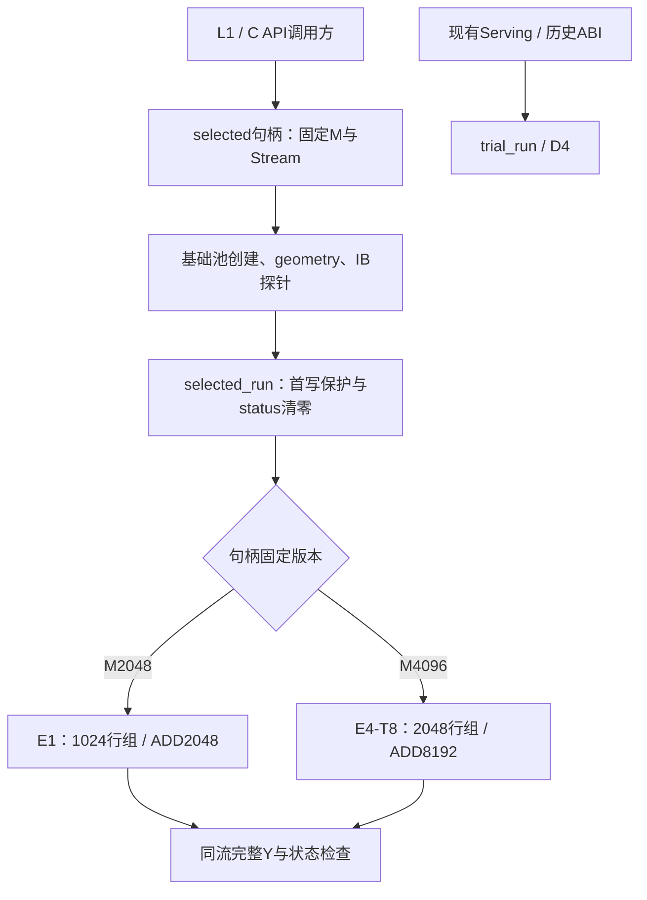
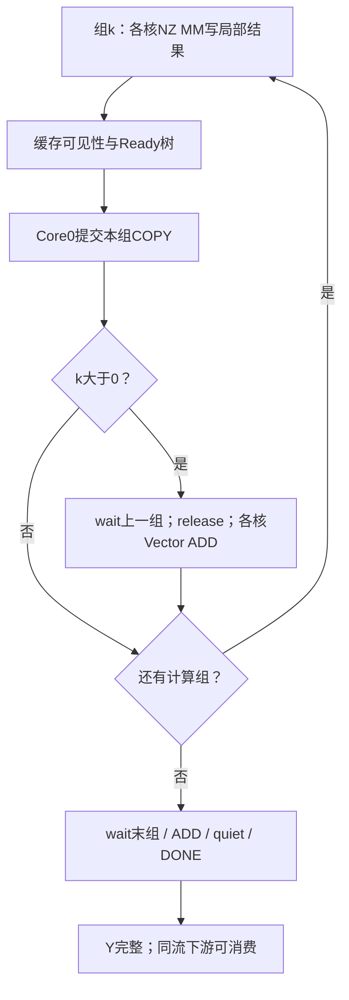

# V2 代码梳理与正式选型入口

2026-10-30；范围为310P3单卡双Die、TP=2、K=N=2048、FP16。
按现有成功记录的性能选择M2048/E1（V2-7）与M4096/E4-T8（V2-15）。
本轮将所选实现收敛成独立公共C入口；V1查历史延期到下次实机，不阻断V2代码交付。

## 源码职责与构建关系

| 分组 | 文件 | 职责 |
|---|---|---|
| 所选正式入口 | [selected_api.h](../src/op_host/mf310p_v2_selected_api.h) | ABI1、固定M计划、创建/探针/入队/状态/销毁；调用方无实验kind参数 |
| 所选Host | [selected_adapter.cpp](../src/op_host/mf310p_v2_selected_adapter.cpp) | 每句柄固定一个M/符号/Stream，复用基础池，保留首写防护与失败状态 |
| E1设备实现 | [dcci_entire_candidate.asc](../src/op_kernel/mf310p_v2_dcci_entire_candidate.asc) | V2-7，1024行组、Ready树、整核缓存维护、SDMA COPY、本地Vector ADD |
| T8设备实现 | [e4_layered_candidates.asc](../src/op_kernel/mf310p_v2_e4_layered_candidates.asc) | V2-15，2048行组，2×1024 NZ MM、2×4MiB COPY、AddTile8192 |
| 共享设备定义 | [kernel_common.h](../src/op_kernel/mf310p_v2_kernel_common.h) | NZ静态tiling、IB/Tag、release/Add完成等共同合同 |
| 正式选型构建 | [selected.cmake](../src/selected.cmake) | 生成独立libmf310p_v2_selected_device.so；Host编入现有扩展，不再加载test/perf私有Host |
| 基础池与探针 | [trial_adapter.cpp](../src/op_host/mf310p_v2_trial_adapter.cpp)、[trial_internal.h](../src/op_host/mf310p_v2_trial_internal.h) | 现有create/geometry/IB/status/destroy；结构布局未改变 |
| 旧正式D4 | [kernel.asc](../src/op_kernel/mf310p_v2_kernel.asc)、[serve.cpp](../src/torch_adapter/mf310p_v2_serve.cpp) | 旧构建及现有Serving调用链保留为历史/兼容对照；不等于本轮最快选择 |
| 历史候选 | B2、E2、E3、MM shadow、G1C等op_kernel文件与test/perf | 原文保留；不加入selected设备库 |
| 统一测量 | [L1_test](../../tools/L1_test/README.md) | api=v2_selected_v1调用公共入口；仍使用V2-7/V2-15编号、完整计时与统一采集 |

为了保持旧性能的源码身份，E1/E4文件未搬动、改名或重写。E4文件仍含T2/T4/P模板，
新Host只允许T8 mode=2；不把“编译单元保留模板”误写为“公共接口允许所有实验配置”。
原来的test/perf/e4_private_host.cpp和脚本继续用于历史复现。

新公共入口未接入旧Serving的自动选层/补齐/Graph路径。它按形状创建独立固定句柄，
不在一个句柄上切换E1/T8，也没有从端点推导2049～4095的最优阈值。

## 实际计算、搬运与等待

| 项目 | E1 / M2048 | T8 / M4096 |
|---|---|---|
| 计算核 | 8核，每核负责本组连续行 | 8核，每核负责本组连续行 |
| NZ MM基本tile | M128×N256×K64，CONFIG_NORM | 同左，设备源未修改 |
| 每核单次MM形状 | 128×2048×2048 | 同左 |
| 每核MM调用总数 | 2 | 4，每2048行组内2次 |
| Ready/通信组 | 1024行，2组 | 2048行，2组 |
| 每组数据消息 | 1×4MiB COPY | 2×4MiB COPY，连续分段 |
| ADD方式 | 本地Vector，2048 FP16元素/tile | 本地Vector，8192 FP16元素/tile；等待组内两包 |
| 收尾 | 最后一组wait/ADD、核间Add完成、quiet、双Rank DONE | 同左 |

W使用NZ29，X与Y为ND。T8的通信组扩大到2048行，但MM仍按1024的既有tiling做两次子调用。
T8不是SDMA inlineReduce，收件wait仍是阻塞调用。Core0同时计算和提交通信，其他核在release事件等待；
它不是V3 A3-2那种独立通信核，也不是计算完全无阻塞的流水。

通信可在下一组MM期间执行；一旦进入wait/ADD，核仍会受到相应依赖约束。
组内计算、SDMA和等待的真实独占耗时仍UNKNOWN，不能拿两种完整算子耗时相减当内部阶段时间。

## 本轮处理的Host问题

旧私有Host使用thread_local哈希表，按裸上下文地址和kind组合索引预热状态；没有随基础池销毁清除。
同地址销毁重建可能命中旧预热记录。新入口把预热、固定Stream、输出地址集合和失败状态直接放入句柄，
销毁时一并释放；基础trial结构不改，历史私有Host原件保留。

新入口保留每符号两次enable=0、首次真实/新输出的设备同步、64B status清零、设备协议和最终排空。
热态已预热输出不新增同步；没有新增每次调用的Host集合通信。backend错误或协议失败将句柄标为poisoned，
后续run拒绝；destroy必须先确认Stream完成，无法确认时保留资源，不回收可能仍在写的数据。

## 状态与证据

设备E1/E4/common及D4/基础Host布局保持原SHA。公共Host、构建组合和L1适配是新代码，
CPU验证不等于新二进制在NPU通过；**CANN/NPU为NOT_RUN**。
历史性能原件、Screen标签及T8/T4近乎持平说明见[选型与源码包](../../releases/v1-v2-20261030/README.md)。
本轮无新设备测量，生产Stock默认和旧Serving路由不变。
