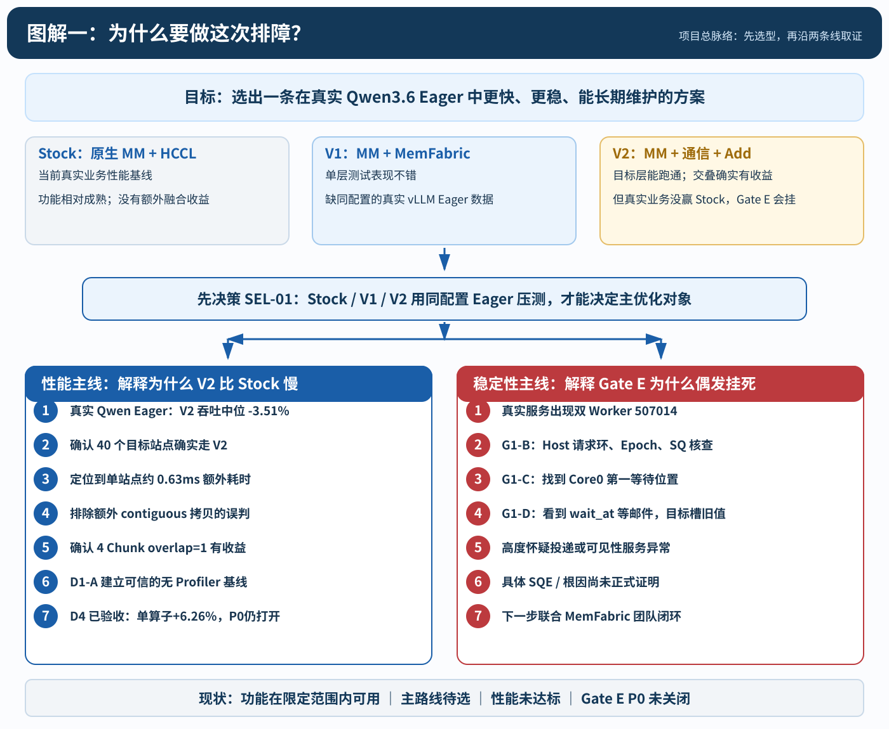
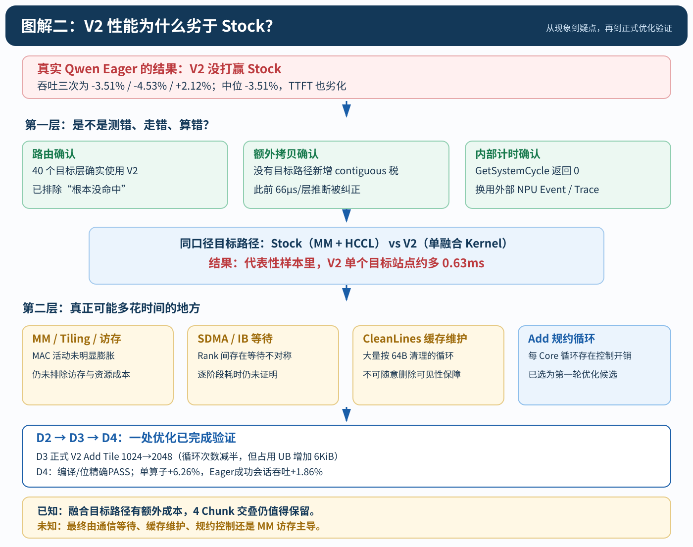
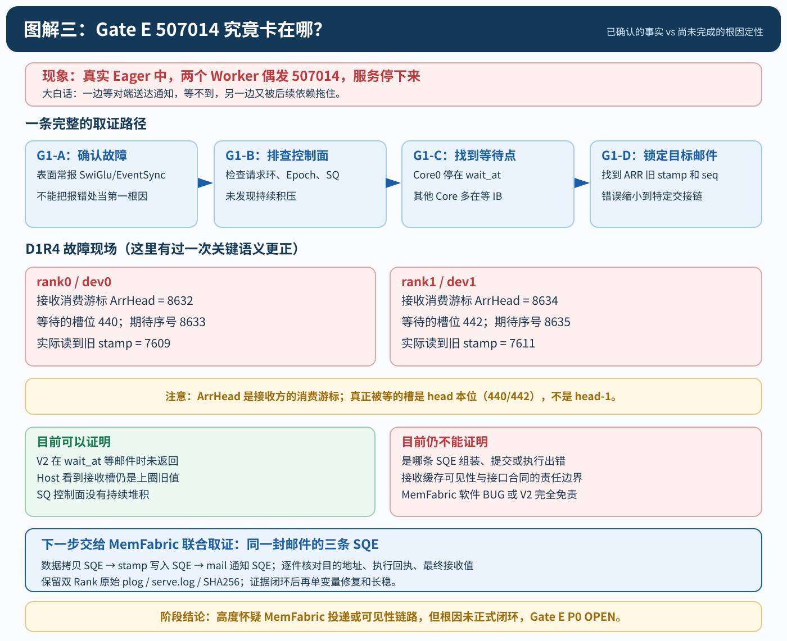
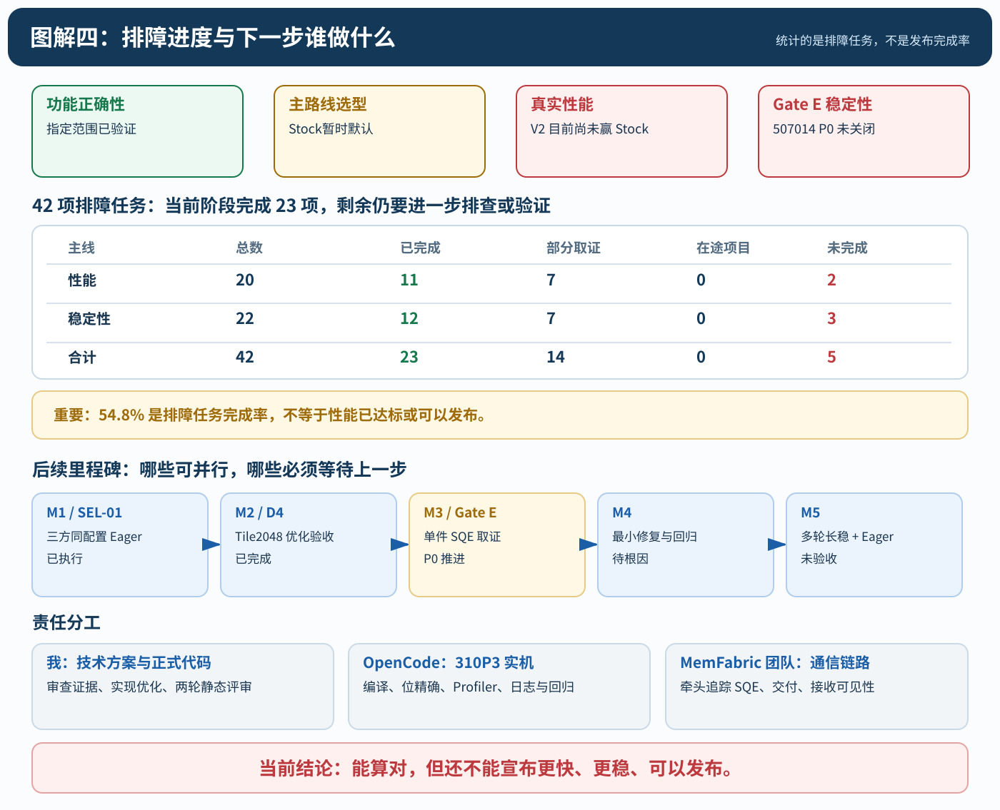

# 310P3 融合算子：V1/V2 性能与稳定性专项排障总账（持续跟踪）

> **汇报版入口**：[《V1/V2 性能与稳定性专项排障总账｜项目汇报与跟踪版》](V1_V2_性能与稳定性专项排障总账_项目汇报跟踪版_20261023.md)；本文件保留 42 项逐条技术排查和原始证据引用。

> **版本**：2026-10-24 v1.2（D4 完成，图解同步） · **文档定位**：项目唯一排障清单（大白话） · **证据截止**：GitHub 已提交 D4 最终实机报告（`33e3f2cfc81e`）：单算子 +6.26%，Eager 成功会话吞吐 +1.86%；但 Gate E P0 仍复发，未获生产放行。本文件位于 docs 独立分支，不代表已合入正式 V2。  
> **适用场景**：310P3 / CANN 9.1 / Qwen3.6-35B-A3B-w8a8 / TP=2 / vLLM **Eager**。正式 V2 目标是 40 个层（10 个 Full Attention o_proj + 30 个 GDN out_proj），可用 M=2048～4096，其他 M 应回退 Stock。  
> **排障总账最新进度**：性能 20 项（11 已完成、6 部分、0 在途、3 未完成）；稳定性 22 项（12 已完成、7 部分、3 未完成）。**42 项中完成指定排查23项，约54.8%**，但核心产品关口——**三方选型、Eager提速、Gate E根因修复与长稳**——均尚未验收通过。
> **大白话说明**：**Stock**=原生矩阵乘加 HCCL AllReduce；**V1**=先算矩阵，再用 MemFabric 收发/规约的早期两核方案；**V2**=把矩阵计算、跨卡搬运和加法放到一个 Kernel 里。**Rank**=两张卡里其中一张；**Chunk**=把4096行分成四份各1024行；**邮件**=跨卡搬完之后告诉对方“这份数据到了”的完成标记。

## 图解一：从 V1/V2 选型到性能与稳定性两条主线

**这张图怎么读：** 最上面是我们想达成的目标；中间先比较 Stock、V1、V2，**还没选定谁是最终优化对象**；下面再分成两条线，一条解释“为什么 V2 没打赢 Stock”，另一条解释“为什么 Gate E 偶发卡死”。两条线可并行取证，但最终都要回到真实业务验收。

**这里最容易混淆的一点：** 历史的单层 V2 比 V1 快，不等于真实 vLLM Eager 里 V2 也更快。没有三方同配置数据，不能提前选赢家。

---

## 0. 一页看结论：为什么必须先选 V1 还是 V2？

我们的终极目标不是“把 V2 做得比 V1 漂亮”，而是选出**真实 vLLM Eager 更快、能长时间不挂、能稳定维护**的一条路径。如果 V1 在真实业务明显胜过 V2，就应该优先修 V1；如果 V2 更有潜力且安全，再优先 V2。两者都达不到门槛，保留 Stock，不硬上融合。

| 比较对象 | 10/17 单层 M4096（每次同步，越小越快） | 10/19 真实 Qwen Eager vLLM 50条、输入4096、输出2048、并发10 | 能得出的结论 |
|---|---:|---|---|
| **Stock** | 3.156ms | 三组 Stock 作为基准 | 它是最后的业务标准 |
| **V1** | 2.808ms | **没有可核验的同场模型数据** | 目前不能说 V1 比 V2 慢 |
| **V2 overlap** | 2.738ms | 吞吐变化 -3.51% / -4.53% / +2.12%；TTFT 中位每组都更慢 | 已证明 V2 在这套真实业务上**没有打赢 Stock** |

**最重要的区别**：单层数据包含同步，真实 vLLM 会不断交错执行算子，两者的 Stock 基线不同，绝不能跨表比大小。V2 仅比 V1 快 0.07ms 的单层差异，不足以决定真实模型优胜者。**先把三方同配置 Eager 压测完成，才能选主要优化对象**。

## 1. 第零关：Stock / V1 / V2 三方 Eager 公平选型（最高优先级）

**实验编号：SEL-01，状态：待实机，不得预填赢家。**

用同一台服务器、同一对 310P3 die、同一模型文件和输入集合做 **三组独立运行**。除了执行路径是 Stock、V1、V2，其余尽量锁死：

1. **先确认可比性**：三臂都是 TP=2 / Eager，CANN 9.1、torch/torch_npu/vllm-ascend、Qwen 模型及参数完全一致；MemFabric 两臂必须用**同一套真实 KVER11 Host SO + 设备侧编排器 + JSON**，不能从历史分支各自重编版本。明确输出形状 M、模型路由范围、chunk、暖机、独立进程和退出清理。Stock arm 完全关闭 MemFabric 路由。
2. **路由验证先于计时**：Stock 看到原生 MM+HCCL；V1 能在这 40 个预期层真调用 V1（其适用形状和尾块逻辑如有缺口，先记录“不可比/阻塞”，不能悄悄回退 Stock）；V2 真调用 V2。记录每层调用次数、双 Rank 数值检查及实际 SO SHA；Graph 关闭。
3. **同一道题的性能对比**：固定 50 条相同请求、input=4096 / output=2048 / concurrency=10，解码及调度参数完全相同，先暖机再计时；至少做两轮以上交叉顺序（例如 Stock→V1→V2→V2→V1→Stock），每次新进程、场次之间按既定设备冷却/映射排空纪律。对比吞吐 tok/s、TTFT p50/p90/p99、TPOT/ITL p50/p90/p99、失败率、真实 V1/V2 命中层数、设备异常。
4. **另做稳定性资格门**：优先选中的方案需要在 input4096 / output256 / concurrency10、25条×多轮的持续 Prefill/Decode 工况下过 Gate E。V1 过去也有过同步/epoch 问题，不能因为现在主要查 V2 就默认 V1 稳定。
5. **必须保存原始逐请求结果**，而非只报一个平均值。设备被别的租户占用、二进制漂移或任意 Rank 挂死时终止当前对照并留证，不得为了“跑齐三组”绕过门禁。

**选型规则（同时看快、准、稳）**：

- 如果 V1 在真实 Eager **连续两组以上明显赢 Stock，而且稳定性门有希望关闭**，V2 仍输：**优先 V1**，V2 的已完成诊断保留为技术储备；V1 也须解决自身独立安全门。
- 如果 V2 明显优于 Stock 且优于 V1，位精确与稳定性过门：**优先 V2**，继续正式 Kernel 优化与验证。
- 如果两者都差于 Stock、或都不稳定：**暂用 Stock**；优先修已取证的故障并选择收益潜力最大的路径。不要为了保留“融合”标签而牺牲业务性能。
- 如果 V1 未真正命中目标层、或版本/输出语义不等价：结论必须是 **“三方选型未完成”**，不能拿三方表替代公平对比。

**和眼前 D4 的关系**：D4 是 V2 的一个小范围 Add 优化 A/B，**可以与 SEL-01 方案准备并行**，但不能代替 SEL-01。如果三方测试发现 V1 更值得优化，要允许改变主线决策，既有 D3 代码并非必须合入。

## 2. 两条并行工作的脉络（以后不再见一个现象就改一次代码）

### 2.1 性能线：从“真实业务变慢”到“能复现的优化”

**模型真的慢** → G3 Eager A/B 找到负收益 → 40 个目标层实际替换确认 → 真实 Prefill Trace 证明 V2 单目标站点多约0.63ms → 排除错误的 contiguous 拷贝归因 → Gate B 证明设备内计时不可靠 → Gate C/LOOP4 测出四Chunk交叠有用、等待活动偏高 → D1-A 排除稳定Profiler税、建立可信基线 → D2/D3 Add Tile2048 改正式代码 → **D4 已完成：单算子 +6.26%，真实 Eager 成功会话吞吐 +1.86%；两臂均出现 Gate E 类挂死** → 保留已证实收益，待审查 CleanLines/通信等下一候选 → 回到真实 Qwen/SEL-01 验收。

**这条线已经修正过自己的误判**：原先“V2多一笔每层66µs contiguous”被原始双臂 Trace 推翻。后续遇到类似假设，应保留纠错记录，不能继续照旧优化。

### 2.2 稳定性线：从“看到507014”到“查单封邮件”

**Eager Gate E 挂死** → G1-A确认同类异常可复现、表面错误在SwiGlu不等于根因 → G1-B排查Host请求环/Epoch → G1-C观察8核阶段并看到Core0停在通信等待 → G1-D在真实故障D1R4抓住两个Rank的ARR消费游标、旧stamp和SQ状态 → 更正ArrHead不是发送计数而是接收方消费位置 → **目前最大缺口：那一封邮件的3条SQE究竟有没有正确组装、提交、执行并对接收方可见** → 根因单变量修复 → 关闭诊断做多轮Gate E长稳 → 验收。

**大白话**：不是“整个快递站不营业”，而是“快递站说这批单据处理完了，收件人却一直看不到下一件的完成单”。我们还需要查这件包裹的具体运单、派送指令和签收记录。

## 图解二：V2 性能劣化是怎样一步步缩小范围的

**这张图怎么读：** 先确认问题真的存在，随后排除“根本没执行 V2”“额外做了一笔 contiguous 拷贝”等错误怀疑，再把候选缩小到 MM/Tiling、MemFabric 数据交付、缓存维护和 Add 规约。**当前不是四个问题都已定因**：Add Tile2048 已完成 D4 单变量实机，单算子改善 6.26%，真实 Eager 成功会话吞吐改善约 1.86%；不能据此宣称已打赢 Stock。

对应下面的 **P04～P18** 排查项；图中的 0.63ms 是代表性目标站点差额，不是已经测出某个子模块的耗时。

---

## 3. 性能问题排查进度表

> **读表方法**：“问题归属”是**谁牵头查**，不是已经证明谁写错了。结论中的“可排除”必须写清楚排除的是哪个具体假设；“已发现问题”不表示问题已修。历史数字只可在同口径里比较。

| 潜在劣化点 | 子项 | 详情描述 | 问题归属（V1、V2、memfabric） | 进展 | 结论（是否可以排除这个怀疑项了？） |
|---|---|---|---|---|---|
| P00 三方选型 | 真实模型三方压测 | Stock、V1、V2 在完全相同的 Qwen Eager 配置下比速度，同时比正确性和稳定性；决定继续优化谁。 | V1 / V2 / memfabric（共同验证） | 待测（最高优先级） | **不能排除 V1，也不能认定 V2 最优**；缺少真实 vLLM 三方同场数据。 |
| P01 实际模型变慢 | Stock vs V2 | G3 Eager 50 条、输入4096/输出2048/并发10：吞吐三组 -3.51%、-4.53%、+2.12%；TTFT 三组均慢约2.1～2.5%。 | V2 | 已完成对照 | **确认 V2 性能问题存在，不能排除**；尚不代表 V1 的实际表现。 |
| P02 V1 模型适配 | 40层真的走V1吗 | 要核实 10个 o_proj +30个 out_proj 使用 V1 两Kernel 路由，输入格式、尾行、输出槽和 Stock 回退正确；不能把 V1 未命中算子当 V1 性能。 | V1 | 待测 | **不能排除**：没看到与 G3 完全同配置的 V1 Serving Eager 证据。 |
| P03 单算子历史对比 | 同步造成的表象 | 10/17 M4096 的单层逐次同步测试：Stock 3.156ms、V1 2.808ms、V2 overlap 2.738ms；三方同口径但不是异步 vLLM。 | V1 / V2 | 已查明 | **可排除“单层 V2 总是比 V1 慢”的简单说法**；不能拿它代替 P00。 |
| P04 路由是否真的生效 | V2 的40站点 | 真实 Prefill Trace 中，每个 Forward 的40个目标 MM+HCCL 被40个 V2TrialKernel 取代，双 Rank 首调位精确。 | V2 | 已验证 | **可排除“Eager 实际全走 Stock”**；Graph 不适用此结论。 |
| P05 输入多拷贝 | x.contiguous | 原先怀疑每站多66µs，复核原始 Trace 发现两臂均有 conv/Mamba 的 contiguous；目标站点前没有额外同流拷贝。 | V2 | 已排查并纠错 | **可以排除本次目标站点净新增 contiguous 拷贝**，不要再按40层×66µs计算。 |
| P06 D2D拷贝 | HCCL内部搬运 | Stock D2D 次数多于 V2，主要随 HCCL 集合变化；没有证据支持 V2 每层新加一笔 D2D 搬运税。 | V2 | 已排查 | **可排除“V2 独有 D2D 是主要劣化点”**；不代表整模型无其他拷贝。 |
| P07 微基准为何误导 | 同步/队列竞争 | 原来每次同步、连续密集AR使Stock看起来更慢；真实 Eager 的Stock算子可以异步排队且AR不那么密集。 | V1 / V2 | 已解释 | **可排除“微基准快就一定模型快”这一判断方式**。 |
| P08 融合Kernel整体慢 | 0.63ms/站 | 真实模型同形状 Stock MM约795µs+HCCL AR约1149µs；V2 Kernel约2574µs，每站多约630µs（p50参考）。 | V2 / memfabric | 已定位到内核 | **问题仍在**；下一步要查通信等待、缓存维护、Add控制各占多少。 |
| P09 MM本身 | 计算能力/Tiling | V2四Chunk MAC活动合计约459µs，与4次单Chunk计算活动吻合；MAC没明显增大，但MM访存/工作区仍可能优化。 | V2 | 部分排查 | **仅能下调计算量异常嫌疑**，不能排除MM Tiling/访存成本。 |
| P10 MemFabric数据交付 | SDMA/邮件等待 | MTE2/Scalar活动偏高，单Chunk对比有Rank不对称；没有可靠的发送SQE→落地分段时间。 | memfabric / V2 | 部分排查 | **不能排除**，也不能断言Rank1 SDMA“慢1.5ms”就是根因。 |
| P11 CleanLines缓存维护 | 64B逐行刷新 | 每Core、M4096 大约65536次CacheLine级操作；它可能费时，但随便删除会造成跨引擎读到旧数据。 | V2 / memfabric | 源码已审；性能待测 | **不能排除**；只能尝试证明等价的缓存维护替代方案。 |
| P12 Add规约 | Tile1024 / Tile2048 | D3 每 Core 规约循环由 1024 降到 512，新增 6KiB UB；D4 已核验 MatMul Workspace 裕量 118752B。 | V2 | **D4 完成；单算子 GO** | **已证实 TP2 配对 Event p50：2726.9→2556.3µs（改善6.26%）**；不代表整模型已赢 Stock。 |
| P13 四Chunk流水 | overlap=1 | 正式4Chunk与LOOP4串行对照；D1-A 无Profiler Event优势约0.39～0.59ms。 | V2 | 已验证 | **可排除“目前交叠完全无效”**；继续保留4Chunk/overlap1作为现行基线。 |
| P14 设备内部计时 | GetSystemCycle | 310P3上该函数虽然能编译，但8核×多次读值始终为0，不能分段计时。 | V2 / memfabric | 已验证不可用 | **可排除这条计时方法**；只能做整Kernel对照或PMU活动画像。 |
| P15 Profiler扰动 | ON/OFF/AIC | D1-A 做了12个交叉会话；干净场景三种模式p50接近，差异通常≤3.3%。 | V2 / memfabric（实验环境） | 已完成基线 | **可排除稳态Profiler一定拖慢的假设**；不能排除极低频采集交互。 |
| P16 极端长尾 | 74ms与23～45ms | 真实Prefill曾出现一次74ms；Gate C多次出现23～45ms双Rank停顿；D1-A零复现。 | V2 / memfabric / 环境 | 部分排查 | **不能排除**，不等于Gate E 507014是同一根因。 |
| P17 Host等待 | Python/Host/新同步 | Gate A对同流算子和Host时间重新核对；大部分Host挂起受设备提交节奏影响，没有独立确定的每层额外Host税。 | V2 | 部分排查 | **不把Host视为当前第一主嫌疑**，但最终模型回归仍须看提交/同步。 |
| P18 正式优化验收 | D4 Tile2048 A/B | 8 会话×30 次 ABBA；在 dev6/7 跑真实 Qwen TP2 Eager（20 请求、输入4096/输出512、并发10），成功会话 base2/cand3。 | V2 | **D4 全部执行完成** | **单算子6.26% GO；成功 Eager 会话 TPOT -1.98%、吞吐 +1.86%、TTFT 基本不变**；但两臂各挂死一次，稳定性 NO-GO。 |
| P19 最终Eager收益 | TTFT/TPOT/吞吐 | 不论最终选V1或V2，都必须在多次真实Eager对比中稳定优于Stock、没有额外失败。 | V1 / V2 | 未达标 | **不能宣布性能问题解决**；最终只认真实vLLM同场收益。 |

### 3.1 已经能放心写进优化方案的事实

- **真实 V2劣于Stock**：G3 Eager吞吐中位 -3.51%，TTFT持续劣化；不因为单算子微基准胜出而改变结论。
- **主要瓶颈确实在目标融合路径内部**：真实Prefill同形状Stock MM~795µs + AR~1149µs≈1944µs，V2核~2574µs，单站多~630µs；它们是Profiler设备时间的近似代表值，不是完整模型TTFT分解。
- **MM计算量不是最明显的异常**：四Chunk MAC活动总量约459µs，MTE2/Scalar明显更大。但MTE2和Scalar是活动画像，不能相加当真实时长，更不能说“SDMA占了1.7ms”。
- **保留现有四Chunk交叠**：D1-A裸路径Event数据表明相较LOOP4串行，正式V2每次减少约0.39～0.59ms；该差值也包含调度形态差异，不能称纯SDMA隐藏时间。
- **D4 优化已获得局部正收益**：Add Tile2048 单算子 TP2 配对 Event p50 改善 170.6µs（6.26%）；真实模型成功会话 TPOT -1.98%、吞吐 +1.86%；样本很少、TTFT无显著变化，且 Gate E 类挂死复发。
- **异常长尾另立台账**：74ms和23～45ms事件的触发机制未知，D1-A短窗口没有复现并不等于彻底排除。

### 3.2 目前优化优先级与验证计划

| 顺序 | 优化或验证任务 | 谁负责 | 通过门槛 / 失败动作 |
|---|---|---|---|
| **0 / SEL-01** | 三方同配置Eager、决定V1还是V2 | OpenCode实机；我复核/选型 | 三臂均真实命中、环境同一、性能/正确性可比；否则“未选型” |
| **1 / D4 已完成** | Tile2048编译/UB/正确性/ABBA/Eager执行完成，单算子+6.26%，成功会话吞吐+1.86% | OpenCode已完成；我已复核 | 性能局部GO，Gate E P0仍NO-GO；保留候选但不合入正式分支 |
| **2 / P11** | CleanLines 缓存维护安全优化 | 我先设计与编码；OpenCode验证 | 必须先证明跨引擎可见性不受损，不得直接删除DCCI |
| **3 / P10/P13** | SDMA/轮询/RANK不对称专项 | 我和MemFabric团队共同设计证据；OpenCode实机 | 仅针对证实的慢环节单变量A/B，不能提前动signal/DONE |
| **4 / 真实模型** | 用最终入选版本重新三方或Stock对照 | OpenCode跑；我验收 | TTFT、吞吐、TPOT及尾部指标优于Stock，安全和稳定性都合格 |

**D4的基本测量规矩**：Stock/V1/V2选型用真实模型指标；单Kernel局部优化用D1-A的无Profiler NPU Event为主、Profiler Kernel为辅，两者不混。单次TP2请求的耗时要考虑两Rank配对时较慢的一边。≥6ms异常单独保留并说明原因，不可以删掉后声称“全程无异常”。

## 图解三：Gate E 从“507014 报错”追到了哪一封邮件

**这张图怎么读：** Worker 报错的位置不一定是设备第一次卡住的地方。G1-B 排控制面，G1-C 找到 Core0 停在 `wait_at`，G1-D 抓到接收槽的旧 stamp。**更正后的等待槽位是 440/442，不是早期报告误写的 439/441**。

现在能把问题交给 MemFabric 团队重点追查，但**还缺目标消息对应的三条 SQE 的逐项执行证据**，所以不能写成“已证明 MemFabric 某行代码有 BUG”，也不能宣布 V2 调用侧完全没有责任。对应下面的 **S07～S21**。

---

### 3.3 D4 最终结果回填（2026-10-24）

| 验收门 | 结果 | 结论 |
|---|---|---|
| 编译/UB | BiSheng四组合通过；修复一次 `TOTAL_UB_SIZE` 静态断言作用域问题；MatMul 工作区剩余裕量118752B | PASS |
| 正确性 | Trial 8/8形状双Rank位精确；Serving混合60调用（V2 36/Stock 24）位精确、status0 | PASS（指定范围） |
| 单算子A/B | 8会话×30采样，双Rank配对Event p50由2726.9降到2556.3µs，改善6.26% | **局部 GO** |
| 真实Qwen Eager | dev6/7，输入4096/输出512，20请求，并发10；成功会话base n=2/cand n=3；输出吞吐37.96→38.67 tok/s（+1.86%），TPOT -1.98%，TTFT基本不变 | **小样本正向，尚不能判定打赢Stock** |
| 稳定性 | 默认epoch预算，7次会话2次双Rank AICore超时（base1/cand1），故障会话20/20请求失败 | **P0 OPEN，生产NO-GO** |

**两个不能混淆的结论**：一是本次Eager使用dev6/7、输出512，与历史G3的dev0/1、输出2048和Stock压测不可直接比较；二是双die AICore活动100%约60秒是持续卡住的强证据，但**不能证明与G1-D D1R4已查到的ARR目标邮件属于相同根因**。原版与候选各有一次挂死，支持故障非Tile2048独有，样本不足以证明风险概率完全相同。

**运行环境额外收获**：迁移到dev6/7时发现MemFabric的`aclrtMemSetAccess`在受控可见设备下需要物理设备号，临时Host补丁在两臂均应用；测试结束已恢复原Host SO。补丁归属MemFabric侧，不能当作本次V2 Kernel正式合入代码。

证据：[D4最终报告](https://github.com/10wvw01/vllm-ascend/blob/perf/310p-v2-d3-add-tile2048-20261023/csrc/_310P/memfabric_mm_ar_v2/docs/V2_D4_ROUND1_ADD_TILE2048_ONDEVICE_REPORT_20261023.md) · [ABBA原始统计](https://github.com/10wvw01/vllm-ascend/blob/perf/310p-v2-d3-add-tile2048-20261023/csrc/_310P/memfabric_mm_ar_v2/evidence/d4_20261023/abba/d4_abba_analysis.json) · [Eager逐场数据](https://github.com/10wvw01/vllm-ascend/blob/perf/310p-v2-d3-add-tile2048-20261023/csrc/_310P/memfabric_mm_ar_v2/evidence/d4_20261023/d4_e2e_final_analysis.json)

## 4. 稳定性问题排查进度表（Gate E 为 P0 主线）

> 故障与性能的区别：性能慢可以先想办法测；**507014 会让两个Worker都停下，属于发布阻塞项**。表内“可排除”只限对应故障形态，不推广成整个模块永不出错。

| 潜在劣化点 | 子项 | 详情描述 | 问题归属（V1、V2、memfabric） | 进展 | 结论（是否可以排除这个怀疑项了？） |
|---|---|---|---|---|---|
| S01 基础协议 | 8核同步/收发/规约 | G0/G1/G2多尺寸、1000次等受控正确性通过，说明基本流程可以跑通。 | V1 / V2 / memfabric | 已验证指定范围 | **可排除基本API永远不可用**，不能排除长稳时序故障。 |
| S02 输出槽复用 | PyTorch引用计数 | 曾把空闲槽引用计数错当2，实际为1，修复后不会覆盖模型仍持有的输出。 | V2 | 已修复并回归 | **当前已知复用BUG可排除**，修改池实现后必须重测。 |
| S03 首次输出丢写 | MTE3新地址 | 首调/新地址会偶发旧数据；使用持久槽、首写守护、预热和位精确保护。 | V1 / V2 / memfabric | 工程缓解 | **未从底层根除**，不可删首次写保护。 |
| S04 冷池尾块坏数 | staged-tail与深度 | 首个M2049等尾块曾静默坏数，加入2048/3072/4096深度预热和首形状数值检查。 | V2 / memfabric | 工程缓解且回归通过 | **低频冷启动风险未根治**；改版必须重复冷启动。 |
| S05 KFC部署失败 | 507018中毒 | torch进程里KFC命令非零会毒化上下文，改进程外deploy helper后当前版本通过。 | memfabric | 已修复并验证 | **原自动部署中毒路径可排除**，前提是实际加载正确助手/SO。 |
| S06 诊断/正式代码混用 | ABI与构建 | 已分正式与诊断源码，Gate C确认ON/OFF导出符号正确；不许诊断库冒充正式库。 | V2 | 已回归 | **现有拆分问题已解决**；重建需要符号检查。 |
| S07 Gate E是否真会挂 | 双Worker 507014 | G3、F01、B02、G1-C C2R2、G1-D D1R4及后续取证批次出现过可复现超时。 | V2 / memfabric | 已证实故障 | **不能排除，P0仍打开**；少数会话成功不叫修复。 |
| S08 报错在SwiGlu | 表面算子与第一停点 | 错误常在aclnnSwiGlu/EventSync冒出，但设备阶段证据更早显示V2通信等待。 | V2 / memfabric | 已定位 | **可排除仅凭SwiGlu错误行就认定SwiGlu是根因**。 |
| S09 Host请求环是否卡住 | ReqSeq/积压 | 故障窗口的Host和AICPU记录显示请求环已消费，短暂pending没有长期积压。 | memfabric | 已观察故障窗口 | **可下调Host队列满/不消费作为第一停点的嫌疑**；单封请求映射仍需查。 |
| S10 Epoch是否不工作 | 15s生命周期 | G1-B/C/D看到Epoch正常轮转、结束码0，故障时编排侧可空闲。 | memfabric | 已观察故障窗口 | **基本排除常驻Epoch整体停摆为本次第一停止点**；不代表每条SQE正确。 |
| S11 SQ是否填满 | hwHead/hwTail | 故障时SQ读数相等且HAL错误码0；但队列空不等于写入必然到对端。 | memfabric | 已排查控制面 | **可排除可见的长期SQ堆积**；不能排除某条SQE组错、漏投或执行可见性。 |
| S12 V2到底卡哪 | Core0阶段50 | D1R4双侧Core0停在smem_shm_sdma_wait_at，未到wait返回/邮件校验；其余Core下游等IB。 | V2 / memfabric | 已定位第一等待点 | **可排除“wait已经返回只是校验失败”**；不等于证明wait原语无BUG。 |
| S13 等什么邮件 | ARR消费游标 | 更正ArrHead为接收方消费游标：dev0头8632→槽440期待8633、旧7609；dev1头8634→槽442期待8635、旧7611。 | memfabric / V2 | 已纠正并取证 | **确认两个读视角下槽内容偏旧**；未证明哪条写命令出错。 |
| S14 1024环绕 | 是否只有边界才出错 | 多轮健康回绕、D1R4坏槽440/442在环中段，因此不是只能在seq1023坏。 | memfabric | 已反证仅边界假设 | **可排除“只在回绕边界失败”**；不能排除跨圈复用时序风险。 |
| S15 一起丢还是两起 | 单向原发/级联 | 结合代码“先signal当前块、再等前块”，推断rank1→rank0先发生异常，另一侧可能因rank0后续未signal而连带挂住。 | V2 / memfabric | 因果解释较强，仍待逐单证据 | **不能把双侧旧槽直接算作两次独立MemFabric丢包**。 |
| S16 真实SQE是否执行 | 每封邮件三命令 | 需要按故障seq关联数据拷贝、stamp写、mail写各自SQE地址/长度/内容/提交与硬件完成，判断错投、漏投还是写未落地。 | memfabric（牵头） | 待取证，P0关键项 | **不可排除，尚未完成根因定位**。 |
| S17 缓存可见性 | Host与AICore读旧值 | D1R4 Host D2H看到旧stamp且AICore一直等；强烈支持目标值未正常可见，但仍需同窗口可信一致性/写回/CP完成证据。 | memfabric / V2 | 部分取证 | **不能宣布缓存域或接收轮询100%无责**。 |
| S18 最小复现 | 脱离完整模型 | Gate E真负载可复现；受控异步window1/2/4与1024边界压力多次通过，尚无脱离vLLM仍能稳定复现同一故障的最小程序。 | V2 / memfabric | 部分完成 | **仍需MemFabric团队参与缩小触发条件**，不允许靠错误注入冒充原故障。 |
| S19 MemFabric责任划分 | 是代码BUG还是硬件边界 | 请求已消费、等待旧邮件，问题高度集中在MemFabric提供的投递/可见性服务；但未逐SQE证实，且V2的并发使用是否满足接口约束仍需双方复核。 | memfabric（牵头），V2（协查） | 有强证据，未终判 | **不能直接写“已定性MemFabric软件BUG/V2完全免责”**。 |
| S20 最小修复 | 单变量A/B | 等S16/S17锁定异常环节，才修改SQE配方、缓存时序或V2调用；一次只动一个变量。 | memfabric / V2 | 待根因后启动 | **P0未修复**；不允许先删IB/DCCI或提前signal赌运气。 |
| S21 长稳关闭 | Gate E重复验证 | 修复后按输入4096、输出256、并发10连续Prefill/Decode，双Rank多轮验证无507014/静默坏数，Stock同场对照。 | V2 / memfabric | 未通过 | **P0 OPEN**，短跑或一次正常不能算修复。 |
| S22 实机环境串味 | G1-D与Gate C部署残留 | 曾发现取证Host SO残留及设备侧v11丢失；已恢复但必须独占/锁hash/保留回滚包。 | V1 / V2 / memfabric（部署） | 已纠正现场，制度待固化 | **不能排除后续混用风险**；任何实验先核实实际加载文件。 |

### D4-4 新增稳定性事实（尚未完成根因裁决）

- dev6/7 上原版与Tile2048分别出现一次双Rank AICore超时，AICore活动双双100%持续约60秒至看门狗，错误码`retCode=0x25`。
- dev4/5对照2/2正常、epoch预算5秒对照4/4正常，但样本太少，不能彻底排除卡、epoch换纪、负载相位时序等原因。
- 尚未采集到这两例的逐封邮件ARR槽位与3条SQE执行完成证据，**不能把它们直接当作G1-D的精确同根因证据**。继续按 S16/S17/S19 追查。

## 5. Gate E 究竟是不是 MemFabric 的问题？给团队怎么交接？

### 5.1 当前定性：**交给 MemFabric 主牵头，但还不是“MemFabric软件BUG已经实锤”**

已确认的事实是：V2 的 Core0 在 `smem_shm_sdma_wait_at` 等下一封完成邮件；当时 Host 从接收端保留区读取到了**上圈旧 stamp**；MemFabric 控制面却显示请求环已被消费，SQ空、Epoch健康。这是非常具体的**MemFabric投递/内存可见性接口异常**，理应请MemFabric团队优先调查。

但我们还没有抓到**与坏邮件一一对应的那3条SQE的硬件完成记录**，所以不能直接确定是 MemFabric Host代码、AICPU组装、CP/SDMA执行、缓存写回，还是V2和MemFabric之间的并发/内存可见性约束没有被正确满足。双方必须用同一份证据裁决，不能先相互“甩锅”。

### 5.2 D1R4 故障现场的关键数字（原始证据与更正后语义）

| 读到的值 | dev0 / rank0 | dev1 / rank1 |
|---|---:|---:|
| V2代际 | 1730 | 1730 |
| Core0 位置 | chunk0，阶段50，`wait_at` 未返回 | chunk2，阶段50，`wait_at` 未返回 |
| Core1～7 | 阶段60，等待IB放行 | 阶段60，等待IB放行 |
| ArrHead **接收消费游标** | **8632** | **8634** |
| 真正被等的槽 = ArrHead % 1024 | **440** | **442** |
| 应出现的邮件序号 = ArrHead+1 | **8633** | **8635** |
| Host 读到该槽旧stamp | **7609** | **7611** |
| AICPU 请求消费 / SQ状态 | reqSeq8634，SQ head=tail=302 | reqSeq8636，SQ head=tail=308 |
| Worker表面失败 | 507014，08:34:49.395Z | 507014，08:34:58.078Z |

**这组数字为什么关键**：目标槽里的旧单号恰好比期待单号少1024，说明“旧的一圈还在，新的还没被接收方正确看见”。它把问题缩到了单件完成标记，而不是所有Chunk同时坏掉。

**必须纠正旧版 G1-D 报告**：早期把 ArrHead 误认为发货计数，从而把等待槽说成439/441（head-1）。核对MemFabric `wait_at` 源码后，ArrHead实际是消费游标，真正等待的是**440/442（head本位）**。给团队必须同时附上更正文档，明确哪一版说法有效。

根据正式核先signal当前块、再wait前块的顺序，一个较强候选是 **rank1→rank0 的chunk0先没有完成，rank0无法推进发送后续chunk，随后rank1被连带卡住**。但目前只有等待点、消费槽旧值和控制面排空证据；仍需逐件映射请求/SQE才能定为已证明的因果链。

### 5.3 给 MemFabric 团队的“拿到就能查”资料包

| 必须提供 | 具体内容 | 帮助团队回答什么 |
|---|---|---|
| **1. 一页故障概述** | Qwen3.6 TP2 Eager，输入4096、输出256、并发10，25条/轮；现象为两Worker 507014，Core0阶段50等待；D1R4 的 gen1730、seq/槽位/旧stamp数字 | 首先让对方知道问题是什么、发生在哪里 |
| **2. 精确复现命令与配置** | 固定模型路径（脱敏）、vllm启动参数、store URL配置（脱敏）、`gate_e_eager.sh` 或G1-D运行脚本；含请求集合/种子、warmup/初始化、停止与恢复步骤 | 避免团队按错版本/错误负载复现不出来 |
| **3. 两仓库Git提交 + 二进制清单** | vllm-ascend源码SHA、memfabric_hybrid源码SHA、**运行时**两路径Host SO SHA、V2插件/Device SO SHA、KVER JSON及设备侧实际在位版本、CANN/torch版本；注明D1R4**是诊断v12，不是生产v11** | 证明到底跑的是哪套代码，防止“看源码A、运行库B” |
| **4. 两Rank日志与时间线** | `serve.log`、设备plog/aicore错误、MemFabric Epoch/reqSeq/SQ快照、V2每Core阶段，时间格式与双Rank时钟偏移假设 | 把报错行和真正等待点对应起来 |
| **5. 故障前后邮件快照** | ARR head、槽440/442及前后邻槽的stamp/mail、预期序号、收到的tag/地址/长度、成功邻件；同时给Host D2H与AI Core的取证语义 | 判断是“投错柜子”“没投递”还是“看不见” |
| **6. 逐SQE证据（目前缺口）** | 对应请求的3条SQE：数据拷贝、stamp、mail，分别的源/目的地址、长度、立即数、入队序号、硬件Head/Tail、完成/错误和最终读回 | 真正把 P0 根因从“某段路”定位到“哪一步” |
| **7. 正负例与边界反证** | F01、B02、C2R2、D1R4故障；D1R1～R3 / D2R1～R6健康；1024边界健康且坏点在环中段；原始manifest/SHA | 防止对方只盯“1024回绕”或把一次PASS当修复 |
| **8. 双方接口合同与验收** | `signal_at`、`wait_at` 的调用顺序、Core0唯一signal、缓存维护、credit/quiet/DONE、内存地址生命周期与允许并发条件；修复后多轮Gate E | 判断哪个条件由V2保证，哪个必须由MemFabric保证 |

**建议交付形式**：`MemFabric_GateE_507014_取证交接包/`，内含 `README_复现步骤.md`、`环境与SHA256.json`、`D1R4_双Rank时间线.md`、`ARR与SQE单件证据.csv`、`日志清单_SHA256SUMS.txt`、`已证实_推断_未证实.md`。**当前只具备部分材料**：3条SQE逐件对照和硬件完成回执缺失，不能伪造补全。

**原始大日志的处理原则**：放服务器只读归档、SHA256清单入Git；分享给团队时复制与故障窗口相关的脱敏最小包，保留时间戳、Rank、seq、tag、地址映射关系（可统一脱敏，但不能破坏对应关系）。

### 5.4 协作分工和下一轮最小取证

1. **我（V2负责人）**：把 D1R4 的rank、代际、预期seq、Chunk、来源 Core0 signal 和接收槽一一对应；审查 signal/wait/地址生命周期是否满足MemFabric接口；提出双方认可的单件取证字段及停止条件。
2. **MemFabric团队（通信交付负责人）**：为目标请求增加低开销、可关闭的3 SQE组装/入队/执行完成证据，核对写stamp/mail的顺序、目的地址、缓存与可见性，不先改协议。
3. **OpenCode（310P3现场）**：在单独G1取证环境进行短窗→原Gate E工况复现，双Rank plog/manifest/原始trace保存；出现507014立刻停止，不能自动重启擦除现场。
4. **证据会合后**：分辨“SQE没组对/没送出”“硬件没完成或写错目标”“落地但接收看不见”“V2使用条件不满足”，再决定由谁修哪一行代码，之后关闭诊断做多轮真实长稳。

## 图解四：项目进度与下一步谁负责什么

**这张图怎么读：** 图中的 23/42（54.8%）表示**42 项排障任务中，23 项已有明确的调查结论**，不是“产品完成了一半”。真正阻止项目发布的仍是三方选型、真实 Eager 性能、Gate E P0 根因修复及长稳。

下一步不是再无限增加新编号，而是**SEL-01 做三方选型、保留已通过 D4 的 Tile2048 候选、MemFabric 联合查 SQE**，然后把新结果回填本总账对应行。

---

## 6. 进度怎么算？别把“找到故障”算“修好了故障”

进度统计只按这两张明细表对应的**独立排障事项**计算，不继承以前30项统计口径，避免分母变了却装作完成率直接可比。

| 排查清单 | 总项数 | 已完成指定排查/判断 | 有线索但未闭环 | 正在实机或已委托 | 尚未完成 | 指定任务完成率 |
|---|---:|---:|---:|---:|---:|---:|
| **性能** | **20** | **11** | **6** | **0** | **3** | **55%** |
| **稳定性** | **22** | **12** | **7** | **0** | **3** | **54.5%** |
| **合计** | **42** | **23** | **13** | **0** | **6** | **54.8%** |

这里的“已完成”指表中那个**具体排查任务**已有明确答案（有些答案是“确认有问题”或“排除误判”），**不是故障已修或产品已发布**。例如 S07 已复现挂死算“复现任务完成”，但 S16/S20/S21 的根因/修复/长稳仍没完成。与上一版30项总账分母和拆项不同，不能拿50%对比旧版60%判断工作倒退。

**两个最重要的发布阻塞**：

- 性能：最终选择 V1/V2 之前 **不能声称已经选对了主优化对象**；无论选谁，最终都要在真实Eager稳定赢Stock。
- 稳定性：**Gate E 507014 P0仍未关闭**，当前最多是“把故障收窄到具体邮件链路”，不是“MemFabric根因已修”。

额外集成问题：旧Graph构建把Stock分支固化，V2实际未执行。若Graph属于发布范围，必须另做真实Graph运行/性能验证；本总账优先 Eager，不拿Graph对照填充任何Eager表格。

## 7. 接下来按这张表执行，不再随手开新实验

| 阶段 | 做什么 | 负责人 | 完成后改哪一行 |
|---|---|---|---|
| **立刻：SEL-01** | 三方同场Eager；先确认V1能真实走40层再测，不符合就明确阻塞原因 | OpenCode实机；我定性 | P00/P02，给出路线选择 GO/NO-GO |
| **已完成：D4** | Tile2048 编译/UB/TP2/ABBA/Eager；单算子+6.26%，Eager成功会话吞吐+1.86%，两臂各挂死一次 | OpenCode执行完成；我复核 | P12/P18已归档；后续追查S16～S21，仍不允许生产合入 |
| **P0：G1下一取证** | 把rank1→rank0目标邮件关联请求+3SQE+目标ARR快照 | MemFabric团队牵头；我和OpenCode配合 | S15～S19，补齐致因链 |
| **取证裁决后** | 仅修已确认的单一机制，回归，记录二进制SHA | 属地团队编码；OpenCode验证 | S20 |
| **最后资格验收** | 选定方案的真实Eager吞吐/TTFT/TPOT、连续Gate E长稳、环境可恢复 | 三方协同 | P19/S21，仍需检查Graph独立门 |

**每轮更新模板**（填在本页表格对应ID，而不是另建一串断开的实验名）：

> `日期 / 项目ID / 实验配置及两仓库源码SHA / 真实加载二进制SHA / 观察到的原始数字 / 推断与反证 / 本轮是否可排除 / GO或NO-GO / 下一轮负责人 / 原始日志路径与SHA`

每项结论统一只有四种：**已排除（写清排除什么） / 已证实（写清什么现象） / 未决（缺哪份证据） / 修复并回归（写清回归范围）**。任何人都不能把“实验跑完”直接改成“问题解决”。

## 8. 证据导航：所有结论从哪里来的

1. [10/17 Stock/V1/V2单层三方](https://github.com/10wvw01/vllm-ascend/blob/feat/310p-memfabric-public-api/csrc/_310P/memfabric_mm_ar_v2/docs/20261017实机测验及修复.md)
2. [G3真实Qwen Eager模型A/B、Gate E](https://github.com/10wvw01/vllm-ascend/blob/feat/310p-memfabric-public-api/csrc/_310P/memfabric_mm_ar_v2/docs/V2_G3_QWEN_E2E_REPORT.md)
3. [G1-B Host请求环/Epoch/SQ](https://github.com/10wvw01/vllm-ascend/blob/diag/310p3-g1d-minimal-forensics-20261021/csrc/_310P/memfabric_mm_ar_v2/docs/G1_GATE_E_FORENSICS_G1B_ADDENDUM_20261020.md)
4. [G1-C设备第一停点](https://github.com/10wvw01/vllm-ascend/blob/diag/310p3-g1d-minimal-forensics-20261021/csrc/_310P/memfabric_mm_ar_v2/docs/G1C_DEVICE_FIRST_STOP_REPORT_20261020.md)
5. [G1-D D1R4原始取证汇总](https://github.com/10wvw01/vllm-ascend/blob/diag/310p3-g1d-minimal-forensics-20261021/csrc/_310P/memfabric_mm_ar_v2/docs/G1D_EXECUTION_REPORT_20261021.md)
6. [ArrHead语义修正与责任假设](https://github.com/10wvw01/vllm-ascend/blob/diag/310p-v2-gate-c-controlled-isolation-20261022/csrc/_310P/memfabric_mm_ar_v2/docs/G1D_HANG_ROOT_CAUSE_LOCALIZATION_20261021.md)
7. [G1-D故障脱敏节选](https://github.com/10wvw01/vllm-ascend/blob/diag/310p3-g1d-minimal-forensics-20261021/csrc/_310P/memfabric_mm_ar_v2/evidence/g1d_20261021/sanitized/D1R4_FAULT_WINDOW.log)
8. [性能Gate A/B：拷贝归因/时间戳](https://github.com/10wvw01/vllm-ascend/blob/diag/310p-v2-gate-c-controlled-isolation-20261022/csrc/_310P/memfabric_mm_ar_v2/docs/V2_MTE2_SCALAR_GATE_AB_VERIFICATION_REPORT_20261022.md)
9. [性能Gate C：4Chunk隔离](https://github.com/10wvw01/vllm-ascend/blob/diag/310p-v2-gate-c-controlled-isolation-20261022/csrc/_310P/memfabric_mm_ar_v2/docs/V2_MTE2_SCALAR_GATE_C_VERIFICATION_REPORT_20261022.md)
10. [D1-A三模式基线与异常隔离](https://github.com/10wvw01/vllm-ascend/blob/diag/310p-v2-gate-c-controlled-isolation-20261022/csrc/_310P/memfabric_mm_ar_v2/docs/V2_D1A_PROFILER_PERTURBASELINE_REPORT_20261022.md)
11. [D2/D3 Tile2048源码与D4计划](https://github.com/10wvw01/vllm-ascend/blob/perf/310p-v2-d3-add-tile2048-20261023/csrc/_310P/memfabric_mm_ar_v2/docs/V2_D2_D3_ROUND1_ADD_TILE2048_20261023.md)

> **插图维护办法**：本文四张 SVG 图保存在 `./images/`，以仓库内相对路径引用。后续如果排障状态变化，应**同步更新 SVG 里的文字、节点和本表统计**，并检查 GitHub 页面能显示；不允许只改一处造成图表与正文互相矛盾。四图是现有证据的解释性可视化，不替代原始 Trace 或诊断日志。

> **维护纪律**：本总账是 docs-only 跟踪文件，正式Kernel、诊断Kernel、MemFabric正式协议及Serving代码均未因编写总账修改。D4已完成，Gate E P0仍未关闭，正式仓库合入必须另行审查。后续每次得到实机报告优先回填本表对应ID、更新日期、保留原始证据，避免历史结论被覆盖。
