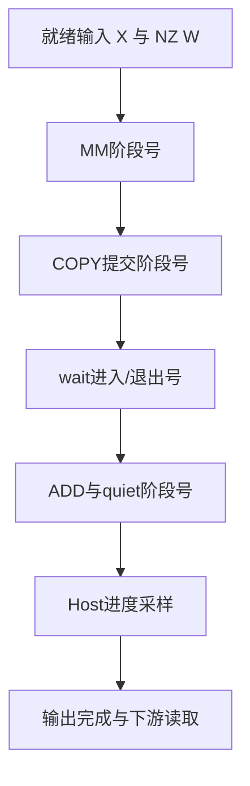

# V2-18｜G1C 阶段进度取证

统一编号中N为实现代际，M为设计序号；不是矩阵行数。旧名称保留作检索别名。
状态：HISTORICAL_REQUIRES_MATCHED_BUILD。新采集框架尚未完成CANN/NPU验证。

## 来源和设计边界

当前主线来源：[源码/既有设计](../../../../../csrc/_310P/memfabric_mm_ar_v2/src/op_kernel/mf310p_v2_g1c_kernel.asc)。历史版本的行为须与冻结源码和二进制同时核对。

G1C进度序号，不是可相减的设备时钟；恢复匹配快照运行。

## 算子使用、输入与输出

该历史/诊断版本没有用当前SO替代执行。恢复匹配快照，按共同适配器协议提供冻结的`factory_file`；框架核验返回的`adapter.version`。 本版为diagnostic，Eager完整MM+AR计划主动拒绝把它计作性能候选；原始专用脚本保留。

- 输入：ND FP16 X[M,2048], NZ29 FP16 W[2048,2048], TP=2; historical wrapper follows its pinned source contract。
- 输出：ND FP16 Y[M,2048], two-rank SUM of local FP16 linear outputs; no outstanding writes at ready boundary。
- 数学语义：`P_rank=FP16(linear(X_rank,W_NZ)); Y=FP16(P_0+P_1)`。这里只规定TP2局部FP16 MM后归约；不替代原量化包装层的输入合同。
- 统一计时：Full MM+AR Tensor call including mandatory per-call prepare/wrap/pad/copy/seed/protocol/completion; downstream ADD is an untimed functional gate before/after sampling。
- 权重NZ物化、持久会话初始化和首写保护属于冷态准备并单列；每次调用必需的动作仍计入热态。
- 临时/池输出的租约由各实现保留到下游消费结束；不能提前释放或将同一底层地址当作两个独立输出。

## 整体流程

步骤顺序表示依赖；标为交叠的设计可以并行执行，图中箭头不表示所有步骤全程串行。

## 每步耗时与瓶颈判断

| 步骤 | 工作 | 本版内部独占耗时 | 判定依据 |
|---|---|---|---|
| 1 | MM阶段号 | UNKNOWN | 待采集；不凭名称判定瓶颈 |
| 2 | COPY提交阶段号 | UNKNOWN | 待采集；不凭名称判定瓶颈 |
| 3 | wait进入/退出号 | UNKNOWN | 待采集；不凭名称判定瓶颈 |
| 4 | ADD与quiet阶段号 | UNKNOWN | 待采集；不凭名称判定瓶颈 |
| 5 | Host进度采样 | UNKNOWN | 待采集；不凭名称判定瓶颈 |

这里的UNKNOWN专指新统一合同下的核内分段独占墙钟耗时；不是否认历史完整算子测量。
历史实测与当前可复算的Host阶段见[性能证据总表](../L1_PERFORMANCE_EVIDENCE.md)。
统一输出完整Wall/Event、Host可测阶段及硬件Profiler原始CSV；不支持的设备阶段明确缺失，不能写0。
Host各段在同一调用内可比较；其间可能与设备交叠，不能和设备Kernel耗时求和凑成100%。

## 复核与待验证项

- 实际NZ MM或本版Kernel路由、双Rank输入/输出、相同N及下游消费必须逐项通过。
- 同路径不同源码/二进制的历史实现须单独冻结；`historical_identity_verified`记录人工审计，不代表自动证明源码到SO可复现。
- 优先检查本版流程中的缓存可见性、就绪空洞、阻塞wait、提交/环背压、局部Add、输出整理与尾部排空；这些是候选瓶颈，不是已测占比。
- 不移除IB、cache clean、credit、quiet/DONE或首写保护来获取虚假性能。
- 本次文档/CPU框架工作不改变Stock默认，不构成实机或发布GO。
