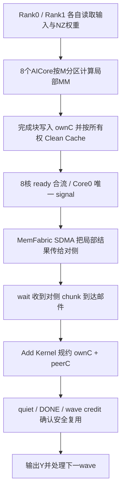
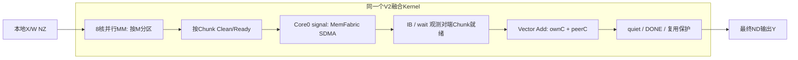

# 融合算子专项总结

**——Ascend 310P3 单卡双 Die MM + MemFabric AllReduce 融合研发（Stock NZ MM 基线调整前）**

| 项目 | 内容 |
|---|---|
| 总结版本 | **V1.1（证据增强修订版），2026-10-28**；基于 V1.0 修订 V1 固定成本与 L0–L4 实测对照 |
| 历史工作范围 | 2026-09-22 至 2026-10-27 A1-R1；以**Stock 对照从普通 row-major MM 改为真实 Serving NZ MM**为截至边界 |
| 明确排除 | 2026-10-27 A1-R2 Stock_NZ 新基线的 Screen/Confirm、后续 D4 分段诊断及其后所有新数据；这些属于下一阶段，不回填本期成果 |
| 研发主仓 | [`10wvw01/vllm-ascend`](https://github.com/10wvw01/vllm-ascend)；历史 `feat/310p-memfabric-public-api` 与独立 `perf/diag` 取证分支；当前唯一项目入口为 `dev/310p-memfabric-mm-ar` |
| 技术对象 | Ascend 310P3 / dav-2002，单卡双 Die，TP=2；Qwen3.6-35B-A3B-w8a8 中 FP16 `self_attn.o_proj` 与 GDN `linear_attn.out_proj` 的 MM + AllReduce |
| 证据约束 | **实测结果、历史推断、目前缺证据**严格分开；所有正负收益必须写明对照对象、计时口径与适用版本 |

> **阅读结论。** 本阶段完成了 MemFabric 公共 API 适配、V1 多核协作及多 Kernel/两 Kernel 单波方案、V2 单 Kernel 双引擎融合、CANN 工程化、Torch/vLLM-Ascend 模型接入、完整的算子—模型—客户端性能归因及大量异常取证。V1/V2 在特定历史算子基准中取得明显的大 M 优势，但真实 Qwen3.6 Prefill 的有效 Stock 基线不同：旧 V2 在真实 Serving 中整体慢于原生 MM+HCCL；最新 D4 相对于 Stock_NZ 的严格算子级加速在此时间截点**尚未得到证明**。局部工程成绩成立，生产级性能和稳定性目标尚未完成。


> **V1.1 修订说明（针对两项审阅意见）**：
> 1. 新增“V1 多核协调 / 多 Kernel 发射 / MemFabric 固定协议 / 数据搬运”四层拆解：逐项标注**设备测量、消融差分、形状趋势、未独立测量**，并纠正“V1 始终都是同一种多 Kernel”的不准确表述。
> 2. 将 L0–L4 扩充为**实际值可横向核对的多轮原始数据矩阵**，区分 V1 三种 q、T0 Serial/Overlap、T1 小 M、T2 三臂、F2 全部配置、真实 Prefill 双 Rank、单请求 Device Step、50请求每场吞吐/TTFT。所有跨日期表均保留来源和“不可跨行做因果差分”的标识。
> 3. 新列出“**无法从现存证据计算的 V1 每次多核 barrier/launch 的独立时间**”及最小补测设计，不使用 V2 的 G0 IB probe 代替 V1 barrier 计时。

---

## 0. 总结边界、验收口径及证据等级

### 0.1 为什么以“Stock 改为 NZ MM”划界

这里的 NZ MM 指的是**Stock 参照路径的实际矩阵乘算法和权重布局**，不是 V1/V2 开始支持 NZ 权重的时间。V1 在 9 月、V2 在 10 月开发初期即已使用 NZ 权重。真正的转折发生于 A1-R1：独立算子基准使用的 row-major `F.linear` 与 Qwen3.6 Serving 实际触发的 `aclnnMatmulWeightNz` 不是同一强度的 MM 算法。A1-R1 测得普通 row-major Stock 单 MM（M=4096）约 1869µs，而真实模型 NZ MM 约 752µs，前者约为后者的 2.5 倍；于是此前部分“融合比 Stock 快”的结论不能直接外推到真实 Qwen3.6。[E16]

本报告包括**A1-R1 发现参照失配的证据**，但不包括后来新增的 Stock_NZ 独立 Screen/Confirm 实验。也不混用 9 月旧二进制、10 月 G3 旧 V2、10 月 D4 Tile2048 和 A1-R1 的 Stock/V2 数值做跨版本精确差分。

### 0.2 四层测试的统一语义

本专项按用户要求采用 L0–L4 五层叙事；其中 L2 是“真实模型单请求内目标站点”，L3 是“该请求完整 Prefill 设备关键路径”，L4 是“50 请求、并发 10 的真实客户端 TTFT”。**历史报告中也有名称为 L3 的“4096/2048 长输出回归”，本报告统一归到 L4 历史业务负载证据，避免同名异义。**

| 层级 | 比较对象 | 最重要的指标 | 不能冒充的结论 |
|---|---|---|---|
| L0 | 同条件 V1 vs V2；或 V2 优化前 vs 优化后 | 完整算子/设备 Event 延迟、正确性、重叠收益 | “V2 比旧 V2 快”≠“比 Stock 快” |
| L1 | **完整** Stock FP16 MM+HCCL AR vs 完整 V2 MM+MemFabric AR | 双 Rank 同样 M/K/N、实际布局、p50/p90/p99、必要准备和完成同步 | Stock MM-only、AR-only、坏基线、不同 Stream/不同进程的时间片段不能充当严格完整 L1 |
| L2 | 单次真实 Qwen 前向中，40 个目标站点实际命中及本地开销 | 站点次数、M/Stride、MM+AR、V2、额外 Copy、与下游消费的依赖 | 不能用微基准次数假设真实融合命中 40 次 |
| L3 | 一个请求、只生成首 Token 的**完整 Prefill 设备 Step** | Rank0/1 设备关键路径、Forward→Logits 完成时间、阶段重叠 | 客户端 4096/1 时延并不天然等于纯设备 Step |
| L4 | 50 请求、并发 10、输入4096/输出2048、serve 真实客户端 | TTFT p50/p90/p99、失败率，并列 TPOT/ITL/吞吐 | tok/s 改善不是 TTFT 改善；失败场不能用于性能中位 |

**统一公式**：以耗时衡量的降低比例为 `(T_stock−T_fused)/T_stock`；等效执行速率提升为 `T_stock/T_fused−1`。两者分母不同，尤其负收益不能混写。端到端客户端 `TTFT=first_token_received−request_sent`，它包含排队、调度、Prefill、服务处理和返回；设备 Step 不包含所有这些部分。两个独立 p50 相加只构成**描述性近似**，不等于配对完整链 p50。

**证据标签**：`实机-直接`表示同报告实测；`实机-历史/非同源`表示旧版本/旧条件或不完整的配对；`取证推断`表示基于 Trace 的合理机理，不当作硬件根因已证实；`待补`表示原始证据或公允对照不足。

---

# 一、开发

## 1. 研发动机、硬件约束与技术路线演进

### 1.1 从 Qwen3.6 模型结构识别融合价值

目标模型按 TP=2 拆分未量化的 RowParallelLinear 投影：10 个 Full Attention 层中的 `self_attn.o_proj`，以及 30 个 GDN 层中的 `linear_attn.out_proj`。这两类站点均采用局部 K=2048、输出 N=2048、FP16，双 Die 各自完成局部矩阵乘后必须做 AllReduce，形成共同的 `MM + 通信` 热路径。每 Rank 理论上涉及 40 个目标站点，是否在每次请求中实际命中仍需根据运行时 Trace 判定。[E01][E02][E05]

数学合同为：

```text
Rank0: X0[M,2048] · W0[2048,2048] -> C0[M,2048]
Rank1: X1[M,2048] · W1[2048,2048] -> C1[M,2048]
两侧都要得到：Y[M,2048] = FP16-Reduce(C0, C1)
```

主要困难不是矩阵乘法本身，而是计算完成后发送区是否对 SDMA 可见、另一 Die 的结果何时真正落地、AI Core 能否安全读取、哪些 Core 应参与通信信号与规约，以及下一次调用能否重用相同对称缓冲和邮箱。**“同一个 Kernel”并不意味着 MM 与通信天然交叠；需要明确流水数据依赖和缓存所有权。**

### 1.2 时间线：不只是实验数量，而是问题认识不断升级

| 时间 | 主体工作 | 取得成果 | 引发的技术认识 |
|---|---|---|---|
| 9/22 | V1 公共 API、8 核 MM 分工、构建/部署、位精确测试及首轮性能 | 完整链路跑通；发现 MM 每核重复计算、ready 清零与尾批开销 | 先修算法执行组织，再优化调度细节 |
| 9/29 | V1 更名及扩展至 10+30 站点、全 M 融合、小 M 路径及尾批治理 | 40 站点接入、q=1/2/4 对照、真实 Eager/Graph 运行 | 大 M 有优势，小 M 固定成本与长时通信进展问题开始主导 |
| 10/16–17 | V2 单 Kernel 双引擎架构与 T0 实机 G0/G1/G2 | IB 同步、MM/SDMA 交叠、单 Kernel 位精确、M=2048/4096/8192 矩阵 | 避免 V1 多 Kernel 边界，把计算与通信作为一条关键路径设计 |
| 10/17–18 | T1 小 M NZ-direct/N-split；T2 原生 MM + MemFabric AR-only | 原始 NZ 权重直通、UB 越界修复、分离“通信替换”和“融合”价值 | 只换传输引擎并无收益；低 M 固定协议开销明显 |
| 10/19 | V2 G3 真正接入 Serving；Graph/Eager/长稳、目录重构与回归 | 40 站点真实命中、短测正确性、正式/诊断代码隔离 | Graph “测试通过”可能根本没有执行 V2；Eager 模型性能和长稳均不达标 |
| 10/20–21 | G1-D 挂死取证、Prefill 设备 Trace 归因 | 缩小 MemFabric 丢邮件区间；建立 40 站点—Prefill Step 的时间归因 | “算子微基准正收益”不等于真实服务正收益 |
| 10/22–23 | D1-A 计时扰动与噪声校准、D2/D3 设计审查、D4 Add Tile2048 | D4 内部完整 Kernel 延迟下降6.26%；准确划清 E2E 外推边界 | 正确性、计时公平性、二进制身份和性能收益必须分层验收 |
| 10/24–25 | F2 Chunk×Overlap、F1 小 M、F1-C 严格对照、SEL-01 三方业务测试 | 固化 Chunk1024/Overlap1；推翻小 M +20% 假象；Stock 维持默认 | 需要真实FP16、热态、配对 Event、ABBA 与失败场留证 |
| 10/27（边界前） | A1-R1 L1/L2/L3 交叉验证 | 普通 row-major L1 出现 +21～22%“优势”，真实 Serving NZ + L3 却均呈负向 | **发现独立 Stock MM 基线弱于真实 NZ MM，进入下一阶段基线改造** |

## 2. 融合算子 V1 实现

### 2.1 V1：多核协作 MM 与分阶段多 Kernel 通信流水

V1 不单靠一个原生 MatMul API，而是在自定义 AscendC/MM producer、MemFabric Host/Device 桥、输出缓冲及 wait/add Kernel 之间建立可流水执行的计算通信链。其通信数据面通过公共 `smem_shm_sdma_signal`、`wait`、`quiet`，不直接改写 MemFabric 私有请求环。数据区采用双 Die 的对称地址映射；一侧产出部分结果后通过 MemFabric SDMA 送到对侧，再由 Add 组合两侧局部结果。[E02][E03]



关键实现与技术选择：

1. **8 核都做 MM，Core0 兼任 signal**：最初把 AscendC `Matmul` 的 single-core tiling 误当成 block 级协作，导致 8 核重复做完整 batch。修正为显式 M 行分区，Cube producer 从约 1024µs/批降至约 273µs/批；对应 8192 行旧版完整耗时从 17.8ms 降至约 5.65ms（当期 Stock 约6.93ms）。这是一次真正的计算组织层修复，不是简单参数调优。[E03]
2. **分批通信而非全矩阵一次发送**：`batch_m=256×q`，q取1/2/4，分别代表每次 1/2/4MiB（N=2048, FP16）；批与批之间运行 MM、signal、wait、add 的流水。完成条件包括 peer mail 校验、quiet 和 wave credit，不能只看 `signal()` 已返回就覆盖缓冲。[E02][E03]
3. **按核 cache-line 所有权维护缓存**：每核仅清理自身连续 C 行；ready/status 分核 64B 对齐，避免 310P3 各核 L1 互不互通导致同一 cache line 写回互相覆盖；ready 使用 generation 代替每波清零。[E02][E03]
4. **固定成本治理**：原每波 32KiB GVA ready 区清零约260µs，改为单调 generation 后可消除这一主路径清零；尾批不再每次整片 scratch `memset`，以预初始化与仅覆盖真实行消减约0.6ms/尾批。[E02][E03]
5. **小 M 补充 N-split**：早期 all-M 路由使 Decode M 很小也走融合，padding 与协议握手使其损失明显；因此引入对原始 NZ 权重按 N 分核的路径，避免一味依赖大 M 模板。[E02][E03]

V1 的主要价值是证明：**公共 MemFabric API 足以在 310P3 上构造数学正确的 TP MM+AR，并实现 M 方向多批次流水；同时揭示多核 ready/credit、显式搬运、跨 Kernel 编排与同步等多类开销；**目前不能证明单独的 launch 或单独的 8核 rendezvous 是其中最大项。****


### 2.1.1 首先纠正概念：多核固定开销 ≠ 多 Kernel 开销 ≠ MemFabric 通信耗时

**V1 使用 8 个 AI Core 并行做 MM，并不天然意味着“多核越多固定成本越大”。**这里至少有四类不同开销，发生的位置、是否每批重复、能否与 MM 重叠都不一样：

```text
                     【单个批次 / wave 的 V1 关键路径（简化）】
Host 编排：准备wave ── [Gate] ── [Producer(P)] ── [Wait(W)] ── [Add(A)] ── [Quiet/Ack]
                         │          │           │             │              │
8核内部：                 │      8核分M计算       │         多核Add           │
                         │      每核Clean        │          │              │
                         │      每核写ready      │          │              │
                         │      Core0轮询7核────┘          │              │
MF数据面：                │      Core0 signal ── SDMA ── 到达邮件wait ── quiet/DONE/credit

                          └── 另一批的MM可与前一批SDMA交叠 ──┘
```

上图表达的是**先后依赖**而非每个格子的独立实测时间。V1 早期使用多次设备 Kernel 发射完成单波（历史后续源码说明将其称为“六 launch 链”）；**2026-10-16 commit `30306a0a7fad`** 引入了 V1 的两 Kernel 单波路径：`kernel A = clear + gate + 8核 MM + signal`，`kernel B = wait + mail-ok广播 + Add + quiet + ack`。因此本期至少有“早期分阶段流水”和“后期两 Kernel 单波”两种 V1 内部设计，不能把某轮 profiler 数字无条件放到所有 V1 版本上。[E02][E21]

| 开销类别 | V1 发生在哪里 / 为什么不能省 | 现有定量证据 | 能否下结论 |
|---|---|---|---|
| **A. 8核 MM 会合** | 每核计算并 Clean 自己的输出、将 generation 写到**各自64B ready cell**；Core0 确认8核完成后才 `signal`。否则 SDMA 可能读到某核尚未写完的部分结果 | 源码可验证**8核 ready/唯一 producer**；**没有** V1 每次会合的独立µs消融实验 | **存在性已证实，独立固定耗时 UNKNOWN** |
| **B. 波准备时的 GVA ready 清零** | 原来在下一波开始前用引擎任务清理 **32KiB** ready-cell 区，属于数据面可见性/状态重置 | 9/22 profiler 约 **258–260µs/波**；删除该 memset 后 M512 时钟 **903→616µs，减少287µs、时延降低31.8%** | **实测 + 消融，证据最强；并非“8核 barrier耗时260µs”** |
| **C. 剩余控制/波间开销** | 64B 错误通道重置、波间引擎提交空档、首批 SDMA 等待、quiet/credit | 9/22 报告：64B memset约**56µs**、间隙约**140µs**、单批暴露 wait约**170µs**；多批时 wait可降至**1.5–2.2µs**；`gate/quiet/ack` 设备协议小 Kernel 合计 **<10µs** | 已观测不同子项，但**存在重叠/计时边界差异，不得简单相加** |
| **D. Host 多次 launch / Kernel 边界** | 最初每个批次需 Producer、Wait、Add 与控制链发射；后期两 Kernel 单波将多个步骤合入 A/B | 时间线显示**链内相邻任务间隙仅1–2µs**；没有 isolating launch-only A/B 的净差实测 | **“多次 launch 占主要固定开销”没有量化证据，不能宣称已证实** |
| **E. 尾批 scratch 搬运/补零** | 输入行数不满 batch 仍按大模板 MM/交换，早期每个尾批额外对 scratch 清零与 memcpy | 9/22 M768 实测：**2MiB memset + 1MiB copy = 623µs**，另尾批 wait约102µs、quiet约60µs；9/29 一次分配清零+只拷有效行后不再每尾批付这笔约0.6ms | **定量已证实；这是尾批成本，不是多核会合成本** |
| **F. MemFabric 邮件协议** | `signal → wait → quiet/DONE/credit` 用于跨 Die 同步、防止同一 arena/邮件槽提前复用 | 9/22 单批暴露 wait约170µs；T2（另一结构）M64 AR-only Kernel约217µs，含协议及Add，不能直接移植为 V1 signal/wait 时间 | **协议确有固定成本，但 V1 各原语独立µs没有完整拆解** |

**对于“每波固定约 0.52ms → 约0.2ms”的历史文字要这样理解：**它是当期 V1 的总体固定成本估算，含若干等待、任务间隔与准备工作；`260µs` 清零并不是 0.52ms 的85%（算术上约50%），原报告“85%”对应对 `prepare_wave` 主损耗的描述，不能混作整个波的百分比。历史 `0.2ms/波` 也不是 `56+140+170=366µs` 的直接加法：其中部分等待与流水时间发生重叠或统计窗口不同，应以消融前后同形状**903→616µs**作为最可靠的净效果。[E03]

### 2.1.2 每类成本在大 M 与小 M 中为什么不同：用原始值解释

| 性能现象 | 直接历史数据 | 能说明什么 | 不能说明什么 |
|---|---|---|---|
| 固定准备开销对小 M 打击大 | M512 一处 V1 周期 903→616µs（移除32KiB memset） | 已证实改进来自删除慢速 GVA 清零任务 | 不能将全287µs都命名为单次 Kernel launch 或多核等待 |
| q 越大，小 M 通常越慢 | 9/29 M1–64 Stock约**0.29–0.33ms**，V1 q1约**0.47ms** / q2约**0.55–0.60ms** / q4约**0.78ms** | “固定协议 + 将很少有效行补齐到更大的 batch”的合成本钱很高 | 不能把 q1→q4 的全部差值仅归因于signal次数；q变化也改变补齐MM规模 |
| 大 M 大块收益更大 | 9/29 M4096 Stock约**3.28ms**，V1 q1约**3.31ms** / q2约**2.73ms** / q4约**2.36ms** | 分批次数减少、协议及内核控制摊薄，且MM/SDMA流水结构变化 | 不能声称节约的全部时间都是多核barrier费用 |
| 多批具备掩盖通信的能力 | 9/22 M8192：wait中位约**1.8µs**；报告给出对应串行SDMA理想传输时间约**104.9µs/2MiB** | 后续 MM 可以掩盖已发送批次的部分通信等待 | 不等于真实跨Die传输只需1.8µs |
| V1 的纯 MM 仍有优化空间 | 8核重复算整批 → 显式M分区，producer **1024→273µs/批**；当期原生约246µs/批 | “8核分工正确”避免约8倍冗余，比省launch更先决 | 不是多核协调本身的开销；修复的是错误的工作分配 |

### 2.1.3 从 V1 到 V2，究竟哪些固定费用有希望削减

V2 的目标并不是“删掉8核 ready 与 MemFabric 必要握手”，而是**把 Host 多 Kernel 编排改造成同 Kernel 的 MM/SDMA/Add 流水**，减少跨 Kernel 的状态推进及不必要的中间存储。V1 的 kernel A/B 路线已针对 **256≤M<2048** 的默认单波形状消减部分 launch 和 engine memset；**M≥2048 默认仍走原先的分批流水，并非A/B单波**。因此，下面的 T0 大 M 对照不能冒充“V1两Kernel vs V2一Kernel”纯launch成本实验。V2 T0 10/17 与 V1 的完整调用直接比较，M2048仅从1.502ms降至1.414ms（减少88µs）；M4096仅从2.808ms降至2.738ms（减少70µs）；M8192从5.415ms降至5.198ms（减少217µs）。同场净差是事实，但未有按各自具体子版本拆出的“每个Kernel省xxµs”测量，不能把全部差额算到launch减少上。[E06]

**仍缺的硬证据（原版本性能归因缺口，不能硬填）：**把同一 V1 SHA 下的 `P/W/A/控制`、两 Kernel A/B，以及“禁用Ready清零”的受控诊断变体，在同一双Die卡按 Event+Profiler 分别计算 `Host enqueue / Kernel Device Duration / wave makespan / ready会合 / mail等待`；各变体不得改变正确性与池状态。若现有 9/22 原始 Trace 可恢复，先尝试重分析，**无须为了写历史总结而把2026-10-28的新测试冒充9月原始数据**。另需单独测试 `MM8 vs MM4` 保持同输出与协议，才能把“多核数导致的 ready rendezvous 成本”从 MM 计算效率中分离。


### 2.2 V1 阶段实测成果与限制

9/22 同层历史微基准（q=2）中，M4096 Stock 3.284ms、V1 2.726ms，延迟降低17.0%；M8192 Stock 6.760ms、V1 5.258ms，延迟降低22.2%；M2048 基本持平。该实验的 Stock 时间包含当期微基准环境与同步条件，**不能当作后续真实 Qwen NZ-Stock 基线**。[E03]

9/29 扩展到 40 站点后，V1 的全 M 算子测试显示较大 M 的潜力，特别是 q=4 对 M4096 在当期基准中报告约29%～41%的耗时优势区间；但小 M 常因 padding、协议与 N-split 组织受损。图模式 50 请求的输出吞吐在当期曾观察到与 Stock 约持平；Eager 全 M 持续通信出现 2/2 致命挂死，短测正确不代表可服务。[E03]

**重要的历史阶段差异**：V1 当期 Eager/Graph 结果与后来 V2 G3 的“Graph 事实上 Stock-vs-Stock”是不同实现/不同阶段，不能以后者否定 V1 已实际执行的独立 Graph 证据；也不能把 V1 的短/历史 Graph PASS 当作后来 V2 Graph 能用的证据。


#### V1 9/22 按完整 M 规模的同场 Stock 对照（单位 ms）

| M | Stock完整MM+HCCL | V1 q2 | V1耗时相对Stock | 含义 |
|---:|---:|---:|---:|---|
| 512 | 0.481 | 0.627 | +30.4% | 早期固定成本主导，融合慢 |
| 1024 | 0.789 | 0.815 | +3.3% | 接近持平 |
| 2048 | 1.472 | 1.471 | −0.1% | 实际持平 |
| 4096 | 3.284 | 2.726 | **−17.0%** | 当期微基准大M优势 |
| 6144 | 5.273 | 3.998 | **−24.2%** | 当期微基准大M优势 |
| 8192 | 6.760 | 5.258 | **−22.2%** | 当期微基准大M优势 |

这里以**耗时变化** `(V1−Stock)/Stock` 展示，正号是变慢，负号是变快；当期 9/22 与 10/17、10/27 的 SO、运行时基线不一致。不能拿这里的 q2 数值减去后来 D4 的 Event 得出改进。[E03]

#### V1 9/29 q 取值完整形状趋势（历史报告给出的百分比）

| M | q1：256行 | q2：512行 | q4：1024行 | 说明 |
|---:|---:|---:|---:|---|
| 1 | −63% | −92% | −135% | 小M严重负收益 |
| 32 | −45% | −74%～−82% | −153% | q越大 padding越严重 |
| 64 | −57% | −84%～−93% | −154% | 固定成本+padding |
| 256 | −24% | −56% | −107% | 边界仍亏 |
| 512 | −31% | −29% | −62% | q4并不适合该规模 |
| 1024 | −30% | −4% | +1% | q4大致打平 |
| 2048 | −23% | +3.3% | +13% | 部分q开始正向 |
| 4096 | −0.9% | +17%～+20% | +29%～+41% | 负担摊薄后大M趋势正向 |

**特别说明：**此表严格沿用9/29原报告的“报告百分比”符号与区间，没有重新定义成统一等效吞吐加速；该历史报告文字以融合相对Stock的“优/劣”口径陈述，跨轮复用应优先引用绝对时间。多次性能差异并不能充分拆分“多核 / 多Kernel / MF协议 / 补零”四项单独贡献。[E03]

## 3. 融合算子 V2 实现

### 3.1 为什么要从 V1 演进 V2

V1 已完成可行性验证，但早期多 Kernel 流水需要多次跨 Kernel 状态推进、缓冲复用和信号等待；**这不等于每次 launch 都有已测得的巨大开销**。历史 Trace 反而显示部分协议小 Kernel 合计耗时很低，主要已量化损失来自 GVA ready 清零、尾批搬运、波间空档以及小 M 固定协议/补齐成本。10 月 16 日 V1 又引入两 Kernel 单波方案，进一步说明其内部也在压缩 Kernel 边界；V2 则继续推进为正式 MM+SDMA+Add 单 Kernel，并研究跨 Chunk 的计算通信重叠。[E03][E21]V2 因此以**单 Kernel 内同时完成计算和通信协作**为正式方向，外层只保留合理的建池、输出和调用生命周期管理。[E04]



同一 Kernel 里存在两条资源路径：AI Core/Cube 负责 MM，SDMA/AICPU 编排负责跨 Die 数据交换，Vector 管线负责 Add；通过 Chunk 和 IB 完成依赖协调。8 个 AICore 全部参与 MM，Core0 计算完成后承担唯一 `signal()` 发出者；其余核参与计算与 Add，而不是专门空出一个核只管通信。[E04][E05]

### 3.2 大 M T0：单 Kernel 分块交叠

- **计算组织**：固定 K=N=2048；M 沿 8 核划分，普通大 M 试验覆盖2048/4096/8192。先检验 G0 官方 `IBSet/IBWait` 原语和 7→1、1→7 扇入放行，再做串行单 Chunk 和多 Chunk 交叠。[E06]
- **通信组织**：每个 Chunk 局部 MM 完成，缓存 Clean 后允许 SDMA 消费该块；对侧通过 wait 邮件确认到达，再让 Add 核读取与规约；整个波结束还需 quiet/DONE 保护，避免下个请求复用前一波的状态。[E04][E06]
- **流水核心**：`MM(k+1)` 可以尽量覆盖 `SDMA(k)` 的等待；串行版本提供正确性及瓶颈参照。正式大 M 选择 `chunk_rows=1024`，Overlap=1；F2 验证更小 Chunk 的消息固定成本反而超过新增交叠能力。[E06][E13]
- **布局与缓存**：使用原始 NZ 权重，输出 ND；真实模型中非连续 X 的 staging/contiguous 是另一个需要计入完整调用成本的路径。缓存可见性、mail 的 status/dst/len/imm、跨核完成、输出槽重复使用均为 correctness 合同，不可作为性能微优化任意删去。[E04][E09]

10/17 T0 G0/G1/G2 测试全部位精确：G0 1000/10000 轮；G1 多输入种子和1000次复用；G2 18个 Chunk×M×Serial/Overlap 配置各100次。修复了跨核共享结果槽写丢、建池 geometry 调用顺序以及新输出缓冲首写静默丢弃等问题。[E06]

### 3.3 小 M T1：NZ 直通与 N-split

小 M（M=1..256）不再使用大 M 的行分片大模板，而是按照 N 输出列划分，试验 `mm_cores=1/2/4/8` 与 Add 分核。权重直接引用原始完整 NZ，`SetOrgShape` 保留原始布局，`SetSingleShape` 裁出当前分核的有效列片，输出直接写 ND，减少 V1 的 NZ 权重重排、输入 staging 和 blocked C 的复杂度。[E04][E07]

该阶段并不是“Stock 改 NZ”的边界，它只是**融合自身小 M 实现采用 NZ-direct**。实测证明 310P3 可支持相应 NZ B 子视图 + ND 有步长输出，1028/1028 单卡矩阵与160组合双卡测试通过；同时查出 `basicM=256` 时 Matmul NZ2ND 临时 UB 工作区不足的越界风险，收敛到 `basicM≤128` 的安全合同。[E07]

历史 T1 基准 M≤255 多数不如 Stock。后续 F1-C 再次以严格原生 FP16 Stock 和同场配对 Event 复核 M=10，结果为 T1 **耗时更长约38.0%、等效速率低27.5%**；因此“V2 小 M 已优于 Stock”不能成为成果结论。可保留的成果是正确性、NZ 分列计算能力、固定开销识别与下一代小 M 方案的技术依据。[E07][E14]

### 3.4 T2：把 MemFabric 传输价值与融合价值分开检验

T2 做了极关键的对照：**A=原生 MM+HCCL；B=原生 MM+MemFabric AR-only（非融合）；C=V2 MM+MemFabric 单 Kernel**。原计划以 D2D copy 把 MM 输出搬到 symmetric arena，但实机发现拷贝引擎对仍驻留 AICore 缓存的写可能读到旧数据，改用 AICore Stage + 必要的同步、向量交接与 Clean。正确性修复先于性能判定。[E08]

这项实验说明：单纯把 HCCL 换成 MemFabric 并不会自动更快。M8192 的 T2 B 约12.48ms，Stock A 约6.75ms，而 V2 C 约5.21ms（该报告的历史同口径值）。B 的损失主要在 stage 搬运、缓存一致性与同步，以及未能像融合 C 那样消减边界。**“跨 Die 传输性能”与“MM+AR 单 Kernel 价值”是两件事；优化方向应该是真正消除中间搬运并创造计算通信重叠。**[E08]

### 3.5 D4：正式 Kernel Add Tile 1024→2048

在 D1-A 基线与两轮设计/静态审查基础上，D4 仅针对**正式** V2 设备 Kernel 的 Vector Add 处理粒度：1024个 FP16 元素→2048个，单次规约 Tile 加倍，循环次数减半；相应调整队列 Buffer 6144B→12288B 和 UB 临时空间分配，保证 MM 工作区下界（最坏需求131072B、可用249824B）。原型诊断 Kernel 与通信协议、Host/Serving ABI 均不变。[E11][E12]

D4 对照 8 会话、四组 ABBA，M4096 双 Rank 配对 Event p50 从 2726.9µs 降至 2556.3µs，省170.6µs，**V2 内部时延降低6.26%**；四个配对窗口各减少5.50%～7.16%。试验覆盖8个形状、60次 Serving 混合路由，均通过位精确和协议状态验证。真实 Qwen Eager 的小样本输入4096/输出512/20请求/并发10在两版 V2 之间测得吞吐37.96→38.67tok/s（+1.86%），TTFT p50改善仅约0.21%，处于噪声量级。**这是 V2 内部优化，不是 V2 对 Stock 的正收益结论。**[E12]

## 4. 融合算子如何集成到 vLLM-Ascend

### 4.1 编译与部署：打通 CANN/Device/Host/Plugin 链

工程不是完整 ACLNN 自定义算子包，而是保留已经验证的 **AscendC 设备 Kernel 直调 + C++ Host Adapter + torch 扩展 + Python 模型路由**。正式 V2 目录采用 `src/op_kernel`（正式/诊断 ASC）、`src/op_host`（MemFabric 公共 API、建池和运行适配）、`src/torch_adapter`（Torch Op/Serving 生命周期）、`test`、`docs` 分层。10/19 完成源码拆分、清理构建残留，正式 Kernel 与 T1/T2 诊断符号分开，可选择 `VLLM_ASCEND_310P_V2_BUILD_DIAGNOSTICS=OFF` 构建最小正式服务路径。[E05][E10]

构建大致链路如下（实际版本、宏与 SO 须在各测试会话冻结）：

```text
vllm-ascend setup.py / cmake/memfabric_310p_v2.cmake
      ├─ BiSheng --npu-arch=dav-2002 编译 .asc → device SO
      ├─ 链接 MemFabric public include/libmf_smem → Host Adapter / C ABI
      ├─ 构建 vllm_ascend_C Torch 扩展，注册 fused custom op
      └─ Python vllm-ascend 定制 LinearMethod 选择与推理路由
                                  ↓
                  CANN 9.1 + MemFabric KVER11 AICPU 协作运行
```

历史可复现的主要构建标志为 `VLLM_ASCEND_310P_ENABLE_MEMFABRIC_MM_AR=1`、`VLLM_ASCEND_310P_ENABLE_MEMFABRIC_MM_AR_V2=1` 与 `python setup.py build_ext --inplace`；feature-off 必须可构建且不要求安装 MemFabric。Device SO、Host `libmf_hybm_core.so`、插件 `vllm_ascend_C.so`、KVER、CANN、实际进程 maps 必须构成可审计的**装载身份**，不能只有 Git commit。[E03][E05][E10]

### 4.2 适配：控制选层、维度、布局与回退

- **选层**：在 `modelslim_config.py` 的量化/LinearMethod 选择路径只匹配两类真实 FP16 行并行投影，不碰量化 MoE；保留未命中时原生 Stock 路径。[E01][E05]
- **Torch 接口**：正式 V2 的 `_C_ascend::memfabric_mm_ar_v2_allreduce` 串接上游 Tensor、NZ 权重、输出，Host Adapter 管静态 symmetric pool、双 Rank geometry、通信状态、首次调用守护以及生命周期。Adapter ABI 是模型层与 MemFabric 具体 API/对称布局间的内部契约，隔离外部库升级对 Python/Serving 的冲击。[E04][E05]
- **路由**：正式 V2 Serving 在历史 G3/D4 时仅 `2048≤M≤4096` 执行 V2；普通 Decode 的 M≤10 通常回退 Stock，模型更大 M、非合格 Stride/Graph 路径需按明确守卫回退；**启用开关 ≠ 真实命中**。[E05][E09]
- **Graph/Runner 生命周期**：使用轻量 Runner hooks 对 dummy run / sync 和 warmup 进行包装，不复制维护完整 DFlash Runner。G3 发现 torch.compile 追踪/缓存会把 dummy/profile 期 Stock fallback 固化，导致 Graph 两臂实为 Stock，因此 Graph 必须检查编译产物和 Replay Kernel 签名后才可宣称融合实际执行。[E09][E17]
- **双 Rank 资源**：一个进程内 MemFabric 池、静态输出槽复用、first-write warmup、IB 工作区和 HCCL 共存都需要明确生命周期；目标失败时保留 Stock 默认，不让偶发不安全状态进入生产。[E05][E09]

### 4.3 推理：从模型初始化到单次 Prefill

1. 模型加载/量化配置阶段选择合格的 FP16 `o_proj/out_proj` 站点与 LinearMethod；每 Rank 目标范围为10+30处。
2. Serve warmup/dummy/profile 不能无条件发起真实 MemFabric；先建池与完成首调、物理地址/权重/输出缓冲准备，并核验运行时设备与插件二进制。
3. 真正 Prefill 输入 M 落入 [2048,4096] 时转入 V2，局部 MM、SDMA 交换、Add 输出在单 Kernel 中完成；以同一模型路径的 Stock 作为首调正确性参考。
4. 输出 ND 提交给下一个模型算子；若上游 X 非连续，`x.contiguous()` 的真实设备 Copy 是融合路径成本而非免费的准备动作（旧 Prefill Trace 约66µs/目标站点）。
5. Decode 小 M 继续 Stock；Graph 如未证实 V2 replay，就只能记作 Graph stock fallback，不算融合收益。[E05][E09][E15]

---

# 二、测试：L0～L4 分层总结

## 5. L0｜V1 与 V2 的直接比较及 V2 内部优化

### 5.1 V1 vs V2 T0（2026-10-17，历史微基准）

口径：相同 TP=2、K=N=2048、CANN9.1/FP16；Host launch+stream sync 的历史中位数，V2 使用 Chunk1024+Overlap1。此表为**历史运行栈下的直接对照**，不是最新 NZ-Stock 正式验收。[E06]

| M | Stock MM+HCCL | V1 | V2 T0 overlap | V2 比 V1 降低耗时 | 当期观察 |
|---:|---:|---:|---:|---:|---|
| 256 | 0.364ms | 0.484ms | V2 serial 0.581ms（c256） | 不适用 | 小 M Stock 更快 |
| 512 | 0.640ms | 0.594ms | V2 serial 0.762ms（c512） | 不适用 | V1 比 V2 T0 更合适 |
| 1024 | 0.903ms | 0.845ms | V2 serial 0.961ms | 不适用 | V1 更合适 |
| 2048 | 1.688ms | 1.502ms | **1.414ms** | **5.9%** | V2 已优于 V1 |
| 4096 | 3.156ms | 2.808ms | **2.738ms** | **2.5%** | V2 优于 V1，但相对差距不大 |
| 8192 | 6.972ms | 5.415ms | **5.198ms** | **4.0%** | V2 大 M 更具潜力 |

V2 serial→overlap 在该批测试的 M≥2048 档位，报告重叠提速幅度约17%～32%（不同形状/Chunk），证明跨 Chunk 的真实计算通信协同是有效的。T0 只覆盖固定 Chunk 与大 M 路线；不能把它当小 M 专用 T1 的最终成果。[E06]


### 5.1.1 同一 T0 实验：将 V1 / Stock / V2-Serial / V2-Overlap 的所有测量同时列出

下表只引用 2026-10-17 T0 主报告，单位全部为 **ms（Host launch + 每调用 stream sync 的历史中位数）**。此表可以在**同一行同一轮**比较三方，但不是最新Serving NZ-Stock，尤其不可与D4 Event p50硬拼。**若见原报告文字笼统写“M≤1024 Stock最快”，应以其同页数值表为准：M512/1024实际是V1分别0.594/0.845ms，低于Stock 0.640/0.903ms；而V2 T0未胜出。**[E06]

| M | Stock | V1 | V2 Serial | V2 Overlap | V2-Overlap相对V1耗时变化 | V2-Overlap相对Stock耗时变化 |
|---:|---:|---:|---:|---:|---:|---:|
| 256 | **0.364** | 0.484 | 0.581（C256） | 未测 | — | — |
| 512 | **0.640** | 0.594 | 0.762（C512） | 未测 | — | — |
| 1024 | 0.903 | **0.845** | 0.961 | 未测 | — | — |
| 2048 | 1.688 | 1.502 | 1.722 | **1.414** | **−5.9%** | **−16.2%** |
| 4096 | 3.156 | 2.808 | 3.250 | **2.738** | **−2.5%** | **−13.2%** |
| 8192 | 6.972 | 5.415 | 6.267 | **5.198** | **−4.0%** | **−25.4%** |

对于可直接算同一行的 Serial→Overlap，分别是 M2048 **1.722→1.414ms（时延−17.9%）**、M4096 **3.250→2.738ms（−15.8%）**、M8192 **6.267→5.198ms（−17.1%）**。这组“同M同Chunk”的17%左右，是与报告中综合不同Chunk范围“17%～32%”不同的子集；不得混写成所有M均加速32%。

### 5.1.2 T1 小 M：V1 与 V2-NZ-Direct 的真实并列数据

2026-10-17/18 T1 报告给出 `Host enqueue + stream sync` 的中位数，三方均包含完整 MM+AR，单位 ms，V2 某些形状是 MM/Add 分核网格中最佳值范围。[E07]

| M | Stock | V1 | V2 T1最佳 | 有证据支持的结论 |
|---:|---:|---:|---:|---|
| 1 | **0.307** | 0.346 | 0.330～0.357 | Stock最快 |
| 2 | **0.297** | 0.351 | 0.330 | Stock最快 |
| 4 | **0.296** | 0.337 | 0.327 | Stock最快 |
| 8 | **0.292** | 0.394 | 0.324 | Stock最快 |
| 16 | **0.257** | 0.350 | 0.322 | Stock最快 |
| 32 | **0.291** | 0.342 | 0.325 | Stock最快 |
| 64 | **0.288** | 0.361 | 0.321～0.469 | Stock最快；T1部分参数离群 |
| 128 | **0.296** | 0.461 | 0.322～0.454 | T1优于V1的某些配置，但仍未胜Stock |
| 255 | **0.427** | 0.542 | 0.462～0.495 | Stock最快 |
| 256 | 0.519 | 0.473 | **0.451～0.496** | 最佳T1已低于Stock，部分参数与V1交叉 |

它验证了**“V2 小M比V1改进”与“V2 小M比Stock更快”不是同一个命题**。这里的特定 M256 结果也不能代替 F1-C 针对 M10 所做的严格Event ABBA；二者形状及计时规则不同。

### 5.1.3 T2 排除实验：三种系统结构的16形状原始实测

A=`F.linear+HCCL`，B=`F.linear+Stage+MemFabric AR-only`，C=`V2 T0/T1 MM+MemFabric融合`；三臂单位ms、同轮 Host sync、取较慢Rank，中间Stage实际一致性费用**不能从B删除**。[E08]

| M | A Stock | B MM+MF AR-only | C 真融合 | 结构比较 |
|---:|---:|---:|---:|---|
| 1 | **0.3254** | 0.6249 | 0.3179 | C与A极接近；B几乎翻倍 |
| 2 | **0.3238** | 0.6243 | 0.3186 | C≈A；B显著慢 |
| 4 | **0.3285** | 0.6252 | 0.3200 | C≈A；B显著慢 |
| 8 | **0.3288** | 0.6247 | 0.3182 | C≈A；B显著慢 |
| 16 | 0.3403 | 0.6246 | **0.3191** | C稍优；B慢 |
| 32 | 0.3362 | 0.6209 | **0.3181** | C稍优；B慢 |
| 64 | 0.3326 | 0.6228 | **0.3176** | C稍优；B慢 |
| 128 | **0.3475** | 0.6251 | 0.4640 | A最快 |
| 255 | **0.3720** | 0.7790 | 0.4724 | A最快 |
| 256 | **0.3925** | 0.7793 | 0.4717 | A最快 |
| 257 | **0.3876** | 0.7786 | 未测 | A优于B |
| 512 | **0.6059** | 1.0866 | 0.6336 | A略优C |
| 1024 | **0.7828** | 1.7090 | 0.9451 | A最快 |
| 2048 | 1.4778 | 2.9671 | **1.4269** | C比A耗时少3.4% |
| 4096 | 3.2735 | 6.2442 | **2.6875** | C比A耗时少17.9% |
| 8192 | 6.7529 | 12.4765 | **5.2126** | C比A耗时少22.8% |

M8192 的Profiler原始阶段：B 的 MM约**3.90ms**、Stage约**3.92ms**、AR-only约**3.99ms**、其他约0.47ms，总量约**12.3ms**，和Host完成时长12.48ms一致；A 的MM约3.9ms、HCCL约2.8ms，总量约6.7ms。M64 下，B的AR-only Kernel约**217µs**，但它包含相关算子逻辑，不能声称那217µs全是MemFabric协议固定费。此三臂实验支持的强结论是：**只有替换传输而没有消除额外Stage/同步，耗时甚至可达到Stock的1.8～2.2倍**；C的优势依赖整体融合与交叠，而不是MemFabric通信本身“天然更快”。

### 5.1.4 F2 全参数组：不能只给“12.9%～52.3%”，必须展示实际值

2026-10-24，D4同一SO、无Profiler、双Rank逐样本配对Event，M2048/M4096，单位 **µs**；基线各有4场复测，首场略偏快，正式基线取更稳定的后三场附近值。[E13]

| M | Chunk | Overlap0 p50 | Overlap1 p50 | 本M C1024/O1基线（四场中位） | 解释 |
|---:|---:|---:|---:|---:|---|
| 2048 | 256 | 2845.6 | 1840.8 | 1356.7 | 单块小、8批次，握手成本较多 |
| 2048 | 512 | 2081.6 | 1600.7 | 1356.7 | 4批次仍慢于1024 |
| 2048 | 1024 | 1699.5 | 1288.8 / 1356.8 / 1356.6 / 1366.5 | 1356.7 | Overlap1稳定胜Overlap0；首场锚偏快 |
| 4096 | 256 | 5285.1 | 3423.4 | 2530.7 | 16批次固定开销显著 |
| 4096 | 512 | 3961.4 | 2904.6 | 2530.7 | 8批次仍慢于1024 |
| 4096 | 1024 | 3135.3 | 2499.0 / 2539.2 / 2531.1 / 2530.2 | 2530.7 | 4批次，最佳综合配置 |

以同M下的C1024/O1基线为参照，M2048：C512/O1慢**18.0%时延**（1600.7/1356.7−1），C256/O1慢**35.7%时延**；M4096：C512/O1慢**14.8%**，C256/O1慢**35.3%**。原F2报告给的`−15.2%/−26.3%/−12.9%/−26.1%`是以候选为分母的**等效速率劣势**，不应误写为候选时延只慢12.9%～26.3%。同样，**此轮只有V2内部参数扫描，没有Stock数据**。


### 5.2 L0 内部分段优化结论

| 实验 | 实际改进/数据 | 结果 | 项目价值 |
|---|---|---|---|
| T0 G0/G1/G2 | 双核/8核 IB；多种 Chunk；串行/交叠 | 正确性 PASS | 证明单 Kernel 通信同步合同 |
| T1 | NZ-direct N-split，M1..256 | 正确性 PASS；多档小 M 性能弱于 Stock | 明确小 M 需专门设计 |
| T2 | AR-only vs 完整融合三方 | AR-only 全 M 劣于 Stock；融合大 M 可优 | 排除“单换 MemFabric 传输”路线 |
| D1-A | 12会话 ABBA、设备 Event/wall/Profiler | 清洁 p50 模式差≤3.3%；正式核约2.53–2.64ms | 明确可检测的性能信号下限与外部负载污染 |
| D4 | Add Tile1024→2048 | **2726.9→2556.3µs，−6.26% 时延** | 正式 Kernel 真实单变量优化成果 |
| F2 | M2048/4096，Chunk256/512/1024×Overlap0/1，18场 | C1024/O1 最佳；小 Chunk 慢12.9%～52.3% | 少分块减消息开销比盲目加交叠重要 |
| C3 | CleanLines unroll4 | 名义 +1.70% 但配对有正有负，未测 Qwen | 不合入，避免把噪声当收益 |

资料：D1-A [E11]；D4 [E12]；F2 [E13]；C3 [E19]。特别强调：**D4 加速6.26%是 L0，不是 L1。**

## 6. L1｜完整 MM+AR 算子级性能：如何设计和看待历史结果

### 6.1 公允实验的设计

**实验自变量**：只切换“完整原生 Stock `F.linear`/真实 NZ MatMul + HCCL AR”与“V2 MM + MemFabric AR”，其他保持 M/K/N=目标形状、TP2、FP16、相同逻辑输入与权重、同卡双 Die、实际NZ存储/Stride、热态、可核验 SO/KVER、相近 Stream 执行语义和一致的输出消费完成边界。大 M 至少覆盖 M2048/4096，尾块另覆盖2049/3073/4095；小 M 必须独立测 M10 等真实形状。[E17]

**过程重点**：先 Stock/V2 独立完成正确性与跨 Rank 路由证明，再固定环境，独立进程交叉 `Stock→V2→V2→Stock`×2；每场预热与原始样本独立留存，统计按同一样本的 `max(rank0[i],rank1[i])` 配对求 p50/p90/p99。Stock Event 必须确证覆盖异步 HCCL 的真实结束；同时保存 Host wall、设备 Event、Profiler 只作为辅助归因。第一次写入、新建池、Cast、额外 Layout/Copy 不能有选择性剔除。[E14][E17]

**测试中最容易导致错判的四类变量**：① Stock 用 row-major 弱算法而 Serving 用 NZ 快算法；② Stock 每调用显式同步/额外 dtype 转换或连续 AR 拥塞；③ MemFabric 建池前后、首次调用与稳定态对照不一致；④ Profiler/宿主外部租户引入时序干扰。所有实验都要报告这些控制项。**本报告内旧微基准结果只能按当时口径汇报。**

### 6.2 历史算子级测试：曾看到正收益，但后来发现参照问题

| 历史实验 | M | 当时 Stock | V2 | 按当次相同口径的耗时变化 | 证据评级 |
|---|---:|---:|---:|---:|---|
| T0 10/17，Host 同步 | 2048 | 1.688ms | 1.414ms | V2时延 −16.2% | 实机-历史微基准 |
| T0 10/17，Host 同步 | 4096 | 3.156ms | 2.738ms | −13.2% | 实机-历史微基准 |
| T0 10/17，Host 同步 | 8192 | 6.972ms | 5.198ms | −25.4% | 实机-历史微基准 |
| T2 三方 10/18，Host 同步 | 4096 | 3.2735ms | 2.6875ms | −17.9% | 实机-历史微基准 |
| A1-R1 10/27，row-major U1配对Event | 2048 | 1649.0µs | 1345.8µs | 约22.5%等效速率提高（时延降18.4%） | **row-major 参照，非真实NZ** |
| A1-R1 10/27，row-major U1配对Event | 4096 | 3043.8µs | 2513.7µs | 约21.1%等效速率提高（时延降17.4%） | **row-major 参照，非真实NZ** |

> 表中 A1-R1 的“+22.5%、+21.1%”沿用原报告以 `Stock/V2−1` 计算的**等效速率**；此前 T0/T2 的百分比按照 `(Stock−V2)/Stock` 计算的是**耗时降低**，两组百分比不能直接横比。A1-R1 是本次边界判定的直接原因：真实 Qwen MM 使用 NZ 快路径，不能拿 row-major 正收益进入下一轮模型性能预测。[E16]


### 6.2.1 微基准“正收益”为何在真实模型变成负收益：同形状三种执行窗口

2026-10-21 **旧V2** 的三组数字虽不是严格同场ABBA，但与各自Profiler/Serving特征相匹配，能够识别测量方式的系统性偏差：[E15]

| 执行窗口 | Stock完整链 | 旧V2融合 | 旧V2相对Stock耗时变化 | Stock当时的额外负担 |
|---|---:|---:|---:|---|
| W1：逐调用同步的独立微基准 | 3.29ms | 2.72ms | **−17.3%** | Stock含约1.3ms逐次sync税 |
| W4：连续4深异步提交的独立微基准 | 2.53ms | 2.68ms | **+5.9%** | HCCL AR密集背靠背、互相争用 |
| 真实Serving目标站点 | MM约0.795ms + AR约1.149ms ≈1.944ms | 2.573ms（不含约0.066ms额外Copy） | **约+32.4%** | 真实目标AR被其它层隔开约60ms，HCCL在低竞争状态 |

三个窗口下旧V2自身变化幅度不大，Stock则从3.29ms下降到真实约1.94ms。故项目发现的不是“本来快17%，只传导很少”，而是**“先前被同步/排队影响的Stock对照较弱，真实Serving直接负收益”**。W1/W4的描述来自不同执行窗口，最后一行两段独立p50相加只是近似，不可用于精确95%置信区间。

### 6.2.2 截点处最接近同版的 A1-R1：普通Row-Major与实际Serving NZ结果同时放账

| 同一A1-R1批次中不同测量场景 | M | Stock MM+HCCL | D4融合 | 直观看到的方向 | 严格性 |
|---|---:|---:|---:|---|---|
| U1 独立完整链，row-major | 2048 | 1649.0µs | 1345.8µs | V2时延减少303.2µs / **18.4%** | 同场ABBA，但Stock不是Serving实用MM |
| U1 独立完整链，row-major | 4096 | 3043.8µs | 2513.7µs | V2时延减少530.1µs / **17.4%** | 同场ABBA，但Stock不是Serving实用MM |
| L2真实Qwen NZ，Rank0 | 4096 | 751.9+1390.9 ≈2142.8µs | 2510.8µs | **融合慢约368.0µs/站点** | 两段Stock独立p50相加，为描述近似 |
| L2真实Qwen NZ，Rank1 | 4096 | 752.1+1165.5 ≈1917.6µs | 2429.7µs | **融合慢约512.1µs/站点** | 两段Stock独立p50相加，为描述近似 |
| 非配对MM-only路由检查 | 4096 | row-major单MM约1869µs；真实NZ单MM约752µs | — | **Stock内部MM算法差约2.5倍** | 不能拿1869−752当V2优化幅度 |

**结论：**早期 L1 `row-major快21%～22%（等效速率）`不虚假，但它回答了错误的目标问题。这是“报告基线不代表实际业务”的典型案例，下一阶段必须换真实NZ-Stock作为正式L1。


### 6.3 旧版真实 Serving Trace：反向解释了早期 L1 的“正收益”

2026-10-21 针对**旧 V2（非 D4 Tile2048）**采集真实 Prefill Trace（M4096）：Rank0 目标站点 Stock MM `MatMulV3` p50约795µs，HCCL AR p50约1149µs，描述性和约1944µs；旧 V2 完整融合 Kernel p50约2573µs，**比这个描述性 Stock 和多约629µs/站点、约慢32%**，此外真实 V2 侧可见 `x.contiguous()` Copy约66µs/站点。[E15]

原始 W1 微基准逐次 sync 时 Stock MM+AR约3.29ms、V2约2.72ms；W4 连发下 Stock约2.53ms、V2约2.68ms；真实 Serving 中目标 AR 的时间间隔约60ms、HCCL 无连发竞争，Stock约1.94ms、V2约2.57ms。**强证据所支持的认识变化**：旧微基准中 Stock 受同步税/通信拥塞影响，真实模型里它更快；“融合正收益没有传导”首先要核验算子在实际工作条件下是否真的快，而不是先假定被全模型 Decode 稀释。[E15]

### 6.4 当前时间边界下的 L1 结论

- 旧 V2 与实际 Serving Stock 的站点级 Trace **显示旧融合较慢**，但部分值为独立 p50 之和，不能冒充完整配对 L1。
- D4 最新正式 Kernel 相比旧 V2 有确证的 L0 改善，**不能**拿旧 Stock 1944µs直接减新 D4 2556µs 签发严格 L1；版本、Profiler与测试条件不一致。
- A1-R1 最新 row-major L1 交叉通过，但**不具备真实 Serving NZ Stock 代表性**。**截至本报告边界，D4 vs 正式 Stock_NZ 的严格同场、完整双 Rank L1 胜负为 `UNKNOWN`，需要下阶段补测**。[E16][E17]

## 7. L2｜V2 与真实 Qwen3.6 单次推理：40 站点设备归因

### 7.1 单次模型推理的实验设计

利用 `input=4096 / output=1 / concurrency=1 / TP=2 / Eager` 的固定 Token 序列、热态重复请求，分别启动 Stock 与 V2 模型，验证两个 Rank 的每次 Prefill 确实执行 `10×o_proj +30×out_proj`、实际 M=4096；Profiler 短窗口捕获算子执行顺序、Kernel 名称、输入 Stride、Copy、Host/设备时刻和后续消费算子。输出只生成首 Token，以免长 Decode 掩盖 Prefill 的局部证据。[E15][E17]

**与 L1 的指标公式不一样**：L1直接比较两个完整 MM+AR 调用的完成时延；L2要在真实 Forward 的相同位置比较站点执行跨度、40次真实命中后的净变化以及拷贝和依赖影响。逐站点 `p50` 相加仅是解释性时间预算，不是最终 Step 性能。不同 Rank 的绝对时间戳未校准时，不可混算两个设备的时间轴。

### 7.2 10/21 旧 V2 真实 Prefill 归因（4个无异常完整Step）

| 指标（Rank0） | Stock | 旧 V2 | 差异/说明 |
|---|---:|---:|---|
| 40目标站点 Kernel 时长均值总计 / Step | 77.8525ms | 105.9149ms | **旧V2多28.0624ms**（同一离线CSV复算口径） |
| V2独立 `x.contiguous()` Copy | 不同路径无此额外 Copy | 约3.6ms/Step（逐站点约66µs为另一个统计口径） | 不能擅自与28.06ms合成伪精确总数 |
| 旧报告站点净成本归因 | — | 约+30.9ms/Step | 与离线复算口径存在选择/计数差别，保留两者 |
| 目标站点占整步的量级 | 约3.3% | — | 只属于旧模型/二进制工况，不是新D4上限 |

对非目标 MoE、GDN、Norm 和 FlashAttention 等相邻 Kernel 的观察基本维持 ±1% 内，有助于将退化定位在目标 MM+AR 路径，而不是声称模型所有模块都变慢。[E15][E17]

### 7.3 设备硬件管线拆解：瓶颈不是 Cube 数学

旧 V2 Kernel 与 Stock MM 的 Cube `mac_time`分别约458.9µs、456.6µs，数学计算时间相近；V2 `mte2_time`约1711.4µs、`scalar_time`约872.8µs、`mte3_time`约191.1µs，显著高于 Stock MM 的对应管线计数。因流水重叠，不能把不同 Pipe 时间直接相加成 Kernel 耗时；但数据明确把优先级指向**SDMA 到达等待、标量同步协议、内存搬运/缓存可见性**，而非简单继续增加 MM Cube 运算量。10/21 版本的 Host API p50异常大部分是提交队列反压的停靠，不能误判为 Python 算子每次耗费几十毫秒。[E15]


### 7.2.1 历史双Rank与相邻非目标算子：为什么能定位到目标链路

10/21取证包含双Rank各40目标站点、跨多个完整Prefill步的Trace；二次离线复算选取完整4个无异常步，以Rank0的**77.8525→105.9149ms/Step**与Rank1的**目标站点增量约+16.7805ms/Step**分别陈列。两Rank时间起点未校准，不可以相加成“全模型多44.84ms”。相邻算子Rank0总时长（同一Profiler实验）如下：[E15][E17]

| 非目标算子（每完整Step） | Stock | V2 | 变化 |
|---|---:|---:|---:|
| MoE QuantGroupedMatmulDequant（80次） | 647.2ms | 648.6ms | +0.2% |
| MoeGatingTopKSoftmax（160次） | 284.7ms | 285.2ms | +0.2% |
| GDN ChunkGatedDeltaRule（30次） | 268.5ms | 267.2ms | −0.5% |
| 非目标 MatmulWeightNz（181次） | 150.9ms | 149.5ms | −0.9% |
| RmsNorm（191次） | 97.1ms | 97.1ms | 0.0% |
| 非目标 HCCL AR（42次） | 48.4ms | 52.0ms | 无全局系统性证据（另Rank方向不一） |

这说明本轮负收益主要集中在目标路径，并非 MoE、GDN、Norm 等整个模型普遍退化。

### 7.3.1 同版本硬件计数器分解（µs，Rank0，p50）

| Pipe计数器 | Stock真实MM | 旧V2完整Kernel | 数字怎样解读 |
|---|---:|---:|---|
| Cube mac_time | 456.6 | 458.9 | 数学时间接近，非首要差距 |
| MTE2 time | 335.9 | 1711.4 | V2显著增加，可能计入SDMA邮件等待/搬入阻塞 |
| scalar time | 186.5 | 872.8 | V2控制/轮询压力明显 |
| MTE3 time | 91.5 | 191.1 | V2输出/搬出代价更高 |
| Vector time | 194.9 | 127.4 | V2该项反而较低 |
| **Kernel Duration** | **795.1**（不含后续HCCL） | **2573.3**（已含融合） | 完整比较还需加上Stock HCCL的实际完成 |

**不要把 MTE2+Scalar+MTE3 直接相加成纯损失**：Pipe有交叠、stall统计语义不同，设备Kernel Duration才是内核实际持续时间。尤其无法仅凭`mte2=1711µs`断言独立SDMA引擎传输花1711µs；它可能包含消费等待、cache/IB节拍。


### 7.4 边界前最近 A1-R1 的模型侧反证

10/27 A1-R1 再次观察：真实模型 Rank0 Stock NZ MM约751.9µs + HCCL约1390.9µs（独立p50之和2142.8µs），V2约2510.8µs；Rank1 Stock NZ约752.1+1165.5≈1917.6µs，V2约2429.7µs。描述性差额约368µs/512µs每站点，方向上**真实模型 NZ-Stock 更快**，而同批独立 row-major 基准却显示 V2 正向。恰恰因此必须改变 L1 的参照算法，不可把 A1-R1 `row-major +22%`当成真实 Serving 性能成果。[E16]

## 8. L3｜完整 Prefill 关键路径：一个请求只生成首 Token

### 8.1 指标定义与边界

目标测试为同一真实模型请求从本轮 Prefill Forward 开始，到本轮完整 logits 已经可被后续使用为止的**设备 Step 关键路径**。双 Rank 必须都完成必要的跨 Die 依赖；不启用 Profiler 的轻量 Event/时间戳主测与少量 Profiler 归因校准应分开。`input4096/output1` 的**客户端请求总时延**只作为辅助，不能未经校准标成设备 Step。[E17]

### 8.2 历史 L3 数据

| 日期及版本 | Stock | V2 | 差值 | 评价 |
|---|---:|---:|---:|---|
| 10/21旧V2，Profiler Rank0完整Prefill锚定步周期中位 | 2364.4ms | 2395.7ms | **V2多31.3ms** | 与 L2 目标站点退化量级一致；单次74ms异常单列 |
| 10/21旧V2，单请求客户端4096/1稳态 | — | 比Stock约多34ms、约1.4% | 近似 | 客户端辅助指标，不与设备Step混为一数 |
| 10/27 A1-R1无Profiler Forward→Logits Event 四场Serve | S1 2346.08ms / S2 2343.25ms | F1 2372.20ms / F2 2370.96ms | **V2多26.12/27.70ms** | 同批两窗口负向；严格解释应受事件完成边界与原始设备校准约束 |

A1-R1 每场6次预热、30次成功请求，Stock 两场漂移仅2.83ms，负向变化明显超出该漂移。结果能够保守地否定当期 D4 的 L3 正收益，但**并不是正式 50 请求 TTFT 结论**。两个 Rank 同步出现的重尾尖峰、周期性波动与池/SDMA/调度的关联尚未完成因果取证。[E16]


### 8.2.1 为保证“L3”数据不混用，拆成设备时间与客户端代理两本账

| 版本/执行方式 | 是否计完整设备Prefill Step | Stock | V2 | 证据限制 |
|---|---|---:|---:|---|
| 9/22 V1单请求 `max_tokens=1` serve M4096 | **否，客户端单请求总时长** | 3371ms | V1 3388ms（生产路由） | 当时只覆盖10个o_proj目标；每点5次中位；不可当作当期40层设备Step |
| 9/22 V1单请求 M8192 | **否，客户端单请求总时长** | 6799ms | V1 6817ms | 即使当期层级MM+AR优化，也不必然改善整请求 |
| 10/21旧V2带Profiler完整步锚周期 | **是，有限定的设备锚定Step** | 2364.4ms | 2395.7ms | Rank0中位，异常步单列；不跨Rank绝对对时 |
| 10/21单请求4096/1客户端 | **否，只是设备Step的辅助代理** | 见原报告 | V2多约34ms/1.4% | 不可与正式4096/2048客户端相减求排队时间 |
| 10/27 A1-R1无Profiler Forward→Logits | **是，经过当次L2校准的设备事件跨度** | S1 2346.08ms、S2 2343.25ms | F1 2372.20ms、F2 2370.96ms | 每场6预热+30成功；并非50请求客户端TTFT |

**同批A1-R1的四场**可按 S1/F1 与 S2/F2 形成两个方向检查：第一对慢`2372.20−2346.08=26.12ms`；第二对慢`2370.96−2343.25=27.71ms`（源报告按约27.70ms）。Stock场间漂移2.83ms，方向一致，但还要保留V2周期性长尾（F1 p90约2517ms、F2约2451ms）。**从L1站点p50差额推算的40×368/512µs**只是局部预算，不能解释为严格26～28ms关键路径分解。


### 8.3 为什么不能简单“40次 × 算子省时”

真实 Forward 里，设备可能已有其他算子流水、流间等待、HCCL 重叠、不同 Rank 临界路径与输入/输出变换；`max(rank0,rank1)` 的跨 Rank 最终完成往往由最慢设备决定。每站点 p50 是一组局部分布的中位数，其四十倍不等于 Step 的 p50。需要逐事件依赖图、跨 Rank 站点完成与下一消费节点来解释 L1→L2→L3 的差额。[E16][E17]

## 9. L4｜50请求、10并发、vLLM-Ascend Serve 的客户端 TTFT

### 9.1 固定正式负载与执行程序

- 模型固定 `Eco-Tech/Qwen3.6-35B-A3B-w8a8`；输入4096、输出2048、TP=2、max-num-seqs/batch上限10、客户端并发10、50条请求、Eager、`ignore-eos`，实际随机 token 序列与发起节奏存档。每个服务独立启动并热态预热，Stock与V2交叉且尽量在同一健康双 Die 卡上运行；失效会话留档，不能将部分请求吞吐填入有效样本。[E14][E17][E18]
- 每请求记录 `request_id`、发送时刻、首 Token 返回时刻、TTFT、最终返回、实际输入/输出 token 数、异常码；服务端辅助采排队/调度/Prefill/首Token可用事件（如果没有接口就记UNKNOWN）。TTFT主报 p50/p90/p99，另报 TPOT、ITL、输出吞吐、总耗时、成功率及 Kernel 真实性。[E17]
- 正式验收应以**同版本 Stock/V2 和已被 L3 确认有正向潜力**的候选作 ABBA。历史 G3/SEL-01 的完整50请求数据有参考价值，但并不能凭不同时间的多个 E2E 报告重算一个“当前 D4 正式 TTFT 改善值”。[E17]

### 9.2 历史实测结果

**G3旧V2 Eager（三对完整50请求）**：输出吞吐相对 Stock 分别 −3.51%、−4.53%、+2.12%，会话中位−3.51%；TTFT p50 三会话全部比 Stock 多约2.1%～2.5%；第一会话 Stock/Fused 50/50均成功，TTFT p50为11792/12042ms。TPOT p50大致持平，但某些会话 p99 长尾恶化约10.6%。**这是旧V2的模型级性能 FAIL，不能以短测正确性冲掉。**[E09]

**10/21旧V2 Prefill 归因后的独立50请求回归（一对Stock→V2）**：

| 指标 | Stock | 旧 V2 | 变化 |
|---|---:|---:|---:|
| 输出吞吐 | 46.45 tok/s | 45.94 tok/s | −1.10% |
| TTFT mean | 11341.9ms | 11578.6ms | **+2.09%（耗时退化）** |
| TTFT p50 | 11811.2ms | 12091.7ms | **+2.38%** |
| TTFT p90 | 16142.5ms | 16510.5ms | +2.28% |
| TTFT p99 | 27435.1ms | 28075.1ms | +2.33% |
| TPOT p50 | 209.02ms | 212.49ms | +1.66% |
| 成功率 | 50/50 | 50/50 | 无功能失败 |

这是一对历史有效的业务负载对照，但不是最新 D4 L4；且没有足以在同一请求时间轴上严格拆分客户端排队/模型计算/服务返回的完整证据。[E15]

**10/24 SEL-01（D4 Tile2048，Stock/V1/V2 三方）**：执行13场（交叉12场+V2重试1场），Stock有效4/4，V2有效4/5，V1三次自然失败0/3有效。有效 V2 输出吞吐中位46.49tok/s、Stock45.98tok/s，约+1.12%；逐场增益 `[+2.29, −0.06, +4.82, −2.40]%`，正负不一致；TTFT p50 Stock约11.8s、V2约11.9–12.0s，未证明改善。V1 在持续 Decode 段出现双 Die 自旋/超时，不能用失败前的部分吞吐作为与另外两臂的有效比较。[E18]

**10/23 D4 小 E2E**：输入4096、输出512、20请求、并发10测得两版 V2 吞吐+1.86%，只用于 D4 内部优化的方向性旁证，**不满足输出2048/50请求的 L4 正式业务合同**。[E12]


### 9.2.1 增补原始历史业务数据：V1 9/29 的 Eager/Graph 与当前大纲的关系

同为 `input4096/output2048/TP2/50请求/并发10` 的历史 9/29 场，但**与后来G3/SEL-01不是同一版本、同一配置与硬件时态**。输出吞吐是完成模型输出总tok/s，不等于首Token TTFT。[E03]

| 9/29模型版本/模式 | 成功请求 | 输出吞吐 | TTFT中位 | ITL中位 | 判读 |
|---|---:|---:|---:|---:|---|
| Stock Eager | 50/50 | 66.49 tok/s | 16.36s | 129.11ms | 正常基线 |
| V1 Eager q1 | 10/50后发生致命崩溃 | **无有效整场吞吐** | 不报 | 部分请求ITL120.10ms | 不能以未完成场声称加速 |
| Stock Graph（两场） | 50/50×2 | 87.73 / 86.40（均87.07） | 16.30s | 94.87/96.27ms | 历史Graph基线 |
| V1 Graph q1（两场） | 50/50×2 | 85.33 / 87.41（均86.37） | 16.31s | 96.15/95.52ms | 输出吞吐约−0.8%，噪声内 |
| V1 Graph q2 | 50/50 | 86.85 | 16.30s | 96.89ms | 输出吞吐约−0.3%，噪声内 |

9/29 V1 Graph 通过只证明当期 V1 图模式的该业务组合，**不能替2026-10-19 V2 Graph“实际执行V2”背书**；10/19 G3发现V2 Graph的Torch编译分支被Stock固化，名义上`fused_graph`实际Stock-vs-Stock。

### 9.2.2 G3 10/19 Eager三场独立对照：每场，而不只给中位

| 会话 | Stock输出tok/s | 旧V2输出tok/s | 吞吐变化 | TTFT p50方向 | 成功情况 |
|---:|---:|---:|---:|---|---|
| 1 | 46.99 | 45.34 | **−3.51%** | Stock11792ms→V2 12042ms，+2.12% | 50/50 vs 50/50 |
| 2 | 46.86 | 44.74 | **−4.53%** | V2较Stock **+2.36%** | 50/50 vs 50/50 |
| 3 | 42.90 | 43.81 | **+2.12%** | V2较Stock **+2.52%** | 50/50 vs 50/50 |

**结论**：输出吞吐一场正向不足以抵消3/3的TTFT退化；第三场Stock自身相对前两场存在约8.8%漂移，不能只挑第三场声称已提速。首场TTFT p90/p99.9为Stock16122/27545ms、V2 16489/28214ms；TPOT p50 206.35→206.14ms基本持平，而某些尾部p99最高恶化约10.64%。

### 9.2.3 SEL-01 10/24：每个有效会话和所有失败场都列出

| 路线 | 有效完成会话的输出tok/s原始数组 | 有效完成/自然失败 | TTFT p50 | 备注 |
|---|---|---|---|---|
| Stock | **42.49 / 49.18 / 46.12 / 45.84** | 4/4，0失败 | 约11.8s | Stock会话极差15.7% |
| V1 | **无有效完整场** | 0/3，3次自然失败（另1次人工停止不计） | 不可报告 | 已完成30/50、20/50、0/50时不同场遭遇纯Decode挂死 |
| V2 D4 | **47.03 / 45.95 / 48.20 / 44.87** | 4/5，1次自然失败 | 约11.9–12.0s | 吞吐中位+1.12%，不稳定；1次批次切换挂死 |

两臂有效完成场的**中位数**Stock45.98、V2 46.49tok/s；不能按上述四个数组**排序位置**擅自一一配对，因为真实执行顺序及重试场次不同。原报告给出的逐场相对Stock中位收益`[+2.29,−0.06,+4.82,−2.40]%`混合正负，既不满足≥5%的一致方向门槛，也没有证明TTFT改善。[E18]

### 9.2.4 D4内部E2E的边界与正式L4缺口

D4内部两版比较采用`input4096/output512/20请求/并发10/TP2/Eager`：旧V2吞吐37.96→D4 V2 38.67tok/s（**+1.86%**），TPOT p50约0.241→0.236s，TTFT p50约12.110→12.084s（**26ms，约0.21%，噪声级**）。既不是Stock/V2对照，也没有完整50请求×2048输出，因此只证明一个**内部优化小样本方向**。在NZ MM调整边界前，最新D4没有完成`真实NZ L1确认→同版本L2→稳定正向L3→正式L4`连续闭环。


### 9.3 L4 阶段结论

曾完成多组有价值的正式负载历史实验，揭示了旧 V2 的真实性能负收益与不稳定性；**截至切换 Stock_NZ 基线前，未形成一个“最新D4、严格同源NZ-Stock L1→真实模型 L2→无Profiler设备Step L3→50请求正式L4”全链条持续正向的证明**。不能以SEL-01 +1.12% 的输出吞吐代表 TTFT 已达标，也不能以 G3 旧版负收益绝对值预言后续任何 Kernel 必然失败。[E16][E17][E18]

---

# 三、问题点、根因定位与经验提炼

## 10. MemFabric / 310P3 协同相关问题

| 主题 | 具体故障、取证与修复/状态 | 工程经验 |
|---|---|---|
| 公共 API / Host-Device 合同 | MemFabric 的 signal/wait/quiet 与对称 SHM/SDMA 已可支撑 V1/V2；不依赖私有 ring 的直接写入 | 固定 public API，底层变化交给适配层与版本门禁 |
| 多核缓存一致性 | 同一 cache line 上多核写回会互相覆盖；ready/status 改 64B 核独占，MM完成后按所有权清缓存 | 核间 IB ready ≠ GM/SDMA 可见性；必须分别定义 |
| 首次 MTE3 写被静默丢弃 | MemFabric 建池后新 y 地址、首次 store 不落地且 status可能为0；T0/T1/T2 均遇到不同同步要求 | **正确性测试一定包含首次地址、动态输出槽、内容变化**；不能只测重复热态相同数据 |
| AICore→D2D可见性 | T2 中 D2D `aclrtMemcpyAsync` 可读到生产者缓存旧值；改为 AICore Stage + fence/clean，代价也必须计时 | 不能将“同流下发”当成跨引擎数据一致性证明 |
| 向量流水事件 | T2 发现 MTE1装入直接喂MTE3可能产生512B旧区，使用V向量算子建立交接事件 | AscendC队列事件和Pipe同步需要设备级专项验证 |
| KFC/AICPU部署 | 从 v9 外部预部署到 v11 fork+exec 自动部署的完整问题史：run包缺三件套、310P3安装器检测失败、torch进程内KFC非零退出毒化ACL运行时、dev0/1 KFC system()通道损坏、伪helper残留致AICPU 0x2a、常驻哨兵模式serve必死等，详见 §10.1 | 构建、安装、KVER、Device实际装载是独立验收项 |
| Device ID / GVA | 早期只在 dev0/1 健康；迁移dev6/7后必须修复SetAccess物理DeviceID，保留双路径Host SO SHA | 逻辑Device映射不等于MemFabric实际驱动DeviceID |
| 池生命周期 / 507899 | 新旧进程快速衔接、meta区异步释放、异常退出可使下一轮建池失败；历史测试以等待排空和独立进程防护 | 建池和销毁是生产生命周期合同，不是测试附加项 |
| 507014 / 双 Die挂死 | G3 Gate E曾发生双Worker AICore timeout；D4与SEL-01有同型复发，V1持续Decode亦有挂死；长稳仍FAIL | 短测全PASS不能外推出长时多请求可靠性，fail-closed、原始故障保全 |
| G1-D故障定位 | D1R4等待槽仍为上一轮旧stamp/mail；signal请求已被消费但目标到达写未出现。取证把怀疑范围定位在**MemFabric发送落地链**，具体SQE提交/执行还是错槽尚未知 | 必须区分“请求已发出”“请求被编排器消费”“对端邮件确实落地”；不能只看status=0 |
| Graph假阳性 | V2 G3 Graph中torch.compile由dummy期fallback追踪固定 Stock，所谓Stock/V2对比实际Stock-vs-Stock | Graph必须核验具体Kernel在capture/replay真正命中 |

详见 V1 [E03]、T0 [E06]、T2 [E08]、G3 [E09]、G1-D [E20]、D4 [E12]。

### 10.1 KFC/AICPU 编排核部署：历史问题记录与解决方式

KFC 是设备侧 AICPU 执行/管理通道，MemFabric 依赖它把 SDMA 编排核（入口符号 `HybmSdmaOrchEpoch`，KVER 版本化命名 `libmf_sdma_orch_v*.so`）部署到目标 Die 的设备侧搜索路径并加载。当前正式链路：

```text
LoadOrchestratorKernel → RunDeployHelper（fork+exec 助手，宿主进程零 KFC 命令）
  → 助手 aclrtSetDevice(devId) → KFC test -f /usr/lib64/aicpu_kernels/0/aicpu_kernels_device/libmf_sdma_orch_v11.so
      └ 缺失 → 退出码 1 → KFC 同步回传 507018（预期，子进程可容忍）
  → MigrateViaCustChannel（aclrtBinaryLoadFromFile CPU 模式 + GetFunction 触发设备写）
  → CopyToSearchPath（cat 分段拷贝）→ verify（grep HybmSdmaOrchEpoch + 尺寸精确匹配）
  → rc=0（已部署）/ rc=3（本就在）→ 库内 TryLoadKernel 正常加载
```

路径中的 `aicpu_kernels/0` 是设备侧搜索目录结构，**不是宿主物理卡0**；部署**按 Die 各自进行**，每 Die 秒级完成。以下按时间线整理本项目全部 KFC 部署相关问题的现象、根因与解决方式：

| 时间/阶段 | 问题现象 | 根因 | 解决方式与状态 |
|---|---|---|---|
| 9/22 V1（KVER v9） | .run 安装后 orchestrator 加载失败，须手设 `MF_SDMA_ORCH_JSON` | `make_run.sh` 未打包 `hybm/aicpu_kernel` 三件套（launch json + CUST json + so），运行时自动发现路径为空 | 三件套随包打入 `${PKG_DIR}/${ARCH_OS}/hybm/`，自动发现验证生效 [E03] |
| 9/22 V1 | `install.sh` 芯片检测失败 exit 1，`set_env.sh` 不生成 | npu-smi 检测正则仅匹配 Ascend9xx 系列，310P3 报 "310P3" 不命中；copy_extend 仅为 A2/A5 构建 | 检测不到时 WARNING 跳过可选 extend lib 并继续安装 [E03] |
| 9/22 V1（关键） | 库内自动部署在 torch 进程内必败：probe miss 经流 sync 以 507018 返回后，后续建流/launch 立即 507018 | torch_npu 注册的 ACL 错误回调将进程内 ACL 运行时闩锁；独立进程无此现象（当期仅定性到进程差异这一层） | 改为外部预部署（`deployer`+`mini_kfc` P0 链），v9 内核预置于设备侧搜索路径 [E03] |
| 9/22 V1 | 设备侧 kernel 文件被延迟 janitor 删除 | 设备侧文件系统清理机制 | 每次运行前 `ensure_kernel.sh` 重新探测/补拷；后被 v11 自动部署链从根本替代 [E03] |
| 9/22 V1 | pip 残留 memfabric_hybrid 包抢先加载 site-packages 的 `libmf_smem.so`，serve 内 json 自动发现失败（`mf310p_create ret=-7`） | 多副本库装载路径冲突 | 卸载 pip 残留 + serve 脚本显式 `MF_SDMA_ORCH_JSON`；部署必须唯一安装源 [E03] |
| 9/29 V1 二轮（KVER v10） | ——（无新增 KFC 故障，纪律延续） | —— | 运行包 1.2.0（`ba6fd50b`，KVER=10），v10 内核预部署 + serve 显式 `MF_SDMA_ORCH_JSON` [E03] |
| 10/17 T0（KVER v11） | dev0/1 KFC `system()` 通道损坏：fork 失败 ret=4294967295，plog "KFC system run failed"（dev2 正常），orchestrator 建池 auto-deploy 失败 | 设备 KFC 控制面异常；容器内 `npu-smi set` 不可用，无法复位 | 临时绕过：预占 `/tmp/mf_kfc_<pid>_{0..15}.json` 使 `LoadKfcChannel` 返回 `BM_FILE_NOT_ACCESS(-5)` 走 assume pre-deployed 分支（`MF_KFC_BYPASS`）；仅作数据面验证，**不能认定部署正常** [E06] |
| 10/19 G3（P0，根因定性与结构性修复） | torchrun tp2 建池在 auto-deploy 链“锁内复查”处失败 `kfc launch failed, ret: 507018 cmd: test -f ...`，此后任何 launch（含普通 torch 算子）全部 507018/AICPU `0x2a` | **最小复现双向验证**：KFC `system()` 非零退出（`test -f` exit 1 → AICPU 层 `TransformKernelErrorCode` 将 256 转为 kernel 错误 42）在 torch_npu 进程内**永久 fault 整个设备上下文**（同流/新流/延时后均失败，普通算子同殃）；纯 ACL 进程正常。结论：torch 宿主内任何 KFC 非零退出命令都是自杀行为，进程内 auto-deploy（必然以 probe-miss 开头）**结构性不可行** | **修复**：`fix-310p-kfc-deploy-helper` 新增固定命令助手 `orch_deploy_helper`（probe → rm 残留 → CUST 迁移 → cat 就位 → grep+精确尺寸校验；flock 互斥防双 Rank 并发拼接）；`LoadOrchestratorKernel` 改为 fork+exec 助手，探测+部署全部在子进程（全新 ACL 上下文，非零退出无害），宿主零 KFC 命令；退出码 0/3=已部署/本就在；未装助手时回退旧链路。纯进程删核重建、torch tp2 双 Rank、kernel 在位正常路径三向验证均 PASS [E09] |
| 10/19 G3（同场失误记录） | 误用 dev-v1.2.0（v9 期）源码构建替换运行包 → json 发现（v9 缺省名）与 v11 环境不匹配，且丢失 v11 全设备同步修复 | 版本溯源不严；fix 分支 merge 头 `990cf989` 还引入 ConfigureOrch memset 段错误 | 定位已部署库真实源提交 `2f59dedb`（非 merge 头），以原参 `-D_GLIBCXX_USE_CXX11_ABI=0 -DENABLE_PTRACER=ON -DMF_SDMA_ORCH_KVER=11` 重建；库与 site-packages 副本同步 [E09] |
| 10/20 版本溯源 | `version.info` 声明 `2f59dedb`，但实际运行核心库为热替换的 fix 分支构建（/usr/local 呈 .run 层+部署助手+核心库热替换三层拼装）；KVER11 launch json 引用的 kernelSo 文件名在安装目录无对应实体 | 安装产物多来源叠加，元数据不反映真实装载；CMake 版本化 json 规则与实际部署名未对齐 | 装载身份必须以完整 SHA256 + 进程 maps 审计，不能只信 version.info 或文件名（见[版本溯源报告](../310P3_版本溯源与资产保全报告_20261020.md)） |
| 10/23 换卡（伪 helper 残留） | dev6/7 上首次 launch `HybmSdmaOrchEpoch` 报 AICPU `0x2a` | wedge 时期遗留 `MF_SDMA_ORCH_DEPLOY_HELPER=<即时 rc=3 脚本>`，谎报 kernel 在位（仅 dev0/1 三重验证过合法），换卡后环境失效 | 移除伪 helper 后自动部署链正常；教训固化为规范：任何“假定在位”快捷路径必须随环境失效立即移除，G0 先检查未审核的覆盖 helper（见[10/23 实机记录](../MEMFABRIC_310P_KFC_DEPLOY_AND_DEVICE_PIVOT_20261023.md)） |
| 10/23 换卡（非 0/1 设备首次完整实证） | 换卡 dev6/7 后建池报 507899（非 KFC 缺陷，但阻塞 KFC 链验证） | CANN VMM API 命名空间分裂：`aclrtMallocPhysical` 收**逻辑号**、`aclrtMemSetAccess` 收**物理号**，非 identity 映射必现 507899 | Host 库补丁 `HybmPhysicalDeviceIdOf(logicDevId)` 在三个 `AclrtMemSetAccess` 位点换算物理号（修复 SO SHA 前缀 `1dc46d7d`）；随后 KFC 自动部署 dev6 从零完成（`kfc sync=507018` 预期缺失探测 → `deploying` → `deployed and verified size=13960`）、dev7 同轮报告在位——**KFC 部署链设备无关、已闭环**（见[10/23 实机记录](../MEMFABRIC_310P_KFC_DEPLOY_AND_DEVICE_PIVOT_20261023.md)） |
| 10/23 运行模式 | 常驻哨兵模式下 serve 必死（507017） | torch_npu 分配器内部触发 `AclrtSynchronizeDevice`（全设备、全流、无豁免），常驻 AICPU 任务必阻塞它 | v11 默认 **epoch 有限纪**（`MF_SDMA_ORCH_EPOCH_BUDGET_S` 未设/0/非法→15s，内核按 host 心跳到时自退，监督线程重拉）；`4294967295` 常驻值仅限诊断，禁止用于 Serving/正式性能对比；换纪有 ~100–300ms 间隙（请求环排队，零丢失设计） |
| 10/26 治理固化（ADR-014） | 历史上伪 helper、预部署、常驻模式多次误用 | 缺统一准入规范 | [四卡动态选卡与KFC自动部署准入规范](../310P3_四卡动态选卡与KFC自动部署准入规范_20261026.md)：只读 G0 绝不预部署；授权首次建池/短 Smoke 时触发自动部署并核验每 Die；`507018` 仅在“缺失探测→自动部署→核验→加载”完整链路中可容忍，独立 507018/AICPU `0x2a`/helper 失败一律 STOP 保全现场；KVER11/launch JSON/Host 库版本匹配不能只凭文件名判断 |
| 10/27 A1-R1（按新纪律首次成功） | ——（无新增故障） | —— | M2048 双 Rank Smoke **首次 KFC/首写成功**（status=0），无 507014/507899/507018；实际装载修复 Host `1dc46d7d`、D4 `2a19390c`、插件 `8eb65de9`、KVER11 `25e16b0a`，`/proc/maps` 逐 PID 取证 [E16] |

**KVER 演进主线**：v9（9/22，外部 `deployer`+`mini_kfc` 预部署）→ v10（9/29 随运行包预部署）→ v11（10/12 `2f59dedb` 引入 epoch 有限纪；10/19 叠加 `fix-310p-kfc-deploy-helper` 的 fork+exec 自动部署助手并热替换核心库，`131ee5ff` 等价构建）。部署方式相应从“外部预部署 + 运行前补拷”演进为“授权建池时子进程自动部署 + 每 Die 核验”。

**截至本报告边界的判定纪律**：KFC 自动部署链在 dev0/1 与 dev6/7 均已实机闭环；遗留开放项是 G3 §8 类间歇性双 Rank AICPU timeout 与换纪频率的关系（budget=5s 对照实验已削弱换纪主导假说，根因仍指向负载相位时序，见 [E12] §5.2），以及 Gate E/507014 长稳阻塞——它们与 KFC 部署链本身分属不同问题，不得互相冒充结论。

## 11. 性能不达标：从优化尝试到真正瓶颈

### 11.1 方向一：先解决计算组织和固定开销（9月）

V1 先发现 8 核重复执行整个 MatMul、GVA ready memset、尾批大块清零等确定性浪费，利用显式 M 分区、generation 和 scratch 生命周期减少开销。这个阶段的工作价值是把**错误/低效执行组织**修正为有证据支持的高效组织，而非直接证明最终产品加速。[E03]

### 11.2 方向二：用 V2 单 Kernel 消减算子边界（10月中旬）

T0 验证 MM与SDMA的 Chunk 重叠有收益；T1发现小 M 被固定协议成本主导；T2证明“原生MM后独立MemFabric AR”可能因额外 Stage 和强制同步而远慢于 Stock。由此从“换个更快的传输协议”转向“让结果直接进入对称区、单Kernel完成交换与规约，并优化整个 critical path”。[E06][E07][E08]

### 11.3 方向三：把内部阶段效率做成可复现的单变量优化（D1-A→D4→F2）

D1-A 用 external Event、Profiler 与 wall 三口径控制噪声；D4 把 Add Tile 从1024提到2048并得到稳健6.26%内部延迟下降；F2排除了Chunk256/512比1024更好的假设。此阶段学会把**“观测到性能差异”提升为“同一二进制体系中、单变量、ABBA、配对双Rank可复现”**，同时明确哪些改动根本没兑现收益。[E11][E12][E13]

### 11.4 方向四：从算子胜负转向真实模型路径与测量公平性（G3→Prefill→F1-C→A1-R1）

G3 发现 Eager 负收益、Graph 假阳性；Prefill Trace 表明旧V2不仅没有被“Decode稀释”，它在真实 Serving 目标站点**本身就慢**；F1-C推翻M=10错误+20%初筛，确定严格原生FP16 Stock更快；A1-R1 进一步找到普通 row-major 与真实 NZ MatMul 相差约2.5倍的根本参照错配。研发焦点由 Chunk/Tile “局部调快”升级为**先证明真实NZ-Stock完整链、再解释40站点、再验证Prefill设备Step与客户端TTFT**。[E09][E14][E15][E16]

### 11.5 为什么端到端只传导一点，甚至出现负收益

需要按同版本证据依次回答：

1. **基础层**：Stock在真实Serving中是不是本来就更快？10/21旧V2答案是“是”：V2约2573µs对Stock约1944µs的描述性比较，且额外contiguous Copy；不能拿被同步或row-major拖慢的微基准Stock当真实模型优势。[E15]
2. **覆盖层**：仅每Rank40个FP16目标层、且V2主要在M2048..4096 Prefill命中；Decode通常走Stock。因此输出2048的业务中，大量后续Decode工作不会因Prefill单个融合调用而节省时间。[E05][E18]
3. **关键路径层**：在一整次约2.3～2.4秒的Prefill设备Step中，旧目标站点占比历史约3.3%，局部变化不可能不受其它计算、重叠、流间等待和双Rank最慢侧限制；A1-R1显示设备 Step 仍负约26～28ms。[E15][E16]
4. **业务层**：客户端TTFT还叠加排队、Continuous Batching、调度、输出发送，吞吐又受长Decode占比影响。不同会话的Step差和客户端TTFT不能直接相减以虚构排队时间。[E17]
5. **可用性层**：只要偶发507014/Graph不命中/服务失败尚在，输出吞吐的局部改善也不足以支持生产选型。[E09][E18]

### 11.6 本期经验的可复用规则

- **所有性能数字先写“谁对谁”**：V1 vs V2、V2旧 vs 新、完整Stock vs V2、输出吞吐 vs TTFT，分账管理。
- **计时必须严格定义开始和结束**：NPU Event、msprof Kernel Duration、Host wall、客户端TTFT不是同一个量；Stock异步HCCL需证实Event覆盖完成。
- **所有正确性必须验证数据新鲜度**：跨调用更换输入、输出地址、多轮次、尾块、双Rank不同到达、状态码与第一次写入。
- **诊断不能污染正式 Kernel**：正式代码与测试探针分离，源码构建矩阵ON/OFF回归；对Env/KVER/SO做SHA审计。
- **性能分析先找真实基线**：框架实际选用的 NZ MM、Weight Format、Stride、HCCL运行间隔、Graph和模型物理M必须从 Trace 获得。
- **负结论也是成果**：小M旧T1 NO-GO、T2 AR-only NO-GO、F2小Chunk NO-GO、Graph假阳性和小样本不可签收益，减少错误方向投入。
- **稳定性与性能并列但独立验收**：性能实验在允许的安全前提下继续；正式Serving默认Stock，长稳P0不解除不得生产启用。

---

# 四、本期资料缺口及建议补实验（不把未知写成成果）

| 编号/优先级 | 此前证据能回答什么 | 仍缺什么 | 建议新增实验/收集 | 对专项报告的填补方式 |
|---|---|---|---|---|
| GAP-01 P0 | D4比旧V2的L0收益确定；旧V2真实Serving负向 | **D4 vs真实Stock_NZ完整L1**没有同源ABBA确定结论 | 同卡同M2048/4096、NZ路径与Serving一致、严格双Rank配对Event+Host+HCCL跨流证明，8场ABBA，保留row-major仅诊断 | 下一期主账单独新增，不回写本期历史结果 |
| GAP-02 P0 | L2看到旧V2 MTE2/scalar代价与D4附近路径受阻 | D4最新MM/SDMA/IB/wait/Add各段重叠和关键路径下界未封闭 | 低侵入短Trace+同版设备/Host SO+两Rank时间线；禁止插同步改变本体 | 给出具体优化空间和下一轮单变量设计依据 |
| GAP-03 P0 | G1-D锁定“发送请求已消费、邮件未落地” | MemFabric内部究竟SQE组装/提交、硬件执行，还是错槽写入 | 挂死窗口前方ARR槽快照、逐单SQE提交回执/受控协议观测、严格停止/采样审批 | 根因报告从链路定位晋级到具体组件和修复验证 |
| GAP-04 P0 | 10/21旧版40站点与Step归因已形成历史闭环；A1-R1发现NZ错配 | 同版最新D4真实40站点布局、拷贝、实际覆盖与配对时序缺少完整原始Trace | 当前模型短窗口两臂Profiler及原始CSV/JSON、SO/HCCL映射一致性复核 | 只为新版本出具L2账，历史资料不复制成新数据 |
| GAP-05 P0 | A1-R1四Serve无Profiler Forward→Logits负向 | L3可靠事件完成边界、跨Rank关键路径及长尾机理仍需稳固校准 | 设备Step无Profiler定点Event与少量Profiler校准；成功后ABBA复测 | 明确是L3设备Step而非4096/1客户端代理 |
| GAP-06 P1 | 10/21、G3、SEL-01有历史真实50请求结果 | 最新候选经L3正向后，完整4096/2048/50/10的严格TTFT p50/p90/p99证据缺失 | **仅L3正向且安全门允许后**正式L4 Stock-V2-V2-Stock；逐请求首Token时间、排队/失败、真实命中 | 不用长期吞吐的单个+1.12%充TTFT验收 |
| GAP-07 P1 | T1严格M10 NO-GO、协议固定成本明显 | 新一代小M单Kernel是否能降低固定成本超过原生热态Stock尚不清楚 | 先用独立协议时序测试量化单波固定成本，再研发新单Kernel；M1/8/10/16与实际Verify形状分账 | 历史旧T1与未来候选分开报告 |
| GAP-08 P1 | V1/V2多次代码/性能取证已经归档 | 某些旧原始大文件仅服务器本地；10/21 Host SO来源SHA前缀不一致 | 恢复原始Trace或明确归档SERVER_ONLY，核对报告`6e9dc2d6`和`provenance.json`的`88d39285`冲突 | 不能拼不同SO的旧Trace制造精度虚假的图表 |
| GAP-09 P1 | V2 Eager真正命中、Graph假阳性已发现 | Graph capture/replay真正执行 V2 及长期pool/流安全无正式正证 | 单独Graph二进制/运行期Kernel门、首写/回放/输出槽/长稳，Stock回退显式记账 | 图模式维持UNKNOWN而非PASS |


### 补证优先级：针对本次审阅新增的两项“不可假装已测”

| 项目 | 已有资料 | 缺的数据 | 取证顺序与最小化执行 | 不允许怎样写 |
|---|---|---|---|---|
| **V1 8核固定会合费用** | Core0检查7个ready、每核64B隔离、Cache Clean；V1 GVA清零260µs消融 | `ready publish + Core0 wait`真实独立p50/p90/p99；不同活跃核数影响 | 优先分析9/22原Trace；不足时在不修改正式协议的隔离诊断中，对MM1/2/4/8分核与ready-only probe做同场Event | 禁止“V1多核同步=260µs” |
| **V1 Kernel边界净费用** | 10/16存在6 launch→2 launch结构收敛，早期时间线链内间隔1–2µs | 同一算法/布局/协议下6-launch vs 2-launch的控制变量性能消融 | 固定V1源码历史SHA/一致Model输入和设备SO，拆纯enqueue/event/task/同步；如无可复现实机环境，只写UNKNOWN | 禁止把V1→V2总差全记为节省launch |
| **V1尾批成本在模型中的覆盖率** | 9/22 M768尾批搬运623µs；9/29尾批优化 | 真实业务M分布及尾批频率、每次执行是否需Stage | 取用历史Trace并与输入shape比对；无历史数据则说明尚缺 | 禁止把单次623µs乘以40层推测TTFT |
| **L0三方跨版统一性** | 10/17 T0同时测V1/V2/Stock；SEL-01真实三方但V1全失败 | 同一代码/SO下T0、正式V1、正式V2/Stock的完整稳定同源较量 | 当前生产版本若有需要另立“新实验”，绝不覆盖旧实验 | 禁止用旧V1 5.415ms与新D4 2.556ms推“+53%” |
| **L4真实TTFT稳态统计** | G3、10/21、SEL-01旧负向；D4内部小样本 | 同一NZ基线下完整50请求逐请求TTFT与设备Step匹配 | 新候选必须先通过L3正向，之后才执行四场长输出ABBA | 禁止用SEL +1.12% tok/s代表TTFT正收益 |

**实验组织建议**：上述不是让OpenCode一口气重跑所有旧实验。先补下一阶段必须的 GAP-01/GAP-02，保持同一模型架构和硬件身份，按结果再决定是否复测GAP-04/05及是否允许GAP-06；GAP-03安全根因独立管理，不以增加压力次数替代具体取证。对本期缺原始数据的历史结果，只按存档数值和限定范围引用，**不追跑新数据再冒充2026-09/10原始结论**。[E17]

---

# 五、专项成果评价与结语

## 12. 已经完成的可交付成果

| 成果类别 | 实际沉淀 | 目前状态 |
|---|---|---|
| 计算通信融合方案 | V1早期多Kernel/后期两Kernel单波 + V2单Kernel双引擎；TP2对称内存、8核MM/唯一signal、IB/SDMA/FP16 Add、缓存和邮件协议合同 | **已实现，短测正确性验证** |
| 算子专项优化 | MM显式分核、generation ready、tail scratch治理、T0 overlap、T1 NZ-direct、D4 Add Tile优化 | **多轮优化有实机证据**，局部收益真实 |
| vLLM-Ascend 集成 | CANN编译/设备SO、Adapter/Torch Op、ModelSlim定向选层、40目标站点Serving路由、首调用校验与Stock回退 | **Eager真实路由已验证**；Graph融合尚未通过 |
| 性能评价能力 | L0/L1微基准、V1/V2/Stock三方、配对Rank Event、ABBA、Profiler扰动审计、40站点逐层Trace、Step与客户端TTFT | **历史测量体系已形成**；最新NZ L1/正向L3/正式L4缺口明确 |
| 错误诊断资产 | 首写丢弃、同cache line写回、D2D旧读、Stage队列交接、KFC/物理DeviceID、507014邮件丢落地、Graph假命中 | **根因有的已修、有的仍需MemFabric/设备方闭环** |
| 项目经验 | 把“局部跑分”升级为“真实NZ算子关键路径→模型站点→设备Prefill→客户端TTFT”，明确不完整基线的风险 | **后续研发的核心方法论资产** |

## 13. 最终技术结论

**本阶段证明了两件事**：其一，310P3 单卡双 Die 上通过 MemFabric 公共 API 实现 MM+AR 融合是工程可行的，V1→V2 的单 Kernel、计算通信交叠和 Add Tile 优化都已经取得可复现的局部成果；其二，真正影响模型表现的是**融合完整链路相对于真实 NZ-Stock 的净时延、实际40站点在设备关键路径中的覆盖率、异步同步/缓存开销及长时跨 Die 通信可靠性**，不能只拿低效 Stock 微基准或 V2 内部 +6.26% 判断产品价值。

**尚未完成**的是最新正式 V2 对真实 NZ-Stock 的稳定优势、真实 Prefill Step 正收益及正式客户端 TTFT 兑现；MemFabric Gate E 级偶发挂死未闭环。因此本期成果定性为：**核心技术与工程体系形成、若干局部性能优化取得实证、真实模型收益及生产化验证仍处于持续攻坚阶段**。这一结论既反映研发投入和真实成绩，也不掩盖尚未达成的产品指标。

---

# 附录 A：关键原始材料与可审计入口

> 以下均为 GitHub 上已经存在的历史报告/主线文件；文内 `[Exx]` 对应下列链接。历史资料按**生成当期版本与口径**引用，项目状态以主线为准。

- **[E01]** [项目总览 `PROJECT_310P_MEMFABRIC.md`](https://github.com/10wvw01/vllm-ascend/blob/dev/310p-memfabric-mm-ar/PROJECT_310P_MEMFABRIC.md)；[项目控制台](https://github.com/10wvw01/vllm-ascend/blob/dev/310p-memfabric-mm-ar/csrc/_310P/memfabric_mm_ar_v2/docs/PROJECT_CONTROL.md)。
- **[E02]** [V1 工程说明](https://github.com/10wvw01/vllm-ascend/blob/dev/310p-memfabric-mm-ar/csrc/_310P/memfabric_mm_ar/README.md)。
- **[E03]** [V1 9/22、9/29 实机验证与第二轮扩展 `VALIDATION_REPORT.md`](https://github.com/10wvw01/vllm-ascend/blob/dev/310p-memfabric-mm-ar/csrc/_310P/memfabric_mm_ar/VALIDATION_REPORT.md)。
- **[E04]** [V2 技术方案 `DESIGN.md`](https://github.com/10wvw01/vllm-ascend/blob/dev/310p-memfabric-mm-ar/csrc/_310P/memfabric_mm_ar_v2/docs/DESIGN.md)。
- **[E05]** [V2 工程架构与正式/诊断源码说明](https://github.com/10wvw01/vllm-ascend/blob/dev/310p-memfabric-mm-ar/csrc/_310P/memfabric_mm_ar_v2/docs/README.md)。
- **[E06]** [10/17 T0 单 Kernel 正确性、调度与问题修复](https://github.com/10wvw01/vllm-ascend/blob/dev/310p-memfabric-mm-ar/csrc/_310P/memfabric_mm_ar_v2/docs/20261017%E5%AE%9E%E6%9C%BA%E6%B5%8B%E9%AA%8C%E5%8F%8A%E4%BF%AE%E5%A4%8D.md)。
- **[E07]** [10/17–18 T1 NZ-direct 小 M 实机报告](https://github.com/10wvw01/vllm-ascend/blob/dev/310p-memfabric-mm-ar/csrc/_310P/memfabric_mm_ar_v2/docs/T1_NZ_DIRECT_REPORT.md)。
- **[E08]** [10/18 T2 原生 MM + MemFabric AR-only 对照](https://github.com/10wvw01/vllm-ascend/blob/dev/310p-memfabric-mm-ar/csrc/_310P/memfabric_mm_ar_v2/docs/T2_AR_ONLY_REPORT.md)。
- **[E09]** [10/19 V2 G3 真正 Serving Eager/Graph/长稳报告](https://github.com/10wvw01/vllm-ascend/blob/dev/310p-memfabric-mm-ar/csrc/_310P/memfabric_mm_ar_v2/docs/V2_G3_QWEN_E2E_REPORT.md)。
- **[E10]** [10/19 V2 目录拆分与构建回归](https://github.com/10wvw01/vllm-ascend/blob/dev/310p-memfabric-mm-ar/csrc/_310P/memfabric_mm_ar_v2/docs/V2_REFACTOR_REGRESSION_20261019.md)。
- **[E11]** [10/22 D1-A 计时扰动与基线](https://github.com/10wvw01/vllm-ascend/blob/dev/310p-memfabric-mm-ar/csrc/_310P/memfabric_mm_ar_v2/docs/V2_D1A_PROFILER_PERTURBASELINE_REPORT_20261022.md)。
- **[E12]** [10/23 D4 Add Tile 2048 原始实机报告](https://github.com/10wvw01/vllm-ascend/blob/dev/310p-memfabric-mm-ar/csrc/_310P/memfabric_mm_ar_v2/docs/V2_D4_ROUND1_ADD_TILE2048_ONDEVICE_REPORT_20261023.md)；[阶段优化总结](https://github.com/10wvw01/vllm-ascend/blob/dev/310p-memfabric-mm-ar/csrc/_310P/memfabric_mm_ar_v2/docs/%E9%98%B6%E6%AE%B5%E6%80%A7%E6%80%BB%E7%BB%93/V2_MM_MemFabric_AllReduce_Add%E4%BC%98%E5%8C%96%E8%BF%9B%E5%B1%95_20261026.md)。
- **[E13]** [10/24 F2 Chunk×Overlap 扫描报告](https://github.com/10wvw01/vllm-ascend/blob/perf/310p-f2-mm-sdma-overlap-sweep-20261024/csrc/_310P/memfabric_mm_ar_v2/docs/F2_ONDEVICE_REPORT_20261024.md)。
- **[E14]** [10/25 F1-C 严格 Stock FP16 vs T1 ABBA](https://github.com/10wvw01/vllm-ascend/blob/dev/310p-memfabric-mm-ar/csrc/_310P/memfabric_mm_ar_v2/evidence/f1c_20261025/F1C_ONDEVICE_REPORT.md)。
- **[E15]** [10/21 真实 Qwen3.6 Prefill 设备归因](https://github.com/10wvw01/vllm-ascend/blob/dev/310p-memfabric-mm-ar/csrc/_310P/memfabric_mm_ar_v2/docs/V2_PREFILL_ATTRIBUTION_REPORT_20261021.md)。
- **[E16]** [10/27 A1-R1 最后一轮 row-major 参照与 NZ 失配复盘](https://github.com/10wvw01/vllm-ascend/blob/dev/310p-memfabric-mm-ar/csrc/_310P/memfabric_mm_ar_v2/docs/A1_R1_%E5%AE%9E%E6%9C%BA%E5%A4%8D%E7%9B%98%E4%B8%8E%E4%BC%98%E5%8C%96%E4%BC%98%E5%85%88%E7%BA%A7_20261027.md)。
- **[E17]** [L1–L4 历史复用审计与 TTFT 测量合同](https://github.com/10wvw01/vllm-ascend/blob/dev/310p-memfabric-mm-ar/csrc/_310P/memfabric_mm_ar_v2/docs/L1_L4_HISTORICAL_REUSE_AND_TTFT_MINIMAL_CAMPAIGN_20261027.md)；[性能基线总账](https://github.com/10wvw01/vllm-ascend/blob/dev/310p-memfabric-mm-ar/csrc/_310P/memfabric_mm_ar_v2/docs/PERFORMANCE_BASELINES.md)。
- **[E18]** [10/24 SEL-01 Stock/V1/V2 三方 Eager 报告](https://github.com/10wvw01/vllm-ascend/blob/perf/310p-sel01-three-arm-eager-c2-audit-20261024/csrc/_310P/memfabric_mm_ar_v2/docs/SEL01_STOCK_V1_V2_EAGER_4096_2048_TP2_BATCH10_REPORT_20261024.md)。
- **[E19]** [10/24 C3 CleanLines unroll4 设备报告](https://github.com/10wvw01/vllm-ascend/blob/perf/310p-v2-c3-cleanlines-unroll4-20261024/csrc/_310P/memfabric_mm_ar_v2/docs/V2_C3_CLEANLINES_UNROLL4_ONDEVICE_REPORT_20261024.md)（仅已核验性能总账中引用的结论，未将其当作正式合入版本）。
- **[E20]** [10/21 G1-D Gate E 丢邮件/挂死根因定位](https://github.com/10wvw01/vllm-ascend/blob/dev/310p-memfabric-mm-ar/csrc/_310P/memfabric_mm_ar_v2/docs/G1D_HANG_ROOT_CAUSE_LOCALIZATION_20261021.md)。

- **[E21]** [2026-10-16 V1 六次launch→两Kernel单波路线的源码提交 `30306a0a7fad`](https://github.com/10wvw01/vllm-ascend/commit/30306a0a7fad)；[V1 Host runtime（含two-Kernel single-wave与多批流水）](https://github.com/10wvw01/vllm-ascend/blob/dev/310p-memfabric-mm-ar/csrc/_310P/memfabric_mm_ar/memfabric_mm_ar_runtime.cpp)；[V1 Device Kernel（A/B、8核ready）](https://github.com/10wvw01/vllm-ascend/blob/dev/310p-memfabric-mm-ar/csrc/_310P/memfabric_mm_ar/memfabric310p_device.asc)。此条证明历史代码结构，**不是6→2 launch独立性能数字**。

## 附录 B：本期成果与下期 NZ 纠偏的清晰界面

**本期最后一个要点**：A1-R1 的 row-major Stock 表现不能代表 Qwen3.6 实际 NZ MatMul，它不是把前期已完成的代码、正确性、稳定性取证和 D4 L0 优化“一笔勾销”，而是**推翻了一个过于乐观的性能参照**。后续只能使用同版本的 Stock_NZ 完整 MM+HCCL / 最新 V2 / 模型实际关键路径三本一致的账来重新判断加速空间。下期允许展开 Stock_NZ 改造及优化，但这些将作为下一阶段的新增研究成果单独统计。
