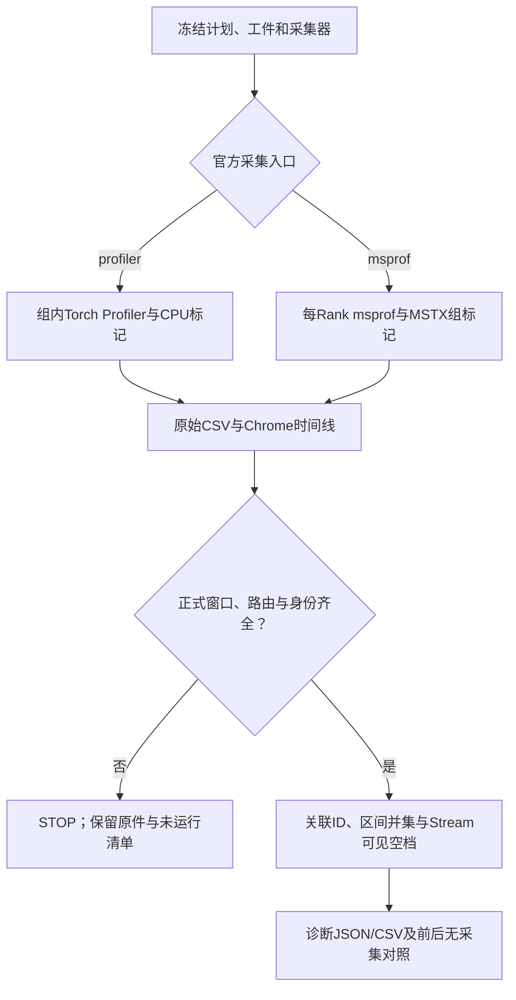

# 官方Profiler采集与统一时间线分析

本轮在主线b7c13b23之上补齐独立msprof入口和官方Chrome时间线分析。
计时合同仍是L1_TENSOR_IO_V4；公开Tensor调用、ready/steady、Stock对照及SDK/首写/协议不变。
本地验证只涉及CPU、真实CPU Torch导出和合成数据，**310P/CANN/msprof实机仍NOT_RUN**。

## 采集入口与控制组

| collection | 执行 | 范围 |
|---|---|---|
| off | 原统一Wall/Event | 无性能Profiler，冷态独立路由审计保持 |
| host | off-before → Host诊断 → off-after | 原Host调用/细分相位 |
| profiler | off-before → torch_npu.profiler → off-after | 仅正式测量组捕获，CPU record_function标记组 |
| msprof | off-before → msprof CLI → off-after | 每Rank独立CLI采整个进程，MSTX标记正式组；分析只取正式组 |

两种官方采集入口互斥；msprof进程里不再开启torch_npu.profiler，包括冷态路由审计。
外部CLI完成导出后，父进程从每个正式窗口核验实际NZ/fused/HCCL路由，缺失就STOP。
每组仍遵循相同W/N/B、保留所有Y、末尾等待；状态/数值/下游ADD在正式标记范围外。
msprof原始数据包含冷态、预热、检查，这是采集事实；派生结果严格按测量标记筛选，不伪称原始数据没有检查。
标记范围包含测量包装层，window_us用于诊断，不替代Wall/Event成绩。



## msprof探测与冻结

`msprof-probe`只运行--help/--version，不运行模型或设备采集。
记录实际可执行文件、显式依赖文件SHA、帮助文本/SHA、版本命令返回码/原文及最终参数。
版本命令不受支持时保留原件，不编造版本；身份范围只限明确声明文件，不能声称冻结了整个CANN安装。
服务器应补充实际动态库、解析脚本及版本材料。运行前后重新核验这些身份。

```bash
# 沿用现有两仓；以下都在vllm-ascend原仓内部目录，目录名换成本轮唯一run_id。
RUN_DIR=csrc/_310P/tools/L1_test/experiments/l1-msprof-20261031-001
mkdir -p "$RUN_DIR"
python csrc/_310P/tools/L1_test/l1_bench.py msprof-probe \
  --binary /actual/CANN/tools/profiler/bin/msprof \
  --option=--aic-metrics=PipeUtilization \
  --out "$RUN_DIR/msprof-tool.json"
```

探测器按实际help中存在的选项默认启用task-time/runtime-api/ascendcl/aicpu/hccl；
显式--option覆盖同名默认。不存在的默认项记录在unadvertised_defaults，不假装已采到。
MSTX选项必须实际存在，选择--msproftx=on或--mstx=on之一；缺能力就阻止本诊断，不猜时间范围。
PipeUtilization为上述示例显式请求；无权限或设备不支持时STOP并保留错误，不能静默换成另一组硬件计数。
--option只接受框架白名单且help支持的独立--name=value，禁止覆盖application/output/devices、delay/duration、system-wide等范围选项。
本地help只证明选项名称，值/权限/310P能力仍须服务器短测验证。
--dependency /actual/library.so可重复，将实际解析器/动态库纳入files。

## 定点诊断与完整矩阵

日常V3迭代可明确选择配置，仍有本组自己的Stock：

```bash
python csrc/_310P/tools/L1_test/l1_bench.py campaign plan \
  --cases v3-5-c512-g1024 v3-6-c512-g1024 v3-7-c512-g1024 \
  --collection msprof --mode shared --warmup 2 --samples 10 --rounds 1 \
  --out "$RUN_DIR/plan.json"
python csrc/_310P/tools/L1_test/l1_bench.py campaign template \
  --campaign "$RUN_DIR/plan.json" --out "$RUN_DIR/runtime.template.json"
# 按既有准入流程填真实runtime、两仓/SDK/Host/Device/Storage身份与证据后，写runtime.actual.json。
python csrc/_310P/tools/L1_test/l1_bench.py campaign freeze \
  --campaign "$RUN_DIR/plan.json" --template "$RUN_DIR/runtime.actual.json" \
  --msprof-tool "$RUN_DIR/msprof-tool.json" --out "$RUN_DIR/frozen"
python csrc/_310P/tools/L1_test/l1_bench.py campaign start --out "$RUN_DIR/frozen"
```

三个定点配置为36场独立TP2会话（三段×每配置ABBA），M=2048/4096、ready+steady各同N。
去掉--cases明确恢复完整43组；官方诊断完整矩阵510场，不自动追加到快速off批次。
`--collection profiler`选择PyTorch入口，无需msprof-tool；同样输出统一时间线结果。
单独Stock/版本计划也支持msprof及`freeze --msprof-tool`，不必从campaign入口启动。
守护仍覆盖torchrun及其进程组，rank shim通过exec进入msprof，不创建额外会话、不放松健康/物理映射检查。
共享模式接受占用/漂移但不能解释为独占硬件结论；首次msprof双Rank形态/权限须现场核实。

## 统一时间线解释

支持官方trace_view.json(.gz)、msprof_数字*.json(.gz)及其traceEvents对象/直接事件数组。
Chrome ts/dur按微秒读取，displayTimeUnit仅为显示单位。大绝对时间戳先用Decimal减去各导出原点，保留短区间精度。
支持X及B/E、b/e区间；解析process/thread元数据、Task/Stream标识及s/t/f关联事件。
每个导出是独立时钟域，双Rank/不同导出不凭时间相近拼接；不拿trace ts直接减Python perf_counter。

| 输出 | 定义与限制 |
|---|---|
| Host→Device关联 | 只按显式flow ID、作用域和唯一包围事件关联；缺端点/重复ID标UNKNOWN，不最近邻猜测 |
| dispatch/queue间隔 | 导出flow起止时间差；保留API返回到Device开始的有符号差，负值不截成0 |
| Host提交/等待、compute、fused、通信、搬运、AICPU | 按元数据/任务类型分类，各类取区间并集；嵌套/并行不能相加凑100% |
| Stream可见空档 | 窗口内该流没有导出任务的区间；不等于硬件空闲、就绪等待或链路停顿 |
| 可见计算/通信任务包络交叠 | 可见独立compute与通信/搬运区间的交集；通信包络可能包含等待，不据此证明数据搬运已交叠；包含fused时不推断核内MM/AR交叠 |
| 单Kernel内部MM/READY/wait/SDMA/排空 | 没有内部边界则UNKNOWN；Scalar/MTE管线计数也不等于互斥阶段墙钟 |
| SDMA真实链路占用/带宽 | 无可靠链路证据则UNKNOWN；任务包络/提交时间不能代替 |

缺HostToDevice连线时显示UNKNOWN_NO_RESOLVED_FLOW，而不是零提交开销。
时间同步误差/采集扰动仍存在；负向关联顺序保留告警，不自动修正时间戳。
未知任务不按名称强行猜类型。重复/重叠L1窗口、缺任一正式组、缺路由或导出被改动均STOP。
缺失某类可选明细则保持UNKNOWN；成功导出不表示内部全部阶段已经可见。

## 输出与离线复核

每个作业保留msprof-launch-rank*.json、msprof-rank*/PROF*/原始数据/CSV/时间线、原rank*.json、
增强rank*.profiled.json、timeline-rank*.json/csv。原应用报告不覆盖，增强报告登记其SHA。跨越窗口边界的持久AICPU/编排任务单列spanning_tasks，不把整个进程寿命当一次算子调用耗时。
外部原始文件按流式SHA完整登记；分析时重核原件、CSV与时间线。
analysis.json含kernel_statistics、timeline_statistics，campaign summary增加时间线窗口数；诊断标DIAGNOSTIC_ONLY。
原始目录可直接用MindStudio Insight查看；统一JSON保留事件/流关联和原始索引，CSV用于横向比较。

```bash
python csrc/_310P/tools/L1_test/l1_bench.py timeline \
  --input /actual/capture --out /actual/fresh-analysis
# 旧数据没有L1标记，必须显式使用whole-trace，结果不冒充正式测量窗口：
python csrc/_310P/tools/L1_test/l1_bench.py timeline \
  --input /actual/historical/msprof_123.json --whole-trace --out /actual/fresh-historical-analysis
```

如果只有CSV或DB、没有Chrome时间线，工具明确报缺少导出；先用该服务器版本官方导出工具生成JSON再离线分析，
不要为补导出重跑通信。失败批次仍保留STOP，不将离线补分析自动改成设备PASS。

## 官方来源与适用性

本轮核对Ascend/msprof公开源码117317f1939fed0c61455282d58ddacb66c9531d，资料不替代服务器当前版本：

- [工具与命令格式](https://github.com/Ascend/msprof/blob/117317f1939fed0c61455282d58ddacb66c9531d/README.md)
- [官方输出字段、timeline/HostToDevice、产品支持限制](https://github.com/Ascend/msprof/blob/117317f1939fed0c61455282d58ddacb66c9531d/docs/zh/user_guide/profile_data_file_references.md)
- [Host/Device flow关联实现](https://github.com/Ascend/msprof/blob/117317f1939fed0c61455282d58ddacb66c9531d/analysis/viewer/association/host_connect_device.py)
- [PyTorch MSTX接口](https://github.com/Ascend/pytorch/blob/master/torch_npu/npu/mstx.py)；已核对blob 63c23faaddfdba8ce7c6480b8b2ed539cfe963d3。

官方文档也注明关联线可受Host/Device时间同步误差影响，且通信API自定义融合不必具备MC²专用阶段。
本项目MemFabric SDMA ADD不据其他产品/官方MC²示例宣称可见全部chunk。当前不升级CANN、不安装新容器、不增仓库目录。
